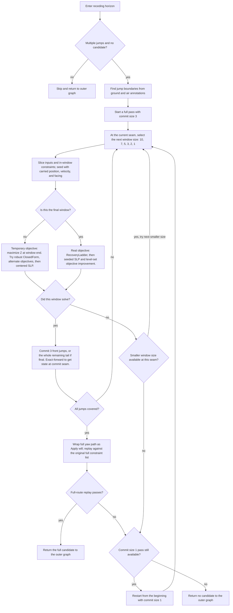

# Scratch notes: angle solver from inputs through smoothing

Scope: current shared-core implementation, from the input snapshot through the solve graph and the optional Smooth action. Focus is the optimization model and inertia treatment. This deliberately skips the byte-level Minecraft arithmetic in `ExactJumpModel` and its conversion details. These are working notes, not a canonical design record.

Checked against current source on 2026-10-20. PR descriptions were fetched with `gh pr view` from `Leg0shii/ParkourCalculatorMod`. PR #209 has an empty body; for that change, only the merge commit and code history are available.

## 1. Inputs entering the optimizer

Entry point: `AngleSolverEngine.buildJob()` on the caller/game thread. It snapshots a solve range `[startTick, landingTick)` into a `JumpSpec`; the worker only sees that snapshot. `runJob()` makes a solve-private scenario and runs the selected `SolverGraph`. `poll()` publishes the outcome; applying a plan writes the solved facings back to the TAS.

The snapshot includes:

- **Start state:** position, yaw, and velocity from `BoxController` at the selected start tick. The initial velocity is normalized against the selected Minecraft model's sub-threshold inertia rule.
- **Per-tick controls:** the row's jump/sneak and movement keys, sprint mode, speed amplifier, input mode, yaw lock, and the effective terrain/slipperiness/medium overrides. Tick inputs are fixed data; the primary decisions are yaw/facing values.
- **Movement input policy:** `Force 45` authors the standard W+sprint strafe pattern (W-only on a grounded jump tick); `Keep` uses the recorded movement sample when available, otherwise derives movement from the TAS row keys. Sprint can be forced or derived. There is no dynamic inference of ground/air from the candidate path: slipperiness annotations define contact per tick.
- **Constraints:** enabled non-RT constraints inside the solve range are copied and mapped to solver ticks. RT belongs to the separate run-ticks search. Position, motion/delta, facing, and other supported constraints are compiled to `JumpConstraint`s; conflicting constraints can fail before the graph starts.
- **Objective:** maximize/minimize X or Z position or motion at the objective tick, with optional custom-angle objective. The spec stores constraints, objective, and copied physics inputs.
- **Optional free start:** when eligible at tick 0, first-tick X/Z interval constraints become a `StartBox` search domain and are consumed from the ordinary constraint list. The scenario seed is clamped into the box. A free-start optimization may mutate the private scenario start; candidate scoring accounts for the authored start domain.
- **Optional prior incumbent:** non-Fast runs can adopt the previous successful plan after rechecking it against the new spec. Seed sweep runs whole Fast solves from starts distributed over the free box.

Useful code: `AngleSolverEngine.buildJob`, `buildPhys`, `collectUiConstraints`, `deriveFreeStartBox`, `runJob`, and `adoptIncumbent`.

### Terminology used below

- **Non-RT constraint:** any ordinary angle-solver constraint other than `RT`, the run-tick count constraint. `RT` is consumed by `RunTicksController`/`RunTicksSearch`, which tries different counts of grounded run-up ticks before a jump; `AngleSolverEngine.collectUiConstraints()` explicitly skips `RT` rows. So “non-RT” here means “belongs to the angle solve,” not “a constraint that is not real-time.”
- **Effort:** `AngleSolverState.Effort`, the top-level solve mode: `FAST` = Fast / seek the first feasible result; `THOROUGH` = Optimize / spend the configured time seeking a better objective; `CUSTOM` = run the selected user graph preset. This selects graph construction and budgets; it is not itself a solver algorithm.
- **Fast vs non-Fast:** shorthand for `Effort.FAST` versus the other effort values in code paths such as incumbent adoption. It is not a perfect synonym for the graph name: the Custom effort can select the built-in `Fast` graph, and `offerIncumbent()` explicitly skips that graph too. When precision matters, say which effort and which graph preset.
- **Costate direction:** in the dual solve, each tick gets a 2D vector `g_t`, the gradient of the Lagrangian with respect to that tick's movement contribution after accounting for the objective and active constraint multipliers. Since the tick's movement contribution has fixed magnitude `m_t`, maximizing `g_t · u_t` chooses `u_t = m_t g_t / ||g_t||`. `JumpLinearModel.recoverYawDeg()` converts that desired input-vector direction into the yaw for the tick. It is a per-tick steering direction implied by the dual—not a camera-facing target supplied by the UI. If `g_t` is zero, that tick is directionally undetermined by the dual and needs a fallback/recovery choice.
- **Run-up:** the grounded movement ticks before takeoff that build the horizontal speed entering a jump. In this solver, a fixed-facing run-up means those lead-in ticks share a yaw direction; the facing-step search tries nearby directions because they change the velocity at takeoff.
- **Receding horizon:** the long-run solver divides a multi-jump route into overlapping windows of consecutive jumps. The built-in graph uses a 10-jump window and commits 3 jumps at a time; it simulates those committed jumps to get the next window's exact position, velocity, and facing, then solves again. It shrinks a window if it cannot solve it, and uses the actual objective only on the final window. The graph node skips if an earlier stage already supplied a candidate, except where its settings explicitly permit an improvement pass.
- **Friction coupling:** `C(s,k)` is the coefficient that says how much the input acceleration at tick `s` contributes to position at a later state tick `k`, after its velocity has persisted through the intervening friction multipliers. It is not a new friction force or a constraint. `JumpLinearModel.coef(s,k)` precomputes it from friction prefix products/sums; multiplying `C(s,k)` by that tick's 2D input vector gives its contribution to `p_k` in the affine regime.
- **Inertia threshold check result (1.8):** at each tick, independently for X and Z, the incoming component is either zeroed when its magnitude is below 0.005 or survives when its magnitude is at least 0.005. This names the velocity branch decision, not whether the jump/constraint succeeds.
- **SLP:** sequential linear programming (`SlpSolve`). It linearizes the position/constraint response to small yaw changes around the current facing path, solves a trust-region LP for a yaw step, then exact-forwards the proposed step. Phase 1 reduces the worst constraint violation; phase 2 improves the objective while maintaining feasibility. In inertia-aware mode, it derives a predicted 1.8 per-axis zero pattern from the current yaws using `JumpLinearModel.zeroingPattern` and rebuilds the local movement model/Jacobian when that prediction changes. This changes the local approximation only: it does not add threshold-band rows or branch over alternative patterns, and exact replay still checks every proposal.
- **`BoundPrunedRecovery`:** the pattern-recovery stage behind the graph's `bnb` node. It creates a free model plus a limited ranked menu of zeroing templates and objective-axis keep-alive cases, scores them with costate-dual bounds, and runs a separate per-pattern tree over intermediate position bands (“seams”). Its tree does not branch on every unresolved inertia check or on yaw arcs; only the initial template menu changes the assumed inertia model. Exact replay checks every offered yaw path. `CertifiedBnb` is the stage that recursively branches directly on per-axis inertia outcomes and yaw arcs.
- **`ClosedFormSolve` / “ClosedForm”:** the fast continuous solver used near the front of the recovery chain. It builds the linear movement model, solves the costate dual for the fixed-magnitude per-tick movement directions, converts those directions to yaw angles, and checks the candidate on the exact model. It can make up to four passes: after exact feasibility fails, it predicts a zeroing pattern from that candidate’s yaws with `JumpLinearModel.zeroingPattern`, then retries with threshold-band rows for the predicted zero checks. “Closed form” describes the dual/direction recovery method; it does not mean every user constraint has a symbolic formula.
- **`RecoveryLadder`:** the fallback sequence inside `AngleSolverEngine.dualChain()`. It tries ClosedForm first, then SLP, then (when time allows) `RelaxationRecovery`; if needed it also uses alternate-objective ClosedForm seeds followed by SLP. Successful SLP or relaxation-recovery candidates may then get a `LevelSetAscent` top-up; a ClosedForm success returns directly from this ladder. This is the algorithm-selection/fallback sequence, not one numerical method.
- **`dualChain`:** “dual” refers to the costate-dual calculation that turns the objective and position constraints into preferred per-tick movement directions; “chain” is the sequence of solvers tried in order. The graph node (`DualChainNode`) calls `AngleSolverEngine.dualChain()`, which delegates to `RecoveryLadder.solve()`—ClosedForm first, followed by SLP and other recovery methods as needed. It is not a pair of solvers or a separate solver for each movement axis.
- **ClosedForm inward margin:** a small positional clearance, measured in blocks, that tightens ordinary X/Z constraint walls in the continuous model. For example, a lower bound `x >= target` is modeled as `x >= target + margin`; the candidate is still checked against the original, untightened constraint in the exact model. It does not permit yaw error or directly adjust yaws: it gives the approximate position solve headroom for differences in the realized path. The default ascending ladder tries `0`, `1e-4`, `3e-4`, `6e-4`, `1.2e-3`, `2.5e-3`, `5e-3`, then `1e-2` blocks, returning at the first exact-feasible rung. This is a numerical buffer for table/arithmetic differences and a way to seek a safely interior candidate, not a formal error bound. It is unrelated to the 0.005 velocity threshold or the velocity-band rows used to model an inertia threshold check.

### `LongRunSolver`: how it builds and solves windows

`RecedingHorizonNode` calls `LongRunSolver.solve()` once for a multi-jump route when it has no candidate. This is a direct solver call: it does not re-enter `GraphRunner`, and it does not call the graph's `certBnb` or `bnb` nodes for each window.

1. **Find segment boundaries.** `jumpBoundaries()` starts at tick 0, adds a boundary where the input's ground/slip annotation changes from air to ground, appends the scenario end, and merges pieces shorter than two ticks. Window and commit counts apply to these detected jump segments, not raw ticks.
2. **Slice a window.** Defaults try window sizes 10, 7, 5, 3, 2, then 1. Each window copies the inputs for its tick range, but starts from the carried position, velocity, and yaw. It receives constraints whose ticks lie within the window. A one-step facing-difference constraint crossing the left seam is converted to an absolute facing bound using the carried yaw; other cross-window constraints are left for final full-route validation.
3. **Solve the window.** Each nonfinal window uses a temporary objective of maximizing Z at its end. It tries `ClosedFormSolve.optimizeRobust`; if that misses, it tries alternate-axis/direction ClosedForm solves; if those miss, it tries `SlpSolve.optimizeCentered`. The final window uses the user's objective and `RecoveryLadder` (ClosedForm, SLP, relaxation recovery if time allows, then alternate-objective seeds with SLP). It then tries objective top-up with seeded SLP and level-set ascent.
4. **Commit and carry state.** The default commit is 3 jumps. For a nonfinal window, the solver copies those front facings into the output, exact-forwards the window, and carries the position, velocity, and facing at the commit boundary into the next window. The final window commits the entire remaining tail. This fixes the prefix only while the windowed route is being constructed; it does not create graph-level fixed-yaw constraints.
5. **Retry and validate.** If no window size can advance from a seam, abandon that pass and restart from the beginning with commit count 1 (default commit ladder: 3, then 1). After a complete chain, wrap the combined yaws as Apply will, exact-replay the entire route, and check the original constraints. Return the path only if it passes; otherwise return null.

The window solver returns a stitched feasible candidate, not a global optimum over all jumps. Later outer-graph stages receive the full path and can change its earlier yaws unless they explicitly pin them.



The commit-size retry also applies if the completed size-3 chain fails full-route replay. If the size-1 pass fails, `LongRunSolver` returns `null`. Cancellation or the stage deadline can also end the node without a candidate.

### Potential improvements to `LongRunSolver`

These are proposed directions; the current implementation above does not do them.

1. **Use `certBnb` and `bnb` inside window solves.** Integrate the branch-and-bound solvers into `solveWindow`, so a difficult window can use certified inertia/yaw branching (`certBnb`) and ranked inertia-template/position-band search (`bnb`) before the horizon commits its front jumps. The window solver would need to pass each slice's local constraints, objective, and carried start state to those solvers, then exact-replay the selected window before committing it.
2. **Choose commits and intermediate objectives from the remaining route.** Replace the fixed 3-jump commit and the same “maximize Z at the window end” objective for every nonfinal window with choices informed by what lies ahead: upcoming constraints and their margins, the reachable position/velocity at the seam, downstream feasibility, and the actual final objective. The solver should commit only as many jumps as its current continuation can support, and choose an intermediate objective that steers toward the remaining route's needs rather than a fixed axis.

### Tick/index details

`JumpPhysicsInputs` is segment-relative. The seed position/velocity is state at the start of relative tick 0. Constraints on relative tick `k` judge position at the start of tick `k`; the inputs on tick `k-1` produced that position. Therefore a constraint intended to judge the result of tick `k` is usually stored at `k+1`.

## 2. Physics structure the optimizer exploits

With movement keys, ground/air state, speed effects, and friction fixed, each tick's yaw rotates a prescribed input vector. In the continuous model, write its contribution as a 2D vector `u_t` with fixed magnitude `m_t` and yaw-selected direction. Friction makes later position an affine function of all earlier `u_t`:

`p_k = p0_k + sum_{s<k} C(s,k) u_s`.

Thus axis position/motion objectives and positional walls are linear in the `u_t`; the awkward part is each `u_t` having fixed magnitude. `JumpLinearModel` precomputes per-tick magnitudes/base angles and friction coupling, compiles walls, and can recover yaw from a costate direction. `ClosedFormSolve`/`CostateDualSolver` exploit this structure. The resulting candidate is judged against the exact model; this continuous model is a search/recovery tool, not the product's final truth.

Facing constraints are outside this affine position-wall model. Current handling folds equal-facing relations (`YawTies`/`FacingPrefold`) and carries supported one-way yaw order through `YawOrder`; unsupported cases can be declined. This is relevant to the input/spec boundary, though detailed stage behavior lives in the source and `AGENTS.md`.

## 3. Inertia is a thresholded state transition, not ordinary friction

The carried horizontal velocity is tested at the top of a tick. In 1.8, X and Z are tested separately: if a component's magnitude is below 0.005, that component is zeroed before applying the tick's acceleration. A yaw sequence can therefore change not only acceleration direction but whether prior momentum survives. This makes the forward map piecewise affine, with a different inertia threshold check result defining each branch.

**High-level mental model:** at every tick, the optimizer must account for the inertia threshold check result on incoming X and Z separately. If the check zeroes a component, it erases that small carried component; it does not erase the fresh acceleration for that tick. If the component survives, the old velocity continues through friction and affects later positions. So two yaw paths that differ only slightly can produce different future paths if one falls inside the threshold and the other narrowly stays outside it. The threshold is a real discontinuity in the trajectory map, not a tolerance applied to the landing constraint.

For this note, the target is Minecraft 1.8. The threshold check is applied to the velocity **entering a tick**, after friction from the previous tick. It compares `abs(vx)` and `abs(vz)` directly against 0.005: below that value the component is zeroed; at or above it the component survives. It is not intrinsically `0.005 / 0.91`; that quotient only restates the condition in terms of velocity before a preceding 0.91 friction step. Ground friction can use a different multiplier, so the threshold applies to the tick-start carried velocity.

### How the optimizer handles the discontinuity

You are right that the simple X/Z position formula is linear only while the inertia threshold check results are fixed. The solver does **not** have one globally linear formula that covers every possible threshold crossing. Instead, it treats the full trajectory as a set of affine regimes, indexed by the ticks/axes where the check zeroes velocity.

1. **Linear relaxation / closed form without threshold decisions:** `JumpLinearModel` without a zeroing pattern carries momentum continuously. It supplies a fast dual solution/seed, but can miss or mis-rank a path whose quality depends on a threshold crossing. Any candidate must pass the exact forward and full constraints.
2. **Fixed inertia threshold pattern:** for a proposed pattern of check results, `JumpLinearModel(scenario, zeroX, zeroZ)` changes the friction couplings so each component's propagated contribution stops at its first modeled zeroing tick. Pattern-building code uses `velocityWalls()` to bound the incoming velocity at proposed zeroing ticks to the threshold band. Under that fixed pattern, the state map is affine again. `zeroingPattern()` can derive the pattern for a given yaw sequence.
3. **Search other patterns:** this is not exhaustive enumeration of every possible hit/avoid bit string. `BoundPrunedRecovery` builds a limited set of candidate patterns at selected ticks, ranks them by a relaxed objective bound, and spends work on the stronger patterns. Its zeroing patterns may extend from the selected tick to the end or cover a short interval, for X or Z. Its keep-alive patterns are nominated around a reference path's threshold events/sign reversals and enforce the objective-improving sign outside the band. It prunes a pattern when its bound cannot beat the incumbent. `CertifiedBnb` instead branches recursively at an influential, unresolved threshold check: for each axis, its children represent zero, positive-side survive, and negative-side survive. It prioritizes a preferred child based on the decoded path, but explores the alternatives under bounds. This searches both sides of the threshold cliff rather than hoping a smooth local step crosses it.
4. **Why the keep-alive branch matters:** modeling only “velocity is inside the band, so zero it” can miss an optimum that preserves tiny momentum just outside the band. PR #397 added the complementary wall/pattern. Its loopmm example had a ~5e-4 landing difference caused by one threshold check zeroing velocity at a momentum reversal: the LP had no branch targeting the threshold side that preserved the carry.
5. **Cold basin discovery:** PR #447 added `GateFoldFinder` for folded dF/no-turn chains where continuous search cannot cross the threshold discontinuity. It enumerates near-threshold check results, runs threshold-steered SLP and lattice polishing, and seeds via threshold homotopy. A result is adopted only when feasible and objective-better.

An **inertia threshold check pattern** means one consistent assignment of check results over the relevant ticks and axes: X or Z zeroed, or surviving positive/negative. It labels one piece of the piecewise-affine trajectory map, not a separate game mode. The search discovers promising patterns in different ways: `BoundPrunedRecovery` proposes a small ranked set using a reference yaw path and dual bounds; `CertifiedBnb` finds an impactful uncertain threshold check from its current relaxation/decoded path, branches its possible results, then uses bounds to focus/prune; `GateFoldFinder` targets near-threshold check results for cold facing-chain cases that ordinary continuous steps do not reach.

The user does **not** enter the inertia-check ticks. The user supplies the starting state, per-tick inputs, and constraints. A candidate yaw path determines the actual check results when forwarded. Pattern-aware stages propose likely tick/axis results as internal search variables, solve those cases, and verify the resulting yaw path against the 1.8 forward model. Pattern search is targeted rather than an exhaustive listing of every X/Z combination at every tick; certified B&B has its own bounded recursive search.

The remaining fast-solve advantage is conditional: for each fixed inertia threshold check pattern, state positions are affine in the per-tick movement vectors, and those vectors have fixed magnitudes. `CostateDualSolver` exploits the fixed-magnitude structure to recover directions from the Lagrangian dual, which can solve that linearized pattern very quickly. That does **not** mean it has solved the global problem across every possible threshold check result. If the winning path depends on a different pattern, another pattern must be found and solved; the candidate is finally checked through the actual thresholded forward dynamics.

In short: the forward model always performs the inertia threshold check; the fast continuous solve can initially reason in a model with no threshold decisions or in a fixed-pattern affine regime; recovery and B&B stages explore alternate threshold-check patterns; a candidate is kept only after it survives the full forward check. This means the continuous dual is useful for finding a direction, but a solve whose quality hinges on barely keeping momentum alive may need a pattern-aware/certified stage to find that basin.

Relevant code: `ExactJumpModel.zeroSubThresholdVelocity/stepRange`; `JumpLinearModel.zeroingPattern`, pattern-aware constructor, `velocityWalls`, `keepAliveWall`; `BoundPrunedRecovery`; `CertifiedBnb`; `GateFoldFinder`.

### Actual built-in graph flow

This is the outer graph from `BuiltinGraphs.build()` and its explicit `facingStep` branches. `GraphFactory` chooses/builds the graph before execution; `Entry` then passes the starting candidate into its first stage. Fast and Optimize share most of the tail, but their opening order differs. `SeedSweep` is omitted in ordinary Fast and enabled in Optimize when its budget allows.

The graph below shows stage order and explains each stage. Its dotted arrows expand the inertia work inside `dualChain`; they are explanatory links, not additional graph branches.

For a long multi-jump map, the built-in route-finding method is **Optimize with receding horizon**. It builds a feasible full route from overlapping windows; it is not a full-route global optimizer. In the built-in graph, the full-route improvement B&B nodes have a 256-tick guard, so they do not search a 60-jump route of roughly 720 ticks. These graph settings are configurable in a Custom graph.

The repository does not document or benchmark support for maps over 100 jumps. Its concrete strategy is still the same: Optimize tries receding horizon before `dualChain`; if no candidate exists after `dualChain`, `setupPeel` sweeps constant run-up facings and calls the same windowed solver on each remaining tail. In the built-in graph, over 256 total ticks makes `foldDriver`, `certBnb`, and `bnb` skip; Custom graphs expose these tick caps (0 disables the cap) and the receding-horizon time budget (0 shares the overall solve budget). Therefore a `dualChain` miss is not immediately terminal, but if the windowed pass and setup-peel retries also miss, the graph has no full-route B&B fallback for a 100+ jump scenario. The UI help says window/commit are tick counts, but `LongRunSolver` applies them to detected jump boundaries.

```mermaid
flowchart TD
    A["Inputs, constraints, objective<br/>The solver reads the keys and movement settings for each tick, your starting position and speed, and the limits the path must satisfy. The objective says which landing result to favor among paths that meet those limits."] --> B["GraphFactory selects the graph<br/>The effort and preset choose Fast, Optimize, or a custom graph before any graph stage runs."]
    B --> B0["Entry<br/>Start graph execution and pass in the current candidate, if one exists."]
    B0 -->|Fast graph| C["First angle search: dualChain<br/>The dual calculation turns the objective and position limits into a preferred movement direction for each tick. Chain means it tries methods in sequence: a quick angle solve, Minecraft 1.8 replay, then recovery methods if needed; it is not one solver per axis."]
    C --> D["Fast: receding horizon [multi-jump rescue only]<br/>If the route has multiple jumps and the earlier angle search found no path, solve overlapping windows of up to 10 jumps, commit 3, replay their exact exit position and velocity, then slide forward. Window and commit counts are jumps, not ticks; see the internal flowchart above for solve and retry steps."]
    D --> E["Fast: normalize yaw values<br/>Rewrite yaw numbers into a standard angle range without intentionally changing the aim direction. The resulting candidate continues through the normal checks."]
    B0 -->|Optimize graph| F{"Include starting-position trials?<br/>The graph builder includes this stage only when the allotted stage time is sufficient; otherwise it leaves it out."}
    F -->|yes| G["Try several starting positions<br/>When the start position is allowed to move, run a Fast solve from a set of sample positions. Keep the best landing that satisfies the constraints."]
    F -->|no| H["Optimize: receding horizon [multi-jump rescue only]<br/>If the route has multiple jumps and seed trials found no path, solve overlapping windows of up to 10 jumps, commit 3, replay their exact exit position and velocity, then slide forward. Window and commit counts are jumps, not ticks; see the internal flowchart above for solve and retry steps."]
    H -. 15-jump example .-> H0["How a 15-jump route is windowed<br/>Default pass: solve jumps 1–10 and commit 1–3; solve 4–13 from the exact state after jump 3 and commit 4–6; solve 7–15 from the state after jump 6 and finish the tail. If a window fails, try smaller windows; if the full pass gets stuck, retry the route with a 1-jump commit for more lookahead. The concatenated path is replay-checked across the whole route."]
    H -. much longer routes .-> H1["What changes around 60 jumps<br/>At 12 ticks per jump, this is about 720 ticks. Receding horizon processes windows, but it does not run the graph's certBnb or bnb inside each window: ordinary windows use ClosedForm with alternate-objective retries and centered SLP fallback; the final window uses RecoveryLadder and objective polish. In the built-in graph, full-route certBnb, bnb, and foldDriver skip above 256 ticks; Custom graphs can raise or disable those caps. The documented measured long-run case is about 30 jumps / 354 ticks."]
    H -. what commit means .-> H2["Window commit versus graph lock<br/>A commit freezes the chosen front jumps only while LongRunSolver builds the next overlapping window from their exact exit state. The node then returns one full yaw path. The outer graph does not pin those earlier yaws: a later full-route stage can change them if it runs and improves the result."]
    H -. which algorithms run in each window .-> H3["Receding horizon's own call path<br/>GraphRunner calls RecedingHorizonNode once. That node calls LongRunSolver, which slices the route and calls solveWindow for each slice: nonfinal windows use ClosedForm with alternate-objective attempts and centered SLP fallback; the final window uses RecoveryLadder. It does not recursively run GraphRunner or invoke the graph's certBnb/bnb nodes per slice. Those are later, separate graph nodes."]
    H -. if receding horizon misses .-> H4["What the outer graph tries next<br/>In Optimize, receding horizon runs before dualChain; a miss continues into dualChain, then setupPeel if there is still no candidate, followed by later rescue stages including homotopyLadder, certBnb, and bnb. In Fast, dualChain runs before receding horizon. certBnb and bnb are not direct per-window fallbacks, and the built-in versions skip when the full scenario exceeds 256 ticks."]
    G --> H
    H --> I["Optimize: normalize yaw values<br/>Rewrite yaw numbers into a standard angle range without intentionally changing the aim direction. The resulting candidate continues through the normal checks."]
    I --> J["Main angle search: dualChain<br/>The dual calculation turns the objective and position limits into a preferred movement direction for each tick. Chain means it tries methods in sequence: a quick angle solve, Minecraft 1.8 replay, then recovery methods if needed; it is not one solver per axis."]
    E --> K["Check whether the landing can improve<br/>If the current landing has reached the best value allowed by the constraints, mark it settled. On the first check, also estimate how far it is from the solver's bound on the best result."]
    J --> K
    K --> L["Free-start rescue: position and angles together<br/>If the starting position is allowed to vary, adjust it together with the yaw path to try to make the jump work. This pass is focused on finding a landing, not polishing one that already works."]
    L --> M["Try different run-up aims<br/>For a multi-jump route with no working path yet, try different starting facings for the run-up and solve the rest of the route from each resulting position and speed."]
    M --> N["Improve or rescue the free start<br/>Try more combinations of starting position and yaw angles. Depending on whether a working path exists, this stage can find one or improve its landing."]
    N --> O{"Try nearby run-up facings<br/>A run-up is the grounded movement before takeoff that builds horizontal speed. For a fixed-facing run-up, test small changes to its aim; Fast skips this search, while TRUE in Optimize means another promising variation is ready."}
    O -->|TRUE| P["Brief angle polish: iterative local search<br/>Change a few tick angles at a time and keep a change only when the jump still works and its landing improves."]
    P --> Q["Shift the starting position<br/>When the start is free to move, try a better starting spot while keeping the current yaw path. Optimize then returns to testing run-up facings; Fast moves on to the next search."]
    Q -->|Optimize| O
    Q -->|Fast| R["Replay-and-adjust search: foldDriver<br/>Try different starting guesses for the angle path, replay each with the game physics, and adjust promising ones. This can search different patterns of when X or Z momentum is cut off."]
    O -->|FOUND / IMPROVED / UNCHANGED / NONE| R
    R --> S["Relaxed-wall search: homotopyLadder [rescue only: no feasible path yet]<br/>Run FoldReplayDriver at wall relaxations 0.05, 0.01, 0.002, then 0 blocks. Each rung passes its best yaws and replayed inertia pattern to the next. FoldReplayDriver uses DiskSocpKernel to solve movement-vector subproblems and narrows yaw-direction chords; exact replay checks original constraints at every round. It keeps the best rung result rather than stopping at the first relaxed feasible result."]
    S --> T["Certified threshold search: certBnb [mode depends on incoming path]<br/>With no feasible path, stop at the first exactly replayed feasible candidate. With a feasible incumbent, keep searching for a better one and report the remaining objective gap. A feasible result alone does not prove optimality. Its tree branches on unresolved inertia checks and yaw ranges; a miss passes the incoming candidate through."]
    T -->|always pass candidate onward| U["Ranked pattern search: bnb [mode depends on incoming path]<br/>With no feasible path, search for one; with a feasible path, use the remaining deadline to improve it. BNB tries a limited menu of inertia templates, then splits intermediate X/Z position ranges inside each template. It returns the best feasible path it found, or passes its input through; it does not prove a global optimum."]
    U -->|candidate, near-miss, or none continues| V["Improve a working angle path: iterated local search [feasible path required]<br/>Perturb a few yaw values, locally climb from each perturbed path, and keep only exact-replay-feasible paths with a better objective. It skips without a feasible path; Optimize gives it more time."]
    V --> W["Check the objective limit and remaining gap<br/>If a feasible path reaches the opposing objective bound, mark the solve settled. Otherwise, the first check estimates the gap from a dual bound; this check skips if the solve was already marked settled."]
    W --> X["Try paths with extra full turns: wrapIls<br/>Vary yaw values by adding or removing full rotations, then try local edits. Keep a change only if the replay satisfies the constraints and improves the result."]
    X --> Y["Try one more starting-position shift<br/>If the start position is free to move, look for a better starting spot for the same yaw path. If no better valid spot exists, pass the current path on unchanged."]
    Y --> Z{"Is final angle snapping in this graph?<br/>The standard Optimize graph includes this stage; the standard Fast graph does not."}
    Z -->|Optimize| AA["Snap angles to game-facing values<br/>Try nearby yaw values the game can represent. Keep a snapped path only if it still satisfies every constraint and improves the objective."]
    Z -->|Fast| AB["Finish the graph<br/>Return the best candidate that reached this point. This box does not run another search."]
    AA --> AB
    AB --> AC["Build the reported result<br/>Replay the chosen yaw path with the exact Minecraft 1.8 movement model and report its positions, constraint results, and objective."]
    AC --> AD["Optional separate Smooth action<br/>After solving, reshape the turn to reduce abrupt changes while keeping the jump valid. Smooth is a separate button, not a stage in Fast or Optimize."]

    C -. expands inside this stage .-> I0["ClosedForm first pass<br/>Solve the continuous movement model, carrying velocity forward without choosing inertia threshold check outcomes. Typical solve time: under 1 s; retries may take longer."]
    J -. expands inside this stage .-> I0
    I0 --> I1["Exact Minecraft 1.8 replay<br/>At each tick, check incoming X and Z velocity separately: magnitude below 0.005 is zeroed; otherwise that component survives."]
    I1 --> I2{"Do all original constraints pass?"}
    I2 -->|yes| I3["Return to the outer graph<br/>Pass along a valid candidate if one was found; otherwise this stage contributes no candidate."]
    I2 -->|no| I4["Predict the candidate's zero pattern<br/>Run its yaws through `JumpLinearModel.zeroingPattern` to estimate which X/Z checks zero velocity. Exact replay supplies the constraint verdict; it does not supply this pattern."]
    I4 --> I5{"Did constraint violation decrease, did the zero pattern change, and is another pass available?"}
    I5 -->|yes| I6["Build the next fixed-pattern model<br/>At checks predicted to zero, stop carrying that axis velocity and constrain its incoming value to about -0.005 through +0.005. Other checks are provisionally treated as surviving: ClosedForm does not add rows forcing them outside the band."]
    I6 --> I7["Re-solve for new yaw angles<br/>The changed carry pattern changes the position equations, so the optimizer solves those equations again for angles that meet the constraints."]
    I7 --> I1
    I5 -->|no| I8["SLP recovery, only if ClosedForm found no feasible path<br/>Sequential linear programming proposes bounded yaw changes from a local linear approximation and exact-replays each proposal. Typical solve time: under 1 s. It declines true equality constraints; its first mode is not inertia-aware, then it retries with inertia-aware model rebuilding if needed."]
    I8 --> I9{"Did recovery find a valid path?"}
    I9 -->|yes| I9a["Optional level-set objective top-up<br/>For an SLP or relaxation result, add a trial wall closer to the dual bound and use SLP feasibility steps to try to improve the objective without losing the landing."]
    I9a --> I3
    I9 -->|no| I10["Further recovery attempts<br/>If at least 3 seconds remain, try RelaxationRecovery: build relaxed-model seeds, then use best-effort SLP and exact replay. If that fails or is skipped, try up to three alternate-objective ClosedForm seeds, each followed by SLP for the requested objective. If none passes exact constraints, dualChain returns no candidate."]
    I10 --> I3

    R -. eligibility .-> R0["foldDriver limits and modes<br/>Without a feasible path, solve/replay rounds try to find one and keep the best replayed result. With a feasible path, polish from that anchor and accept only an objective improvement. Optimize enables more objective rounds and starts; Fast mostly uses its rescue behavior. Declines any facing constraint, including dF = 0, and skips routes over its tick cap."]
    S -. eligibility .-> S0["homotopyLadder limits<br/>Runs only when no feasible candidate exists; it has no separate optimize mode. Skips non-exact or stage-locked runs, any facing constraint (including dF = 0), and routes over its tick cap."]
    T -. eligibility .-> T0["certBnb limits<br/>Facing constraints are optional. If present, they must be ties or one-way yaw-order rows handled by YawTies/YawOrder; unsupported facing forms are declined. It skips if the full scenario has more than 256 solver ticks (input rows), not 256 jumps. First-feasible work has node/time caps; improvement work has a 500,000-node safety cap and the stage deadline."]
    U -. eligibility .-> U0["bnb limits<br/>Facing constraints are optional; if present they must be handled by FacingPrefold or CertifiedBnb. It skips if the full scenario has more than 256 solver ticks (input rows), not 256 jumps. Rescue/improvement phases have finite time budgets; the pattern menu is capped at 64 plus up to 4 keep-alive cases."]
    T -. what certBnb splits next .-> T1["certBnb branch choice<br/>It explores the open case with the best optimistic bound. Inside that case, it first splits the unresolved inertia check estimated to matter most to the objective; the candidate being near the threshold or reversing there raises its priority. If none remain, it splits an overlapping supported yaw-order relation; otherwise, it splits the yaw range estimated to affect the objective most."]
    T -. how certBnb bounds a case .-> T2["certBnb bound<br/>The conic model uses component limits and straight-line cuts to exclude some movement directions outside each allowed yaw range. It also allows for unresolved inertia checks, so the result is an optimistic bound for that case. If the kernel solve is unusable, CostateDualSolver supplies fallback multipliers; the score still accounts for yaw ranges, but lacks the chord-cut multipliers."]
    U -. template choice, branch, and bound .-> U1["bnb search inside a template<br/>It ranks its limited inertia templates by their root objective bounds and drops templates that cannot beat the incumbent. Within a template, it bounds position-range cases with CostateDualSolver and visits the case with the best bound first. It splits the seam whose restored path is furthest outside its allowed range; ties go to the wider range."]
    U -. example of a position split .-> U2["What one bnb split means<br/>Suppose a row requires X at tick 20 to be at least 5. BNB makes a broad reachable range, say 5 to 9. It may split that into 5 to 6.2 and 6.2 to 9, then bound and search both cases. These are possible positions at tick 20, not yaw ranges or inertia outcomes."]
    U -. rescue early stop .-> U3["Objective cap in bnb rescue<br/>For maximize X, an upper limit on X at the objective tick is a cap; rescue may stop when a feasible path reaches it. For minimize X, the matching cap is a lower limit. Without that opposing bound, bnb has no objective-cap early stop."]
    U -. when bnb stops .-> U5["bnb stopping conditions and polish<br/>It stops when its search deadline expires, the pattern and position-range cases are exhausted or pruned, or an outside cancellation arrives. Rescue has one extra early stop: a replayed feasible path reaches the configured objective cap. About 80% of the budget is for pattern search; the remainder can polish the best feasible path. Polish seeds SLP from that path: SLP linearizes the movement around its current yaws, proposes bounded yaw changes, and replays each proposal exactly. Its first phase keeps/improves constraint clearance; its second tries to improve the objective while staying feasible. BNB adopts the result only if exact replay says it is feasible and its objective is better. The pattern menu is capped, so it does not cover every possible inertia pattern."]
    U -. return and next stages .-> U4["What bnb returns, and what follows<br/>Rescue returns a feasible path if it found one; otherwise it leaves the incoming near-miss or no candidate. Optimize returns an improved path only when it beats the incumbent; otherwise the incumbent continues. The graph then tries ILS, checks the objective cap, tries full-turn yaw variants, shifts the start if allowed, and snaps angles in Optimize. Stages that need a feasible path skip when none exists; the final result reports a feasible candidate or the closest recorded miss."]
```

This is a directed control-flow graph, similar to an FSM in that the current node determines what can run next. `GraphRunner` executes the node it arrives at, gives it the current candidate, and follows the outgoing edge matching the result the node returns; most stages route every result to the next stage, while `facingStep` has the explicit loop shown above. The diamonds for graph selection, whether to include the seed sweep, and whether `leafSnap` exists describe graph construction or the selected preset, not extra solver nodes making runtime decisions. Nodes may also do no work when their conditions or budgets do not apply, and methods inside nodes can have their own search loops.

“First-feasible” and “optimize” are not global solver modes passed through every node. `certBnb`, `bnb`, and `foldDriver` infer their behavior from the incoming candidate: no feasible path means rescue; a feasible path means improvement. Only `certBnb` literally stops its tree at the first feasible candidate. A `certBnb` success does not end the graph: `GraphBuilder.chainAll` sends every outcome from `cert` to `bnb`. Thus a first-feasible result from certBnb becomes bnb's feasible incumbent and switches bnb to optimize mode. If certBnb misses with no prior feasible candidate, bnb gets no feasible incumbent and runs rescue mode; if certBnb misses while optimizing, the earlier feasible candidate is passed through and bnb still optimizes. `bnb`'s rescue path can keep searching after finding a candidate. It has an early stop only when it reaches `Scoring.objectiveCap`: the opposing bound on the objective axis at the objective tick (upper bound for maximize, lower bound for minimize), within `1e-6`; without such a row, that early-stop condition is inactive. This differs from a required landing target in the objective direction. `homotopyLadder`, `setupPeel`, and `recedingHorizon` are rescue-only; `ilsPolish` requires a feasible path. Other stages have their own guards and budgets, as stated in their boxes.

Both built-in Fast and Optimize graphs continue through `certBnb` and then `bnb`; Fast does not skip branch-and-bound. The difference is how the stages are configured: Fast sets their dedicated `budgetSec` to zero and gives their first-feasible paths explicit caps (`certBnb`: 3 seconds / 32 nodes by default; `bnb`: 40 seconds), still subject to the overall solve deadline and applicability checks. If a feasible candidate already exists, either node can take its optimize path using the deadline it receives. Optimize gives these stages positive per-stage budgets, letting them use a larger share of the solve for improvement; without a feasible candidate, they instead search for a first feasible path under their first-feasible limits. In either mode, a node may do no work if the model is unsupported, the tick cap is exceeded, or its time/node limit is exhausted.

For the hard ~100-tick solves in scope here, `certBnb` and `bnb` are reasonable places to focus: 100 ticks is within their current 256-tick graph cap, and they can spend substantial time searching inertia outcomes/templates and yaw/position subranges. They still depend on the earlier stages for an incumbent or useful seeds, and their configured budgets and case structure determine how much work they actually do. The “earlier dualChain solved it already” caveat mostly describes easier cases. After B&B, ILS and `wrapIls` are still heuristic objective searches, and a free-start adjustment can change the starting position; they can matter, but they do not provide B&B's style of search bound.

### Shared numerical machinery: homotopy, certBnb, CostateDualSolver, and ClosedForm

`homotopyLadder` and `certBnb` both use `DiskSocpKernel`, but they use its conic solve for different jobs. In the ladder, `FoldReplayDriver` repeatedly solves continuous movement-vector subproblems, tightens the yaw-direction chords, derives the next inertia pattern from exact replay, and carries the best replayed result to the next wall-relaxation rung. In `certBnb`, each search case gets its own yaw-arc chord constraints and unresolved-inertia slack; the dual multipliers are used to form that case's optimistic objective bound, which drives pruning. If the kernel gives an unusable numerical result or does not converge enough, `certBnb` falls back to `CostateDualSolver`. That fallback does not optimize with chord rows, but `CertifiedBnb` still evaluates the resulting multipliers with `SineTableGeometry.support` over the node's yaw arcs, so it has not thrown away the yaw ranges entirely. It also retains the node's wall rows and unresolved-check slack. The fallback can be looser because its multipliers were found without the chord rows; it is a way to keep a usable bound when the conic solve is numerically unavailable, not an equivalent re-run of the full conic formulation. If the kernel reports unbounded/infeasible rather than a numerical failure, the branch is discarded instead of taking this fallback.

**A yaw chord row** is a straight-line constraint on the 2D movement vector for one tick, derived from that node's allowed yaw interval. For example, if the interval points within about 15 degrees of +X and the movement magnitude is `m`, every valid movement vector has X projection at least `m cos(15°)`. The row is `ux >= m cos(15°)`: a chord half-plane that keeps the conic model on the allowed side of the arc. `SineTableGeometry.rangeInfo` scans the actual sine-table vectors in the interval (with its bucket slop) to set the middle direction and minimum projection; `CertifiedBnb` passes that row to `DiskSocpKernel.solveChords`. The kernel also receives component-wise X/Z bounds and a magnitude disk. These are search-relaxation rows, not extra user constraints or inertia threshold checks. They make the bound see the yaw interval's shape more closely; they do not themselves choose a final yaw or prove that a candidate replays successfully.

`CostateDualSolver` is not a wholly separate method from `ClosedFormSolve`: it is the dual optimizer that ClosedForm calls. ClosedForm wraps that solve with facing prefolding/order handling, converts costates into per-tick yaws, retries predicted inertia threshold check patterns with velocity-band rows, and validates every proposed yaw path in the exact Minecraft model. Other code can call `CostateDualSolver` directly for a bound or a seed; that does not run the whole ClosedForm pipeline. `certBnb` uses it only as a fallback if its conic kernel cannot produce a usable result; `bnb` uses it directly for its template and position-band bounds.

### What “unpatterned ClosedForm” means, and why `bnb` calls the costate dual

“Unpatterned ClosedForm” is shorthand for calling the ordinary `ClosedFormSolve.optimize(exact, spec, ...)` entry point without handing it a BNB-selected inertia template. It starts from the free-carry linear model, then can derive a zeroing pattern from the exact replay and retry with that pattern. It does not mean ClosedForm ignores inertia for its whole run. The graph's `bnb` node can receive an infeasible near-miss yaw path, but its `optimize` flag is true only when the incoming candidate is feasible.

The direct costate calls inside `bnb` are not asking the dual to repeat the earlier ClosedForm solve. ClosedForm tried to get a feasible yaw path from its own continuous model and then pass exact replay. A miss can mean its assumed inertia pattern or recovered yaw failed exact validation; it does not mean every possible fixed inertia model is infeasible. `bnb` constructs new models with different proposed X/Z zeroing templates and threshold velocity walls, so it needs new dual solutions for those models. Separately, `BoundPrunedRecovery.solve` does literally call ordinary `ClosedFormSolve.optimize` again as its own incumbent initializer. That is a repeated attempt in this graph route; the BNB component is written to work as a standalone recovery call and does not receive/cache the earlier ClosedForm result when no candidate exists.

The call path is `BnbNode.execute` → `BoundPrunedRecovery.solve`. First, `enumeratePatterns` calls `rootBound` for the free model and each candidate template. `rootBound` builds that model's objective vectors and walls (including the template's velocity walls), then calls `new CostateDualSolver(...).solve(0.0, null)` to rank its optimistic objective bound. For a selected pattern, its inner search calls `makeNode` for the root and each narrower intermediate-position band. Each `makeNode` makes a solver for that node's walls and calls `.solve(0.0, warmLambda)`; it can retry with nonzero margins to get a better yaw seed. The node's dual value is the bound used to prune that pattern-and-band region. The lambda warm start reuses the prior node's multipliers when available, but the model and solve are still new.

There is also a candidate-generation call: BNB invokes `ClosedFormSolve.optimizeWithPattern` on candidate templates. That runs ClosedForm's yaw recovery and replay checks against the selected pattern. So BNB uses the same low-level dual routine in two roles: directly for bounds and seeds, and indirectly through patterned ClosedForm for candidate yaws. The direct calls solve changed subproblems for each proposed inertia pattern and narrowed region; the separate unpatterned ClosedForm initializer is the one genuine same-problem retry.

### What `certBnb` does

`GraphRunner` invokes the `certBnb` node when the selected graph reaches its `cert` node, passing four things: the shared `GraphContext`, the current candidate (or none), a cancellation token, and the node's deadline. In the standard graph this comes after `fold` and `homotopyLadder`. Those stages may have left a feasible candidate, an infeasible near-miss, or no yaw path. `CertifiedBnbNode` first skips if the run is not exact, is stage-locked, is over its tick cap, or has no remaining budget for an existing feasible candidate. It copies the current scenario and constraints/objective into a `JumpSpec`; if the start is free, it includes the allowed start-position box.

### What the homotopy ladder does before `certBnb`

`HomotopyLadderNode` runs only when there is no feasible candidate. It also skips non-exact or stage-locked runs, inputs over its tick cap, and any spec containing a facing constraint. That last guard matters: if a `dF = 0` or other facing row is why `foldDriver` skipped, `homotopyLadder` skips for the same reason. In the fixed-start, no-facing-constraint case, it can run before `certBnb`.

The ladder calls `FoldReplayDriver.solve` four times with position-wall relaxations `0.05`, `0.01`, `0.002`, and `0.0` blocks. Relaxation shifts each non-equality position wall outward in its compiled linear model, making the early solves easier. The solver carries the previous rung's best yaw path and its exact-replay inertia pattern into the next rung as seeds, while also keeping the best result seen across all rungs. At the final rung it applies a tiny `2e-6` inward clearance to selected collision walls in the model. For every rung, though, candidate acceptance is checked by exact replay against the original, unrelaxed user constraints. A relaxed-rung miss is useful as a seed; it is not reported as a successful solve. The aim is to find a promising angle/inertia-pattern basin under easier model walls, then bring that seed back toward the actual walls. This finite continuation over wall offsets is why the routine is called homotopy: it follows solutions/seeds through a sequence of related problems from easier walls toward the target walls. It is a bounded heuristic, not a proof that a feasible basin exists.

### What `FoldReplayDriver` is

`FoldReplayDriver` is the reusable solver routine inside both `foldDriver` and `homotopyLadder`; it is not another graph node. It receives the exact movement model, a `JumpSpec` (scenario, constraints, objective), and optional seeds/budget settings. `solve` searches from a free inertia pattern (or a supplied seed pattern), while `polishFromAnchor` starts from a particular yaw path and tries to repair or improve it. The graph node supplies the outer eligibility checks and decides whether to call one of these entry points.

For a search round, it builds a `JumpLinearModel`: movement and position are linear in each tick's horizontal direction vector, while each vector must stay on its fixed-magnitude circle. A circle-constrained kernel solves for the movement directions that best satisfy the walls and objective. If a previous exact replay supplied an inertia pattern, the model cuts the corresponding X/Z velocity carry and adds velocity-band rows at checks modeled as zeroed. It then converts the chosen directions to yaws and runs the exact 1.8 forward simulation. That replay determines the actual X/Z inertia pattern and checks the original constraints.

The circle-constrained kernel is `DiskSocpKernel`, a custom **second-order cone programming (SOCP) solver** for this direction-vector model. It works on the Lagrangian dual: position walls have dual multipliers, which combine with the objective into one costate vector per tick; each tick's best direction aligns with that costate while respecting the vector's fixed magnitude. The implementation uses a logarithmic-barrier, primal-dual-style iteration with Newton directions, line search, and a decreasing barrier parameter; when the conic solve fails, FoldReplayDriver can fall back to `CostateDualSolver`. For partially narrowed yaw arcs it adds chord constraints and repeatedly narrows the arc approximation. So the inner optimization is not SLP over yaws: it optimizes continuous per-tick movement vectors under linear walls and disk/circle geometry, then decodes the vectors into yaws and checks them exactly.

If the replay pattern differs from the model pattern, the next round rebuilds the movement equations with the replayed pattern and solves again (up to six main rounds). If the same pattern repeats but constraints still fail, it tries local repair methods such as `AnchorSlp`, `BucketWalk`, window scans, and small ULP nudges. Repeated patterns can also trigger a small keep-alive retry or enumeration of a few changed gates. A feasible exact replay becomes a result; relaxed or continuous-model feasibility alone never does. The rounds are a heuristic pattern-following search with limited local alternatives, not a complete enumeration or global certificate.

The node selects a mode from that incoming candidate. A feasible candidate means **optimize**: its yaws and start position are passed as a seed and it becomes the incumbent if exact replay confirms it. Otherwise the mode is **first feasible**. Any incoming yaw path, even an infeasible one, is still passed as a seed for exact replay and limited polishing. With no yaw seed, `CertifiedBnb` first asks `ClosedFormSolve` for a candidate. If that returns no candidate and there are facing ties in first-feasible mode, it can call `GateFoldFinder`; in optimize mode with no ties, it can try `FoldReplayDriver` and then `WallHomotopyLadder` to find a feasible incumbent. With facing ties in optimize mode it also tries `GateFoldFinder`. These are seed/incumbent attempts before the main queue search; they do not replace it. `GateFoldFinder` is a targeted helper for tied-facing specs: it selects up to six currently surviving checks that are near the threshold (0.2 to 5 times the threshold) or at a velocity sign reversal, flips selected outcomes to zeroed, and uses fixed-pattern SLP plus threshold continuation/lattice polishing to try those alternatives. It is not the general B&B tree and does not enumerate every check pattern.

After those attempts, the main search starts with one root record: all yaw arcs are unrestricted, and every inertia state starts `FREE` (unknown). Supported yaw-order constraints narrow the root's arcs. The queue repeatedly removes the record with the strongest optimistic score, evaluates it, and either discards it, accepts an exact-replayed candidate, or replaces it with narrower child records. First-feasible mode stops after the first feasible incumbent. Optimize mode continues until the queue is exhausted, its best remaining bound is within `1e-9` objective units (blocks) of the incumbent, the node cap is reached, or the deadline/cancellation stops it. For a maximizing objective, the gap is best open upper bound minus incumbent; for minimizing, the score is sign-flipped internally and the same nonnegative gap calculation applies. “Within `1e-9`” means an extremely small numerical gap in the modeled objective, not that the position constraints have a `1e-9` tolerance. A cap/deadline stop with open records returns the best known candidate and current bound, but is not certified.

A feasible candidate is never accepted from the relaxation alone: it is decoded to yaw values and replayed through the exact model, which checks the original constraints.

### What the later `bnb` stage does

`bnb` is the graph node name; it invokes `BoundPrunedRecovery`. It runs after `certBnb`. Its mode is also determined by the incoming candidate: if that candidate is feasible, it tries to improve it; if not, it runs a feasibility-seeking rescue. This is not the same stopping rule as `certBnb`'s literal first-feasible mode: BNB can keep searching after finding a feasible candidate. Its rescue-mode early stop is `Scoring.objectiveCap`: a matching-axis/matching-tick upper bound for a maximize objective, or lower bound for a minimize objective, reached within `1e-6`; without that cap row, it does not stop early on objective value. It requires exact mode, an unlocked stage, an accepted facing-constraint form, a route within the 256-tick graph cap, and time remaining. If facing rows are present, `BoundPrunedRecovery.accepts` requires them to be foldable by `FacingPrefold` or supported by `CertifiedBnb`'s yaw ties/order handling. Rescue gets the node's `ffSec` budget (40 s in Fast, usually 3 s or more in Optimize, capped by the node/overall deadline); improvement gets the remaining node deadline. `BoundPrunedRecovery` divides its time: about 80 percent for pattern/tree search and the rest for final polishing. It is a heuristic recovery stage; unlike `certBnb`, it does not report a global optimality certificate.

The two searches therefore have different branching variables and normally use different bound solvers. `certBnb` branches recursively on a per-axis inertia threshold check (zeroed, positive-surviving, or negative-surviving) and on yaw arcs; its normal node bound comes from `DiskSocpKernel` with chord rows and unresolved-check slack. Its fallback uses `CostateDualSolver` multipliers but still scores against the yaw arcs. `bnb` first makes a bounded menu of whole-path inertia templates (mostly selected zeroing patterns plus a few objective-axis keep-alive cases), ranks them by `CostateDualSolver` root bounds, and searches each surviving template. Inside one template, its tree branches on intermediate X/Z position intervals (“seams”), not on inertia outcomes or yaw arcs. Each seam node's `CostateDualSolver` bound assumes that template and its current seam intervals. Both are optimistic bounds for pruning, but BNB's bound only supports its selected templates and seam regions; it cannot certify that omitted inertia templates are irrelevant.

Concrete seam example: suppose the goal is to maximize `X[40]`, and an eligible user row requires `X[20] >= 5`. BNB turns that row into a seam interval for the search. Since the user supplied no upper limit, it synthesizes a safe high end from the model's maximum reachable X by tick 20; suppose that gives `[5, 9]`. A root search record then means “search this inertia template while requiring `X[20]` to stay in `[5, 9]`.” If its recovered path lands at `X[20] = 4.7`, outside the interval, BNB can split the seam into child cases such as `[5, 6.2]` and `[6.2, 9]` (the cut is clamped away from the ends and guided by the recovered position). It solves and bounds each child separately, prioritizing the child with the higher bound. This narrows the possible *position at tick 20* so candidate recovery and bounds can focus on smaller regions; it does not split the yaw at tick 20 or decide whether its inertia threshold check is zeroed/surviving. `certBnb` would instead branch on that check's possible outcomes and/or divide the yaw arc.

The first outer step is to create a small menu of **whole-path inertia templates**. It always tries the unpatterned “free” linear model. For 1.8 per-axis inertia, it also proposes patterns where X alone or Z alone is zeroed from some tick `k` through the end, plus one-tick-only zero patterns. It scores these with a root costate-dual objective bound and keeps at most 64 of the patterned templates; the free model is separate. This is a deliberately restricted menu, not arbitrary combinations of zero and survive outcomes at every tick.

It also tries up to four **keep-alive** patterns on the objective axis. These come from a reference yaw path (the feasible ClosedForm result, the incoming warm candidate if better, or a free-model dual seed). At ticks where that path is inside the inertia band or reverses velocity sign, a keep-alive row asks that velocity instead survive on the objective-improving side: positive for maximizing that axis, negative for minimizing it. Those rows cover the complementary possibility that the free model incorrectly carries tiny velocity through a check that Minecraft would erase.

Before its tree search, it gets a feasible incumbent from ClosedForm if possible, checks the incoming candidate, and runs a patterned ClosedForm solve for each proposed zero template. Every proposed yaw path is exact-replayed against the **original** user constraints. Pattern agreement is not itself required for acceptance: the pattern is a way to build a useful search model, while the exact forward model decides whether the resulting actual yaw path is valid. Patterns whose dual bounds cannot beat the incumbent (or a narrow objective target wall) are removed; remaining patterns are searched concurrently with time slices when there are more patterns than worker threads.

For each surviving pattern, a separate inner tree searches **intermediate position bands**, called seams in the code. It does not branch on inertia outcomes or yaw arcs. Eligible seams are single-tick X/Z position constraints before the objective tick; the code groups lower/upper rows into a position interval and can synthesize a broad opposite side when only one side was specified. A tree record says what interval of position is allowed at each selected seam. Its costate-dual solve gives an optimistic objective bound for that fixed inertia model and those seam intervals. If the bound cannot beat the incumbent, the record is pruned. Otherwise, the solver recovers a yaw seed and tries to restore feasibility with up to 45 damped least-squares angle updates, replaying exactly; at the root, at low violation, or when no seam remains to split, it also calls SLP. For a patterned model this tree SLP is inertia-aware; for the unpatterned model it is ordinary SLP.

The tree chooses a seam whose restored path lies furthest outside its current allowed position interval; ties go to the wider interval. It ignores intervals narrower than 0.04 blocks. It splits the chosen interval around the restored position, with the cut clamped away from either extreme, then resolves both children and bounds them again. The queue visits the record with the highest quantized bound first, preferring deeper records on a tie. Thus the **inertia templates are selected before** this tree, while each template's tree refines position subranges and repeatedly solves for yaws. After all pattern searches (or the budget) it runs a final seeded SLP polish, then returns only an exactly feasible, objective-better candidate (or any feasible candidate in rescue mode).

The Fast graph config gives rescue `bnb` up to 40 seconds, subject to the overall deadline; Optimize config gives it a stage budget and uses its first-feasible cap if no path exists yet. The search uses `maxPatterns = 64`, up to four keep-alive cases, and default `pruneTol = 1e-6` objective units. A missed time limit, omitted pattern, or incomplete seam tree means it can miss a valid or better solution. Its bounds prune work inside the patterns it did generate; they do not prove that omitted inertia patterns cannot work.

The Optimize graph sets a 256-tick cap. When first-feasible, the usual Optimize node caps are 256 nodes and a time cap derived from the remaining graph stage budget (3 to 30 seconds). Built-in Fast uses 32 nodes and 3 seconds. If the facing constraints are a foldable `dF` chain, a special first-feasible allowance can raise this to 2,048 nodes and up to 30 seconds, while preserving 1.5 seconds for later graph stages. Optimize mode instead uses the remaining node deadline, with a 500,000-node safety cap. All of these are upper bounds: cancellation, the overall deadline, and unsupported inputs can stop it earlier.

The supported facing rows are exact yaw ties (`YawTies`) and the facing inequalities accepted by `YawOrder`: a one-sided absolute yaw bound on one tick, or a one-way minimum-turn relation between adjacent ticks, such as `F[t] - F[t-1] >= v` or its reversed/upper-bound equivalent. `YawTies` absorbs equal-facing rows first. Unsupported facing forms include an unabsorbed F equality and a difference constraint spanning non-adjacent ticks or represented as a two-sided band. Other facing forms make the solver decline. The movement scenario must also be supported by `SineTableGeometry`; that code models the game-facing sine-table arcs used by the exact solver. This node is not limited to specs without equality constraints: supported facing equalities are folded into shared yaw variables, and supported position equalities are represented in the relaxation. Its current graph tick cap is the bigger practical restriction on long routes.

**What “search node” means here:** it is one record in `CertifiedBnb`'s priority queue, describing a subset of the possible complete yaw paths and inertia-check outcomes. It is not a tick, a Minecraft entity, or a solver stage. The root record means “all legal yaws are still possible, and no inertia check has been assigned an outcome yet.” In the code, each tick's yaw interval starts as `FULL`; each inertia state byte starts as `FREE`. A child record narrows one part of that set: either fixes one axis/tick check to zero / positive-surviving / negative-surviving, or narrows one tick's yaw arc. Therefore, solving a record means asking: among all full paths consistent with these partial choices, can any path still satisfy the constraints and beat the current candidate?

“Searches over yaw ranges” means the solver does not try every yaw value as a separate complete solve. For a tick with movement input, its record stores an allowed arc of game-facing angles. At the root that can be the full circle; a yaw-branch replaces it with a smaller arc, such as two half-turn arcs. Each arc gives a range of possible movement-vector components, which the relaxation uses to bound what positions/objectives the whole arc could produce. As arcs get narrower, those movement bounds get tighter. This split can happen even when the input has only position constraints and no facing rows; the user did not impose those yaw intervals, they are internal search regions. A tick with no yaw-dependent movement has no meaningful yaw split.

To answer that question, the solver bounds the sine-table movement vector over each yaw interval, then propagates intervals of possible incoming X and Z velocities forward through friction. For each 1.8 per-axis inertia threshold check, it can resolve an interval as definitely zeroed, definitely positive-surviving, or definitely negative-surviving. If the interval straddles those cases, the check remains unresolved; the relaxation allows the possible carry to vary within a conservative band so the node's objective bound does not assume one unproven outcome.

At tick `t`, the movement model has an angle-dependent horizontal vector `u[t] = (ux[t], uz[t])` with a known magnitude and direction set by yaw. The record stores an allowed yaw arc for each tick; it may also fix a check such as “X at tick t is zeroed” or “X at tick t survives positive.” From each arc, `SineTableGeometry` computes a range of possible X and Z movement components. The solver carries ranges of velocity forward, applying friction and the record's gate decisions. A fixed zero check resets that axis's velocity range to zero; a fixed positive/negative survivor clips it to that side of the threshold. If the range itself proves a gate outcome, the solver uses it without branching. If it crosses an outcome boundary, the check stays open and the relaxation allows extra carry uncertainty rather than choosing an outcome prematurely.

The propagated ranges become conservative position uncertainty around the linear movement model. The solver adds that uncertainty to the user's X/Z walls, then solves a convex direction-vector problem (`DiskSocpKernel`, with `CostateDualSolver` fallback) to find the best possible objective this whole node could achieve. “Best possible” here is an optimistic bound: the relaxation can allow combinations the exact yaw path cannot realize, so it is useful for ruling a node out, not for claiming success. If even this optimistic value cannot beat the incumbent—or the relaxed rows are infeasible—the node is pruned.

The optimistic bound is computed from the relaxation's **dual multipliers**. Each position wall gets a multiplier (nonnegative for an inequality; unrestricted for an equality). The multipliers combine with the objective coefficients into a per-tick direction score. `SineTableGeometry.support` maximizes that score over each tick's allowed yaw arc; the bound then adds the wall right-hand sides, the conservative unresolved-gate slack, and, for free start, the start-box support. The objective sign is flipped internally for minimization. This gives an upper bound on the internally maximized score; it may be loose because the disk relaxation and unresolved-gate slack include possibilities no exact yaw trajectory realizes. The node score is also capped by its parent's bound so rounding cannot make a child appear better than its parent.

In code order, `evaluate` does this per popped record: (a) propagate any yaw-order rows; (b) calculate `RangeInfo` for every tick's yaw arc; (c) propagate the inertia and velocity intervals; (d) build a `JumpLinearModel` whose zero flags are the outcomes already proved or fixed; (e) compile the user's position constraints and widen their rows by the unresolved-gate uncertainty; (f) solve the disk-direction relaxation and calculate the record's dual objective bound; (g) prune if infeasible or unable to beat the incumbent; otherwise decode, exact-replay, and choose a gate or yaw split. The outer queue repeats this operation on the highest-bound record until first feasibility, a closed objective gap, exhaustion, or a budget stop.

Otherwise, it converts the relaxed vectors back to yaws, respects that record's yaw arcs/ties/order, and tries nearby game-facing float values. It runs that path through the exact forward model. A replay satisfying every original constraint becomes the best known candidate; an infeasible replay is only a clue for choosing the next split. The solver then selects the most influential still-open inertia check, considering its possible carry injection, its coefficient in the objective position, and whether the replay is near the threshold or changes velocity sign. It creates child records for zero, positive survive, and negative survive. If no gate is left open, it bisects a yaw arc instead. The priority queue explores the record with the strongest optimistic objective bound next.

For each node, it solves a convex relaxation of the angle and position constraints and computes an optimistic objective bound. A node is discarded if its constraints are impossible or its best possible objective cannot beat the incumbent. Otherwise it decodes the relaxed movement directions to yaws, optionally snaps them to nearby game-facing values, and exact-replays the result. The replay may improve the incumbent, but the relaxed solution itself is not treated as a valid answer.

If the remaining uncertainty is an inertia check, `gateImpactOf` ranks the open checks using the possible carry injection times the objective-position coefficient, with extra weight if the exact decoded replay is near the threshold or reverses velocity sign. It branches on the single highest-impact axis/tick into zeroed, positive-surviving, and negative-surviving children. At threshold `thr`, positive survival means incoming velocity `v >= thr`; negative survival means `v <= -thr`; zeroing is the strict middle band `abs(v) < thr`. The outcome seen in the decoded replay is added last, so the priority queue explores it first when child bounds tie. If there is no unresolved inertia check, it first tries to split a still-overlapping yaw-order link (the widest eligible link); otherwise it bisects the yaw arc with the largest estimated objective impact, if that arc is wider than the table-resolution cutoff. A full yaw interval splits into two half-turn arcs around the decoded direction. This means inertia branching and angle optimization are interleaved: every inertia child is re-solved over its remaining yaw ranges, and after the inertia outcomes are settled the solver can keep splitting yaw ranges to improve or certify the objective. It does not complete an inertia-pattern discovery phase before beginning angle optimization. The **record to evaluate next** is selected separately: the queue pops the record with the highest optimistic bound, with newer records first on equal bounds. A node is certified only after its feasible incumbent exists and every open node has been exhausted or bounded to within `1e-9` of that incumbent. Reaching a time or node cap with open nodes can still return a useful feasible result, but it is **not certified**.

The initial angle search first optimizes a continuous movement approximation, then replays its proposed yaw path with the Minecraft 1.8 model. That replay applies each X and Z inertia threshold check separately and decides whether the original constraints pass. If they fail, ClosedForm separately predicts a zeroing pattern from the candidate yaws using `JumpLinearModel.zeroingPattern`, then may build another local model from that prediction. Later stages can search other combinations of those checks. The graph carries the best candidate found so far from stage to stage; a stage can improve it, leave it as is, or fail to find a candidate. This matters for the two opening stages: in Fast, receding horizon runs only when `dualChain` did not find a path; in Optimize, horizon runs first, then `dualChain` is configured to run even when it receives a feasible candidate so it can try to improve it. The facing sweep's TRUE branch means another run-up-facing variation is ready: Optimize sends it through a short angle adjustment and start-position shift, then repeats the sweep; Fast skips that loop and continues to the replay-and-adjust search.

### Captured Optimize run after inertia-aware SLP misses (j147)

This is an actual `THOROUGH`/Optimize graph run on `hpk/d9/j147__X__1bm_Fence_to_Fence_Neo`, with a 10-second budget. It is distinct from the `dualrecovery` test route, which invokes `dualChain()` directly and adds a test-only `BoundPrunedRecovery` fallback. The full Optimize trace is `core/build/reports/solver-trace-optimize-j147-after-slp.txt` (ignored build output); the reproducer is `OptimizeInertiaTraceTest`.

1. **The first `dualChain` did not produce a feasible candidate.** Its inertia-aware SLP reached phase 1 with worst violation 0.01172 at Z tick 27. It tried 29 LP steps; the trust region shrank, but replayed violation stayed at 0.01172, so phase 1 ended infeasible. `RelaxationRecovery` was skipped because the chain's local deadline had expired. Three alternate-objective ClosedForm seeds were tried (Z min, X max, X min); none yielded a feasible result. The chain logged `miss`.
2. **Optimize continued into receding horizon's smaller windows.** Its initial full 37-tick window missed. A 25-tick prefix window solved, then the final 12-tick window solved; the horizon stage returned a candidate. On a later full-window retry, the ordinary path again missed, but the free-start joint retry succeeded. It searched a free start and reported margin 0.0025 at start `(-121.65307, 1095.17533)`, with pattern `x@0-1 + z@0-2`; exact validation found no violations. This became the candidate passed onward.
3. **The following improvement stages kept working on that incumbent.** The graph gave ILS about 3 seconds, then the facing sweep sampled 31 run-up-facing buckets and found objective 1095.087614323. The graph continued through its configured improvement/certification stages. `CertifiedBnb` had a feasible incumbent but did not certify it: after 101 nodes its bound was 1104.085629021, 8.998 objective units above the incumbent. Pattern `bnb` then ran with about 353 ms and ended with the same incumbent value, so it did not improve the best objective.
4. **Final polishing and result.** A final ILS pass had only 64 ms left, then the Optimize graph's `leafSnap` ran. The emitted result was feasible (`viol=0`) with objective 1095.087766858. The solver label was `receding horizon -> free window -> ILS (better objective) -> translated start -> facing sweep -> leaf snap`; in particular, the inertia-aware SLP miss did not make the whole solve fail. The final objective is slightly worse than the earlier 1095.087614323 incumbent, so the last snap result was accepted for its final representable yaw path even though the objective comparison alone is not an improvement.

The trace establishes that the non-SLP recovery here was not “keep retrying the same SLP until the threshold checks pass.” The failed chain returned control to the graph. Receding horizon changed the problem into shorter windows, then a free-start joint solve found a feasible incumbent; later stages improved/searched that incumbent and exact replay remained the acceptance gate.

### RelaxationRecovery timing and j147 eligibility check

`RecoveryLadder` only calls `RelaxationRecovery` if its current deadline is unset or has at least 3 seconds left (`RELAX_MIN_REMAINING_NANOS`). This is a gate to avoid starting a potentially expensive recovery too late; the recovery itself receives the cancellation token, so it is still stopped by the enclosing graph/window deadline. In the 10-second j147 Optimize run, the receding-horizon window budget was too short to pass that gate. I raised the trace test's Optimize budget to 30 seconds to check this. The trace then logged `CHAIN relaxation start`, but `RelaxationRecovery.solve()` returned immediately at its input checks: it declines any equality (`EQ`) constraint, and this capture has `DF EQ 0` rows. Therefore extra time gets the method invoked but cannot make it process this j147 model. No production budget or eligibility rule was changed.

When eligible, RelaxationRecovery works as follows. It makes the continuous per-tick input-vector model and compiles position/motion constraints into linear walls. It asks `CostateDualSolver` for multipliers and costate directions, then improves the primal input vectors with an augmented-Lagrangian loop: vectors stay within each tick's allowed input-magnitude disk, constraint-wall violations receive penalty terms, and the penalty weight grows when violation stalls. It tries a ladder of positional margins if the zero-margin seed does not land. From each relaxed vector solution it constructs dithered and projected yaw seeds, then calls best-effort SLP (inertia-aware first, then ordinary) and exact-replays the proposed yaws; only an exact-feasible replay is returned. A successful result can get a level-set objective-improvement pass in `RecoveryLadder`.

Trace experiment: `OptimizeInertiaTraceTest` now uses a 30-second Optimize budget; the run completed successfully and the trace is `core/build/reports/solver-trace-optimize-j147-relaxation-30s.txt` (ignored build output). It records many `CHAIN relaxation start` events, but no `RXT` work lines because j147's `DF EQ 0` makes every such call decline at the initial equality guard. To observe the actual augmented-Lagrangian and seed/SLP loop, use a recovery-eligible fixture without equality constraints; increasing j147's time alone cannot do that.

### j127 follow-up

I ran the actual Optimize graph on `hpk/d9/j127_Head_to_Head_Neo` with the same 30-second trace-test budget. It did not reach SLP or RelaxationRecovery: the first receding-horizon window's ClosedForm found an exact-feasible path in about 63 ms of solver time at the 0.0025 positional-margin rung (`viol=0`, certified), and the explicit `dualChain` ClosedForm pass also solved. Optimize then proceeded to later improvement stages and finished feasible at objective `-292.770921426`; its result label was `receding horizon -> fold driver -> certified B&B -> branch and bound -> ILS (better objective)`. Thus j127 is not a useful capture for observing the recovery method through the normal Optimize flow, even though it has a 30-second budget. Trace: `core/build/reports/solver-trace-optimize-j127-relaxation-30s.txt` (ignored build output).

### j153 follow-up

I ran `hpk/d10/j153_Flat_Momentum_Head_to_Head_Neo` through the same 30-second Optimize graph. This time ClosedForm and SLP did miss: the initial SLP phase 1 ended around 0.44 blocks of worst violation after 34 LP calls, and the inertia-aware retry ended with essentially the same 0.44 miss after 29 calls. `RecoveryLadder` logged `relaxation start`, then went straight to alternate-objective seeds; there are no `RXT` augmented-Lagrangian or seed-SLP records. The reason is the same structural guard as j147: j153 has 73 exact `DF EQ 0` rows, and `RelaxationRecovery.solve()` immediately returns `null` when any equality row is present. So this capture demonstrates the inertia-aware SLP failure and the RR call site, but not RR's actual algorithm.

The outer Optimize graph still succeeded later, through the seed sweep, certified B&B, pattern B&B, ILS, translated-start search and leaf snap. The emitted result was feasible at objective `-377.789795006`; solver label: `seed sweep 12/64 -> certified B&B -> branch and bound -> ILS (better objective) -> translated start -> leaf snap`. Trace: `core/build/reports/solver-trace-optimize-j153-relaxation-30s.txt` (ignored build output). The 30-second run passed. This confirms a practical limitation in the current recovery ladder: when an input spec contains exact dF equalities, increasing the time budget makes the RR call happen but does not make RR operate on that spec.

### Inertia-aware SLP mechanics, checked against j153

The regular `RecoveryLadder` SLP starts from its dual-recovered yaw path. It first runs the ordinary, unpatterned SLP. If that attempt cannot restore feasibility, the normal (non-best-effort) entry point calls SLP again in inertia-aware mode, seeded with the ordinary attempt's last yaw vector. This is a second SLP run; it restarts the trust region at the configured initial value rather than carrying forward the ordinary run's shrunken radius.

For each inertia-aware LP iteration, `SlpSolve` first exact-replays the current yaw path to measure its current constraint violation. It separately runs `JumpLinearModel.zeroingPattern` on those yaws. That routine starts from the scenario's incoming X/Z velocity, checks each axis against the 1.8 threshold before applying that tick's acceleration, marks components below threshold as zero, then applies the tick's yaw-dependent input and friction. If this predicted pattern differs from the pattern used for the previous LP, SLP rebuilds a `JumpLinearModel` with those axis/tick resets and recompiles the movement-constraint walls and objective coefficients. This changes how earlier movement contributes to later positions after a predicted reset.

The rebuilt model is used to make a local yaw-to-position approximation and form a trust-region LP. The LP proposes yaw changes bounded by the current trust-region radius. SLP then exact-replays the proposed yaws. In phase 1 it accepts the proposal only when the exact replay's worst constraint violation strictly decreases; in phase 2 it accepts only when the replay is feasible and the objective improves. A rejected proposal halves the trust region. A sufficiently large accepted step can grow it again. A changed inertia pattern does not itself accept or reject a proposal; the next iteration recomputes the pattern from the accepted current yaws.

Crucially, this path uses the predicted zero pattern to select the local position equations. It does not add velocity walls requiring a zeroed component to lie inside `[-0.005, +0.005]`, and it does not branch over alternate zero patterns. The exact replay applies the real inertia threshold check and decides whether constraints pass, but SLP's acceptance tests compare constraint violation/objective, not whether the replay's pattern equals the predicted pattern. A proposal that improves exact feasibility can therefore be accepted even if its replay pattern differs; the next iteration makes a fresh smooth-model pattern prediction from that proposal. Conversely, simply shrinking the trust region does not guarantee that replay will become feasible or improve.

The first j153 retry shows this directly. The ordinary SLP started with about 26.71 blocks of worst violation and reduced it to about 0.4401 over 34 LP calls. The inertia-aware retry then began from that last ordinary yaw vector, with the trust region reset to 30 degrees. In one 84-tick local solve, its predicted/replay pattern stayed `x@0 + z@0`; in another concurrent 84-tick window it stayed `x@0,@76 + z@0`. At the latter window's local tick 76, incoming X velocity was `0.00363407965`, so it was classified as zeroed and remained below the threshold in each logged proposal. The pattern did not change, and the smooth prediction matched the exact replay throughout these proposals. Yet the worst constraint miss stayed at 0.440094 (or 0.440709 in the other window), so every proposal was rejected. The trust region repeatedly halved and phase 1 ended after 29 LP calls. This failure was not caused by an observed disagreement between inertia prediction and replay; the local LP simply could not find a step that improved the exact wall violation from that seed.

The trace is `core/build/reports/solver-trace-optimize-j153-relaxation-30s.txt` (ignored build output). Its `SLP-GATE` records compare, per proposal, the local-model pattern, smooth predicted pattern, exact replay pattern, gate velocities, yaw deltas, and accept/reject decision. Tick labels in this trace are local to each receding-horizon window; the concurrent `t33`/`t34` prefixes identify solver threads, not Minecraft ticks.

**Direct answer for the first inertia-aware retry:** no logged proposal crossed the inertia threshold. The first full-window retry (84 ticks) had X and Z zeroed at local tick 0 because both incoming components were exactly 0, plus an X inertia threshold check at local tick 76 in the other concurrent SLP instance. There the exact incoming X velocity was `0.00363407965` before and after the first proposal, below `0.005`; the predicted pattern and replay pattern both marked tick 76 X as zeroed. The yaw proposal changed many yaws by about `+0.001518°`, but did not change that gate velocity or the zero pattern. The proposals were rejected because the worst positional constraint violation stayed at `0.440709` (Z at tick 73; the sibling solve stayed at `0.440094`, X lower wall at tick 72), not because of an inertia violation. All logged proposals in the retry were rejected as the trust region shrank; phase 1 stopped after 29 LP calls.

### Optimize graph after `dualChain`

When `dualChain` returns no candidate, the graph does not stop or rerun that same chain indefinitely. It carries forward whatever candidate already exists (possibly none) and advances through the remaining nodes. For Optimize, the relevant configured order is:

1. `cap1`: check/record whether an existing feasible candidate can be certified at its objective limit.
2. `freeRescue`: if the start position is a free box and there is no feasible candidate, jointly search start position and yaws for a landing.
3. `setupPeel`: only for multi-jump routes with no candidate; sweep the initial fixed run-up facing in 15-degree increments and solve the remaining route from each viable prefix.
4. `freeImprove`: if the start is free, jointly improve its location and yaws (or rescue feasibility if needed).
5. `facingStep`: for fixed-facing run-ups, test nearby run-up directions. In Optimize, a promising direction loops through 3-second ILS and translated-start adjustment, then returns to the facing sweep while another variation is available.
6. `fold`: a replay-and-adjust driver for specs with no facing constraints. It skips any spec containing an F-mode row (including `dF = 0`), as well as overly long inputs; with a feasible incumbent it starts by polishing that path, and without one it starts from a fresh solve. Its inner loop is detailed below.
7. `homotopyLadder`: only while no feasible candidate exists; relaxes position walls and brings them back gradually to try to enter a feasible basin.
8. `certBnb`: exact branch-and-bound. With no candidate it searches for first feasibility; with a feasible incumbent it searches for a better one and can certify an objective bound. This is the stage that directly branches over unresolved per-axis inertia threshold check outcomes as well as yaw intervals.
9. `bnb`: the bound-pruned pattern search. It ranks candidate zeroing/keep-alive patterns, solves promising fixed patterns and uses bounds to discard patterns that cannot beat the incumbent.
10. `ils`, `cap2`, `wrapIls`, `translatedStart`, `leafSnap`, `emit`: local objective polish if feasible; a second certification check; full-turn alternatives; final free-start shift; game-facing snap; report result.

This is the configured order, not a guarantee that every node runs: nodes skip when their prerequisites are absent, an incumbent makes a rescue unnecessary, a model is unsupported, or the stage deadline is gone. For a hard TAS that the early local solvers miss, the two later searches to examine first are `certBnb` (direct recursive inertia-pattern branching with certification bounds) and `bnb` (ranked pattern candidates plus bound pruning); `fold` and homotopy are earlier alternative routes into feasibility.

**What `SetupPeelNode` means by run-up:** it does not read a separate run-up length or infer the length from the `dF = 0` constraints. It scans the physics ticks from the start and counts consecutive ticks where slipperiness marks ground and the jump key is not pressed; that count is `lead`. It skips if `lead < 1` or `lead >= numTicks`. The row snapshot supplies each tick's movement inputs, sprint, jump, sneak, slipperiness, and other physics; these remain the authored sequence. For each peel candidate, the node fills the yaw array with one constant facing, simulates the prefix, and rejects it if any constraints wholly in that prefix fail. From the state at `lead`—position, velocity, and preceding facing—it solves the suffix. Thus SetupPeel itself makes the inferred pre-jump ground run a constant-facing prefix; whether the user's constraint rows also require that facing to stay constant is a separate matter. The later `FacingStepNode` has a different lead calculation: it derives the shared-yaw prefix from `YawTies` constraints.

**Clarifying the first pass:** within `dualChain` / `RecoveryLadder`, `ClosedFormSolve` first optimizes the unpatterned linear movement model. The `CostateDualSolver` chooses each fixed-magnitude movement vector's direction from its costate, then `JumpLinearModel` decodes those directions as yaws. The resulting yaw candidate is immediately run through `ExactJumpModel`, which applies the real threshold checks as part of the forward physics and evaluates the user's constraints. There is no later conversion step that makes the free-model trajectory byte-exact. If the exact trajectory satisfies the constraints, the candidate can be accepted even though its path differed from the unpatterned model. If it fails, `ClosedFormSolve` separately runs the candidate yaws through `JumpLinearModel.zeroingPattern`, which predicts zeroed X/Z checks using the smooth movement recurrence; it may retry with a pattern-aware model based on that prediction. This predicted pattern can differ from the exact replay near the threshold. It allows up to four total ClosedForm passes by default, and can stop sooner if the pattern is unchanged/ineffective or the violation stops improving. So this is a bounded retry loop, not a guarantee that it keeps going until it passes: if it cannot find a feasible path, its best miss stays internal and ClosedForm returns no candidate to the recovery ladder, which then tries other methods. The retry trigger is exact infeasibility, which can reflect any violated constraint; the code does not require a separately identified “inertia violation.” Also, in Optimize and Custom graphs, other graph stages may run before or around `dualChain`, so this describes the first pass of that solver chain rather than a universal first operation for every graph.

### How the dual ClosedForm solve and SLP fit together

The short answer to “is the standard solve a dual method?” is: **the front-end ClosedForm candidate search is dual-based, but the full angle solve is a chain of methods.** The graph's `dualChain` calls `RecoveryLadder`: ClosedForm first, then SLP if ClosedForm cannot return a feasible path, then other recovery attempts if needed. Later graph nodes can add still more searches.

#### What the dual solve does

For a fixed inertia threshold check pattern, `JumpLinearModel` expresses each constrained position and the objective as an affine function of the per-tick horizontal movement vectors `u[t]`. Each vector has a known magnitude from the tick's movement inputs; yaw chooses its direction. In schematic form the continuous problem is:

- maximize the objective `c · u`;
- obey linear position/facing walls `A[j] · u <= b[j]`;
- keep each movement vector's magnitude fixed, `|u[t]| = m[t]`.

ClosedForm assigns a multiplier `lambda[j]` to each active wall and forms a Lagrangian dual bound. Those multipliers combine the objective and wall coefficients into one 2D **costate** `g[t]` per tick. For a given costate, the best fixed-magnitude movement vector points along it: `u[t] = m[t] * g[t] / |g[t]|`. The solver therefore turns the dual multipliers into a full set of directions, then `JumpLinearModel` decodes those directions as yaws. This is the fast part: instead of searching every yaw combination, it solves for a small set of wall multipliers and recovers each tick's direction directly.

The dual bound and the recovered path are different outputs. The bound says how good any path in that model could possibly be; the recovered directions are a proposed path. When the recovered path satisfies all walls and the complementary-slackness conditions line up, it reaches the bound and solves that fixed model. In degenerate or coupled cases, however, the dual can give a useful bound while its recovered directions violate one or more walls. ClosedForm checks the path and its safety-margin rungs; it does not assume that a low dual objective automatically means it has a feasible yaw path. Inertia adds another complication because the clamp-free model may use the wrong affine regime; the bounded fixed-pattern retries described above address that part.

#### High-level: why ClosedForm misses, and what SLP adds

ClosedForm is fast because the dual multipliers directly suggest a direction for every tick. It works especially well when those directions line up with a feasible path in the current linear model. It can miss for two broad reasons: the recovered directions may violate coupled position constraints even though the dual bound is useful, or the linear model may represent the wrong inertia threshold check pattern. Its pattern retries follow the outcomes of their own proposed paths, so they can also fail to find a different useful pattern.

SLP adds a different kind of search: instead of asking the dual for a complete path in one shot, it makes small, coordinated changes to the actual yaw values and checks whether those changes reduce the exact path's constraint violations. This can move the result into feasibility even when the dual's first recovered directions are infeasible. Once feasible, SLP can improve the objective while staying feasible. In the ordinary fallback it builds its own dual-derived starting path when no seed is passed; it does not receive ClosedForm's private best infeasible miss. Because SLP is local, it can still stall if reaching a valid path requires a large move or crossing into another inertia regime. That is why the recovery chain has later relaxation and pattern-search methods too.

#### How often the tests needed SLP

The capture-driven `ProblemsTest` has a `dualrecovery` check. For each fixture, `runDualRecovery()` calls `AngleSolverEngine.dualChain()` and prints the successful route in a `via=` field (for example, `closed form`, `closed form -> SLP`, or `closed form -> relaxation recovery`). The `.expect.json` sidecars specify expected success/objective and optional B&B time; they do not record a per-stage history or a corpus-wide SLP statistic. So the test output can answer this for a particular run, but the tests do not maintain a live “SLP frequency” total.

A historical corpus breakdown is recorded in [issue #204](https://github.com/Leg0shii/ParkourCalculatorMod/issues/204): on 57 Hpk captures, the completed recovery chain solved 55. The recorded buckets were 15 solved by ClosedForm alone, 25 by adding SLP, 8 by adding relaxation recovery, 2 by alternate-objective reseeding, and 5 by the pattern B&B fallback; two remained unsolved. Read as a chain, this means ClosedForm missed on 42/57 and those cases proceeded to the SLP fallback; SLP directly completed 25, and two more completed after alternate seeding plus SLP. Other cases proceeded farther down the ladder. This is a useful measure on that specific July 2026 corpus, not a current rate for every user solve or the expanded fixture set in the checkout today.

#### Why SLP is in the chain

The original recovery work tracked in [issue #204](https://github.com/Leg0shii/ParkourCalculatorMod/issues/204) separated two tasks: calculating an objective ceiling worked, but recovering a feasible continuous path near that ceiling could fail. On the `loopmm` multi-jump example, the costate recovery violated a wall by about 0.245 blocks even in the continuous model; independently, a sub-threshold velocity that Minecraft zeroed caused about 0.03 blocks of later position error. So this was not merely a yaw-rounding or sine-table problem. The merged [PR #209](https://github.com/Leg0shii/ParkourCalculatorMod/pull/209) bundled the dual recovery improvements and fallback chain; its PR body is only “Closes #204,” so the issue discussion and implementation are the source for the rationale.

SLP is the local **primal closer**: it works on actual yaw variables and tries to repair a path that the dual method could not make feasible. When `RecoveryLadder` invokes it without a seed, SLP first computes a margin-zero costate-dual seed. It exact-forwards that seed to get the current positions and constraint violations. At each iteration it differentiates each tick's movement vector with respect to yaw, combines those derivatives through the position-wall coefficients, and builds a local linear approximation of how a small yaw change would change each constraint. A trust-region LP then chooses the yaw changes `dYaw`, bounded by the current trust radius, that reduce the worst violation. The proposed yaws are replayed through `ExactJumpModel`; the linear prediction is only a proposal mechanism, and exact replay decides whether to accept the step, including the actual inertia threshold checks.

SLP has two phases. **Feasibility phase:** reduce the worst exact constraint violation, aiming for a tiny inward clearance. If the LP step is rejected by the exact replay, shrink the trust region; if accepted, keep the new yaws and potentially grow the region. **Objective phase:** once a feasible path exists, use the local objective gradient to improve the requested landing result, accepting only proposals that remain feasible and improve the exact objective. The current defaults allow 40 LP calls for phase 1 and 60 total, with a trust radius initially 30 degrees, capped at 45 degrees; it can shrink as small as `1e-7` degrees before treating the local search as stalled.

The handoff depends on whether ClosedForm succeeds. If ClosedForm returns a feasible path, `RecoveryLadder` returns it immediately; it does not pass that path to the ordinary SLP fallback, and this ladder does not run the level-set top-up on that ClosedForm success. If ClosedForm returns no feasible path, the best infeasible candidate it considered stays private to ClosedForm. Ordinary SLP is then called without a seed, so it builds a fresh margin-zero dual seed of its own. There is one exception later in the chain: if alternate-objective ClosedForm finds a feasible path for a different objective, that yaw path is explicitly passed to SLP as a seed for the requested objective. Successful SLP and relaxation-recovery results can then receive `LevelSetAscent`, which itself runs seeded SLP feasibility solves against progressively higher objective-level walls; that top-up is separate from SLP's own objective phase.

In the ordinary `dualChain` fallback, SLP initially uses the clamp-free local Jacobian. If its feasibility phase fails, it retries once from its current yaws in inertia-aware mode. At the start of each LP iteration, it exact-forwards the current yaws for feasibility feedback, then separately runs `JumpLinearModel.zeroingPattern` on those yaws to predict which X/Z components are zeroed in the smooth recurrence. If that prediction changed, it rebuilds the local position model, wall coefficients, and objective vectors with carry cut off at the predicted zeroing checks. The inertia-aware mode is therefore a local model of the current pattern, not a search over alternative outcomes; it adds no threshold-band rows to make the pattern self-consistent. Exact replay remains the final arbiter for each proposed step, and the next iteration refreshes the pattern if an accepted yaw change alters the predicted pattern. If SLP cannot return a feasible path, `RecoveryLadder` moves on to relaxation recovery and then alternate-objective seeds plus SLP.

**In plain terms:** “ordinary SLP, then inertia-aware SLP” is the retry order only when the first SLP feasibility phase fails. Both attempts use the exact 1.8 forward simulation to judge every proposed yaw update, including its per-axis inertia threshold checks. The difference is the *derivative model used to choose the update*: ordinary SLP assumes velocity carry is uninterrupted; inertia-aware SLP predicts the current zeroing pattern with `JumpLinearModel.zeroingPattern` and builds its local derivatives as though those predicted checks cut the carry. It does not add explicit threshold inequalities or try all possible patterns. If ordinary SLP reaches feasibility, the inertia-aware retry is skipped.

This is **not the same inertia loop as ClosedForm**. ClosedForm starts with no zeroing pattern, solves that unpatterned model, and exact-replays its candidate to score constraint violation. If the candidate is infeasible, it derives a zeroing pattern by running the candidate yaws through `JumpLinearModel.zeroingPattern` (the smooth recurrence, not the exact replay), then solves again with that pattern fixed. That patterned solve adds threshold-band rows for predicted-zero checks and cuts their velocity carry. It can repeat this solve → exact-check → predict-pattern cycle up to four passes by default, stopping sooner on success, an ineffective or unchanged pattern, or no violation improvement.

SLP also starts with an unpatterned local model, and exact replay checks its trial yaws. But if ordinary SLP fails phase 1, it retries once with a patterned *local derivative model* from its current yaw path. That retry refreshes the predicted pattern during its LP iterations as the yaws change; it does not add ClosedForm's threshold-band rows and does not run another ordinary-to-aware retry. So “once” means one mode switch/retry, not one LP update. In both algorithms, exact replay evaluates feasibility; the predicted pattern comes from `JumpLinearModel.zeroingPattern`, not from reading the exact replay's inertia flags.

**Does SLP guarantee its predicted zeroing pattern?** No. In 1.8, `ExactJumpModel.forward` always applies the actual per-axis rule itself: at the start of each tick it sets an axis velocity to zero when its magnitude is strictly below `0.005`. Thus every SLP trial obeys the game's inertia operation in its *exact replay*. But SLP's acceptance test checks the user's position/facing constraints and objective; it does not compare the exact replay's zeroing outcomes against the pattern used by the local derivative model. That pattern is only an approximation for choosing a useful update. If the exact path's pattern differs, the actual replay still applies its own threshold rule, and a later inertia-aware iteration predicts again from the accepted yaws. Unlike ClosedForm's predicted-zero rows, SLP has no separate inequalities forcing an assumed zeroing outcome to be self-consistent.

**Practical limitation:** this can make inertia-aware SLP's proposals poor. The current yaw path's predicted-zero check is below threshold, but the LP update is not constrained to keep the incoming velocity below threshold. It can cross the threshold, where the true position response changes abruptly and the local derivative model is wrong. SLP then exact-replays the proposal: phase 1 rejects it only if the original constraints fail to improve; phase 2 rejects it unless it is feasible and improves the objective. A pattern change by itself is not a rejection reason. Rejected steps shrink the trust region; accepted steps become the new path and inertia-aware SLP rebuilds its pattern on the next iteration. The trust region bounds each tick's yaw change `dYaw` (by default, each is at most 30 degrees initially, capped at 45); it is not a bound on velocity and does not shrink specifically until an inertia check is met. In practice, the predicted pattern for a fixed yaw path should usually agree with exact replay away from the threshold, since both evaluate the same trajectory intent; the main mismatch risk is a proposed step crossing a threshold, plus small smooth-vs-exact numerical differences near the boundary. Exact replay prevents SLP from *returning an infeasible path*, but it does not prevent wasted or misleading proposals, nor guarantee efficient convergence around threshold crossings. This is a real robustness gap compared with ClosedForm's fixed-pattern threshold-band rows, not a guarantee that SLP's local pattern remains valid throughout each proposed step.

#### Reproducing and reading an SLP inertia trace

In this log, **recovery SLP** means the `SlpSolve.optimize` call that `RecoveryLadder` starts after ClosedForm returns no feasible path. **`seed=dual`** means SLP did not receive ClosedForm's best miss: it built a fresh starting yaw path by solving the clamp-free position-wall model with `CostateDualSolver`, then converting the resulting per-tick directions to yaws. In the loopmm trace, ClosedForm's best exact miss was `0.1156`, while this fresh SLP seed's exact miss was `0.2761`.

`SlpInertiaTraceTest` uses `dualrecovery/loopmm-3jump-lands`: a 1.8.9 capture with per-axis threshold checks where ClosedForm misses and the recovery chain reaches SLP. It calls the chain directly, so it does not run the sidecar's later pattern-B&B fallback. Run it with tracing enabled:

```sh
./gradlew :core:test -PslowTests --tests de.legoshi.parkourcalc.anglesolver.SlpInertiaTraceTest \
  -Dpkc.solver.trace=slp-inertia \
  -Dorg.gradle.java.home=/Library/Java/JavaVirtualMachines/jdk-21.jdk/Contents/Home
```

The trace is written to `core/build/reports/solver-trace-slp-inertia.txt`. Existing `SLP` lines show each step's trust radius, maximum yaw change, exact constraint violation before/after, objective, and accept/reject. New `SLP-GATE` lines compare the smooth-model pattern (`smooth`), the byte-exact replay pattern (`replay`), the Jacobian pattern (`jac`), and the incoming exact velocity at every pattern difference. Tick numbers in this trace are zero-based; `Z` means the axis is zeroed and `C` means it carries. In a `current-replay-vs-smooth` or `trial-replay-vs-smooth` entry, `4Z:C>Z@0.004990.../0.005` means smooth predicts carry on Z at tick 4, while replay sees an incoming Z velocity below the threshold and zeros it. In `replay-changes`, `27X:Z>C@-0.0598/0.005` means the current path zeros X at tick 27, while the proposal carries an incoming X velocity of about `-0.0598`. The `decision` is still based only on the user constraints/objective, not on pattern equality.

One observed run illustrates the concern. The initial dual-chain SLP succeeds in ordinary mode: three phase-1 proposals reduce exact maximum violation from `0.2761` to `0.02047`, `0.005401`, then `-0.002506`, and are accepted. Its objective-refinement phase accepts LPs 8 and 16, moving the objective from `-279.320538` to `-279.312517` and then `-279.312440`; the other 29 refinement proposals are rejected. The result is exactly feasible. Afterward, the optional level-set top-up asks SLP to satisfy a stricter objective-level wall as well as the original constraints (the row count rises from 9 to 10). Its seeded ordinary SLP starts `0.006703` outside that stronger target. All 29 phase-1 proposals are rejected. The inertia-aware retry starts from the same yaws and also rejects all 29. For each retry, the trust radius halves from 30 degrees to about `1.12e-7` degrees; proposals stop changing the exact violation near the end. Both attempts stop at `0.006703`, so the top-up fails and leaves the already-feasible base SLP result in place.

For both rejected top-up attempts, each row below is one proposed all-tick yaw update. The ordinary and inertia-aware attempts had the same exact violation at each corresponding LP number; the inertia-aware attempt used a different Jacobian pattern, as described below. Every proposal was rejected, so the starting yaws and starting miss stayed unchanged.

| LP | Yaw-change limit (degrees) | Exact miss after ordinary proposal | Exact miss after inertia-aware proposal |
|---:|---:|---:|---:|
| 1 | 30 | 0.6756 | 0.6756 |
| 2 | 15 | 0.08303 | 0.08303 |
| 3 | 7.5 | 0.02202 | 0.02202 |
| 4 | 3.75 | 0.03199 | 0.03199 |
| 5 | 1.88 | 0.03618 | 0.03618 |
| 6 | 0.938 | 0.03738 | 0.03738 |
| 7 | 0.469 | 0.03758 | 0.03758 |
| 8 | 0.234 | 0.03570 | 0.03570 |
| 9 | 0.117 | 0.03214 | 0.03214 |
| 10 | 0.0586 | 0.03028 | 0.03028 |
| 11 | 0.0293 | 0.02943 | 0.02943 |
| 12 | 0.0146 | 0.02892 | 0.02892 |
| 13 | 0.00732 | 0.02875 | 0.02875 |
| 14 | 0.00366 | 0.02858 | 0.02858 |
| 15 | 0.00183 | 0.02858 | 0.02858 |
| 16 | 0.000916 | 0.02858 | 0.02858 |
| 17 | 0.000458 | 0.02858 | 0.02858 |
| 18 | 0.000229 | 0.02858 | 0.02858 |
| 19 | 0.000114 | 0.006703 | 0.006703 |
| 20 | 0.0000572 | 0.006703 | 0.006703 |
| 21 | 0.0000286 | 0.006703 | 0.006703 |
| 22 | 0.0000143 | 0.006704 | 0.006704 |
| 23 | 0.00000715 | 0.006703 | 0.006703 |
| 24 | 0.00000358 | 0.006705 | 0.006705 |
| 25 | 0.00000179 | 0.006703 | 0.006703 |
| 26 | 0.000000894 | 0.006703 | 0.006703 |
| 27 | 0.000000447 | 0.006703 | 0.006703 |
| 28 | 0.000000224 | 0.006703 | 0.006703 |
| 29 | 0.000000112 | 0.006703 | 0.006703 |

On the first inertia-aware proposal, the Jacobian assumes X zeroing at ticks 27–32. The proposed yaw update instead gives those X velocities about `-0.0598` through `-0.0373`, so exact replay carries them; the step also changes the smooth prediction to a different pattern. Replay reports the original constraints/level-set wall are much worse (`0.006703` to `0.6756` violation), so it rejects the proposal. This is a concrete instance of the local model proposing a high-velocity path through checks it modeled as zero, with the exact constraint replay preventing that bad step from being accepted.

The trace also shows an exact-vs-smooth pattern mismatch on the *current* seeded path at Z tick 4: smooth prediction says carry, while exact replay sees incoming `vz = 0.00499008097` and zeros it under the strict `0.005` rule. That is only about `9.9e-6` below the threshold, so it is consistent with the pattern disagreement being a near-boundary numerical case. The test's final chain path remains exactly feasible; these 58 rejected proposals belong to the failed optional polish, not to the returned answer.

If the ordinary SLP attempt and its inertia-aware retry both return no feasible path, `RecoveryLadder` continues as follows:

1. **Try `RelaxationRecovery` if allowed by the time gate.** With no deadline it tries; with a deadline it only starts when at least 3 seconds remain. It solves a *relaxed movement-vector problem*: each tick gets a continuous X/Z movement vector whose length cannot exceed that tick's available movement, while position constraints are represented by linear walls. An augmented-Lagrangian iteration pushes the vectors toward the requested objective and increases penalties for walls they violate. The resulting vectors are converted into yaw guesses in two ways (a direction/dither guess and a projection guess); best-effort SLP then tries those seeds, with inertia-aware and ordinary local models. The relaxation itself is not an exact Minecraft simulation and does not settle inertia outcomes. Exact replay decides whether any SLP result actually satisfies the original constraints. Unsupported constraints or a failed seed ladder can make this stage return no candidate.
2. **Try alternate-objective seeds.** If relaxation did not return a feasible path (or was skipped), loop through the other X/Z and MAX/MIN objective directions at the same objective tick, excluding the user's requested direction. For each one, ClosedForm tries to find a feasible path under that alternate objective. If it succeeds, that yaw path seeds SLP on the user's original objective and constraints. A passing result gets the optional level-set top-up.
3. **Return no candidate from `dualChain` if all attempts fail.** This is not another search method: it means ClosedForm, ordinary/inertia-aware SLP, relaxation recovery, and alternate-objective reseeding all failed to produce a feasible path within their limits. `DualChainNode` reports `NONE` and keeps its incoming candidate unchanged; the outer graph follows its configured next edge and can try later stages. So “3” is the handoff out of this recovery ladder, not proof that the full graph solve is over.

The two inertia-handling approaches are related only in that both use exact replay:

| Stage | What it does with inertia | How it changes the solve |
| --- | --- | --- |
| ClosedForm retries | After an infeasible exact replay, predicts zeroed X/Z checks by running the candidate yaws through `JumpLinearModel.zeroingPattern` (a smooth recurrence). | Re-solves a fixed-pattern affine model; adds threshold-band rows for checks modeled as zeroed and cuts their carried velocity. Other checks are provisionally carried, with no explicit survive-side row. |
| Ordinary SLP fallback | Starts with a clamp-free local model, while exact-forwarding each proposal. If that feasibility attempt fails, retries using the current yaws' predicted zero pattern. | Rebuilds the local Jacobian under that pattern when it changes. It does not add threshold-band rows or search alternate patterns. |

So SLP does **not** repeat ClosedForm's fixed-pattern solve. ClosedForm solves a sequence of global-in-that-model direction problems; SLP locally adjusts yaw angles around a seed and exact-checks each adjustment. The ordinary SLP fallback also gets its own dual-derived seed, not ClosedForm's private infeasible result.

Thus the division of labor is: **ClosedForm uses the dual to get a fast global bound and a promising whole-path direction; SLP uses local yaw derivatives and exact replay to repair a feasible path and then improve it.** The dual seed makes SLP informed, while SLP's local nature means it can stall in the wrong basin; the later pattern searches and branch-and-bound stages cover cases that this chain cannot resolve.

**Why exact validation is needed:** the mismatch is broader than “continuous yaw versus discrete yaw.” `JumpLinearModel` solves over continuous movement directions and uses continuous trig. The 1.8 exact path deterministically maps proposed absolute yaws to the float facing sequence the game accumulates (`JumpPhysicsInputs.toGameFacings`), uses the 65,536-entry Minecraft sine table and legacy float arithmetic for movement, and applies the hard inertia threshold checks. This mapping is not a search that tries nearby Minecraft angles; it simulates the game-facing sequence implied by the proposed yaw path. The yaw candidates themselves are not simply restricted to 65,536 discrete angles; the table quantizes the trig result, while the game's facing values are float32. Exact simulation is therefore needed to check the whole realized trajectory, including table/arithmetic differences and inertia discontinuities.

Exact validation is integrated at multiple points, not saved for one final pass: ClosedForm checks every candidate/rung with `violOnExact`; SLP exact-forwards proposed steps before accepting them; recovery and B&B stages only adopt candidates after exact feasibility checks; and Smooth exact-checks each proposed smoothing edit. The engine also verifies/assembles the final result from the exact forward path. So validation guides the search throughout, while the continuous model supplies efficient proposed directions and bounds. A final-only check could reject an infeasible candidate but would give the earlier stages no exact feasibility signal for accepting a yaw step, growing ClosedForm's inward margin, updating an inertia pattern, or pruning/adopting a search candidate. A small smooth-model discrepancy (including an error around 1e-4, depending on what quantity is being compared) also does not guarantee a tight positional constraint remains satisfied; and near the 0.005 velocity threshold, a small discrepancy can change whether carry is erased, which changes later positions discontinuously.

### Inertia threshold check discovery in more detail (1.8)

“Discovering” an inertia threshold check means searching over the consequences of the test at a tick/axis, then asking whether the resulting angle path actually produces that outcome. The optimizer does not first decide the check outcomes from the UI inputs, and the player does not mark the ticks. Nor does it produce a separate list of inferred constraints to show the user: these are temporary solver rows used to find a path. The exact forward simulation remains the authority on which checks the path really takes.

For one axis at one tick, the useful cases are:

| Hypothesis for the incoming component | Added model condition | Effect in the fixed-pattern model |
| --- | --- | --- |
| zeroed by the check | `-threshold <= v <= threshold` (a closed linear band) | Drop that component's carried velocity at this tick; fresh acceleration still applies. |
| survives positive | `v >= threshold` | Keep the positive carry and its later friction coupling. |
| survives negative | `v <= -threshold` | Keep the negative carry and its later friction coupling. |

`JumpLinearModel.zeroingPattern(yaws, threshold, perAxis, outZeroX, outZeroZ)` is a small velocity-only rollout. It starts with `vx = scenario.initialVelocity.x` and `vz = scenario.initialVelocity.z`. For each tick `t`, in order:

1. **Check incoming velocity before this tick's input.** In the 1.8 per-axis case, set `outZeroX[t] = abs(vx) < threshold` and `outZeroZ[t] = abs(vz) < threshold`; set each flagged component to exactly zero. The comparison is strict.
2. **Build this tick's smooth movement vector.** `JumpLinearModel.precompute()` has already authored the tick's forward/strafe/jump-boost inputs into a fixed magnitude `mMag[t]` and base angle `baseArg[t]`. For the candidate yaw `yaws[t]`, it computes `phi = baseArg[t] + yaws[t] * pi/180`, then `dx = mMag[t] * StrictMath.cos(phi)` and `dz = mMag[t] * StrictMath.sin(phi)`.
3. **Advance to the next tick's incoming velocity.** Set `vx = (vx + dx) * f4[t]` and `vz = (vz + dz) * f4[t]`, where `f4[t]` is the `JumpLinearModel` friction multiplier for that scenario tick. Then repeat the threshold check at the next tick.

Structurally, this mirrors the game’s horizontal recurrence: at tick start, check each component and zero it if needed; then add that tick’s movement and apply friction before the next check. So it deterministically predicts a single pattern for the candidate yaws; it does not search alternatives. But “what will actually be under threshold in the full replay” is too strong: the default `new JumpLinearModel(sc)` used by ClosedForm has `floatFriction=false` and uses double movement vectors plus `StrictMath` trig; it is not `ExactJumpModel`'s float-facing / sine-table replay. Near the threshold, the predicted flags can differ from Minecraft's actual flags. It does not read the exact replay's `ForwardPath` velocities.

ClosedForm then constructs `JumpLinearModel(sc, zeroX, zeroZ)`. That model cuts earlier input carry at each flagged zeroing tick when it forms later position coefficients. `velocityWalls(threshold)` adds two linear walls at each modeled zero check, equivalent to `-threshold <= incoming v_axis[t] <= threshold` in that fixed-pattern model. It adds no outside-the-band wall for a false flag: those components are simply carried as if they survive. Finally, the resulting yaw candidate is replayed through exact Minecraft physics to check the original constraints; ClosedForm does not separately compare the exact replay's pattern against these predicted flags.

The real check is strict on the zeroing side (`abs(v) < threshold`); the linear rows use closed boundaries so the relaxation is safe to optimize. Therefore a boundary point at exactly the threshold is not proof of a zeroing check. ClosedForm derives its proposed pattern from `JumpLinearModel.zeroingPattern`, which advances the candidate yaws with the smooth double-precision movement recurrence. The exact replay then checks the original user constraints, but does not reject a candidate just because its actual Minecraft check outcomes differ from the proposed pattern. Such a candidate can still be accepted if it meets every original constraint; if it misses, a later pass derives another smooth-model pattern from its new candidate. In 1.8, X and Z have independent cases on the same tick, so a pattern can zero X while Z survives.

There are explicit hypothesis-search mechanisms and also iterative pattern-following refinements:

1. **`BoundPrunedRecovery` starts with a deliberately small menu.** For each possible onset tick `k`, it proposes X-zeroed or Z-zeroed patterns lasting from `k` to the end, plus one-tick versions at `k`. It builds a `JumpLinearModel` for each pattern, adds threshold-band rows at its modeled zeroing ticks, and computes a root objective bound with the costate dual. In the current config the candidate menu is capped at `maxPatterns` (default 64) after sorting by that bound. These are templates, not every possible sequence of separated X/Z check outcomes.

2. **It adds a separate keep-alive menu, which asks the opposite question.** It takes the best available reference yaw path (usually the closed-form result; otherwise a free-model dual seed), runs the exact forward model, and looks at the objective axis's velocity at each tick. A tick is nominated when the reference is already inside the threshold band or the component changes sign across the tick. For a maximizing objective it adds `v >= threshold`; for minimizing, `v <= -threshold`. This enforces survival on the useful side of the threshold, where the unpatterned model alone would miss the fact that a tiny carry may be erased. It adds at most four such rows, in tick order. This is the complementary branch added for the loopmm case in PR #397.

3. **`CertifiedBnb` can recursively discover check outcomes instead of relying on those templates.** It propagates intervals of possible incoming X/Z velocities through each node's current yaw arcs and already-fixed check outcomes. If an interval is wholly below the threshold in magnitude, that check is resolved as zeroed; if wholly on one side outside the band, it is resolved as positive- or negative-surviving. An interval that still crosses outcome regions remains unresolved. The node's relaxation includes the still-possible carry/injection uncertainty, so its bound remains useful before the exact side is known.

   When branching, it scores unresolved checks by how much sine-arc uncertainty they inject, how strongly that tick's carried velocity couples to the objective, and whether the decoded candidate is already near the threshold or reverses sign there. It chooses the highest-impact axis/tick and creates three children: zeroed, positive-surviving, and negative-surviving. The child matching the decoded path's actual result/sign is tried first, but the alternatives remain in the tree. Each child is propagated and bounded again. A node whose best possible objective cannot beat the incumbent is pruned; a decoded path only becomes an incumbent after exact forward replay and full constraint checking. This is the broadest systematic search among these paths, but it is bounded by the stage's node/time budget and prunes aggressively; it does not blindly enumerate all `3^(2*ticks)` X/Z assignments.

4. **`GateFoldFinder` is a targeted escape hatch for folded facing chains.** From a seed it predicts the X/Z zeroing pattern with `JumpLinearModel.zeroingPattern` and considers at most six individual X/Z checks that currently survive and are near the threshold (0.2 to 5 times the threshold) or at a sign reversal. It tries subsets of those bits with the outcomes changed from survive to zeroed, solves each fixed-pattern linearized problem with the associated threshold-band rows, and uses a gate-mismatch merit in SLP so the yaw iterate can move toward the requested pattern. Its threshold homotopy also walks from a much smaller threshold to the real one over 12 rungs, extracting/solving the pattern along the way. It only adopts an exactly feasible result, and its applicability is limited to the folded/tied cases that invoke it; it is not the general pattern enumerator. This was added for cold starts near a threshold discontinuity (PR #447).

5. **Several ordinary solve/refinement stages follow the pattern of their current path.** This was missing from the earlier summary:

   - `ClosedFormSolve.solveWithPrefold` starts with the unpatterned model. If its result is not exactly feasible, it derives an X/Z zeroing-pattern prediction from the candidate yaws with `JumpLinearModel.zeroingPattern`, then reruns the dual solve with velocity-band rows for the predicted zero checks. It repeats up to `maxInertiaPasses` (default 4), stopping on feasibility, an ineffective/unchanged pattern, or lack of violation improvement. This is fixed-point iteration, not branching over alternatives; the candidate pattern is induced by the prior solve.
   - `RecoveryLadder` calls the ordinary `SlpSolve.optimize` only when ClosedForm returns no feasible path. This first SLP attempt is not inertia-aware. SLP locally linearizes the position constraints around the current yaw path, asks a trust-region LP for a bounded yaw update, and exact-replays the proposal. In phase 1 it accepts updates that reduce constraint violation; once feasible, its objective phase accepts only feasible objective improvements. If phase 1 still cannot restore feasibility, the ordinary SLP attempt recurses once in inertia-aware mode from its current yaws. That mode recomputes the smooth-model zeroing-pattern prediction each iteration and rebuilds the position model/Jacobian when it changes. It does not add explicit threshold-band rows or explore alternate patterns, so exact replay still decides whether a proposed step is acceptable. If SLP returns no feasible path, `RecoveryLadder` proceeds to relaxation recovery (when enough time remains), then tries alternate-objective ClosedForm seeds followed by SLP.
   - `FoldReplayDriver` alternates between a continuous directional solve for a fixed inertia pattern and exact replay, for at most six outer rounds. The first model has no prescribed zero pattern. Each later model uses the exact replay's per-axis zero checks; at those checks it adds `velocityWalls` requiring the incoming component to lie in the threshold band. It decodes the model's movement vectors into yaws, replays those yaws through `ExactJumpModel`, checks the original constraints, and extracts the actual pattern from the replay velocities. A matching model/replay pattern is a fixed point. If a pattern repeats in a cycle, it may pin some checks to survive and retry twice; after that it can enumerate combinations involving at most three changed X/Z checks. A fixed-pattern miss can also go through local repair (`AnchorSlp`, bucket walk, window scan, and tiny nudges). Every returned candidate is judged by exact replay. `FoldDriverNode` declines the whole stage if any facing-mode constraint exists, so this route does not carry `dF = 0` rows through its kernel.
   - `FreeStartSolve` has its own bounded pattern queue. It starts from the unconstrained joint solve's best near-feasible yaw path, predicts its zeroing pattern with `JumpLinearModel.zeroingPattern`, and enqueues that pattern plus variants that remove or extend the last zeroing check on each axis. It solves queued fixed patterns and repeats that enqueue step from improved near-feasible paths, deduplicating patterns and stopping at `jointPatternCap` or its deadline/violation gate. This is especially relevant to the free-start-box optimizer, not a general all-tick pattern enumerator.
   - Smooth's `SmoothFaceRecovery` rebuilds its local constraint rows from the current yaws' `JumpLinearModel.zeroingPattern` prediction while it adjusts yaw smoothness. This preserves the current local regime during a smoothing step; it is not a search intended to discover a better threshold pattern. Every accepted step is exact-forward checked.

These methods infer different amounts of structure. `ClosedFormSolve` and SLP follow a pattern predicted from their current yaws, while `FoldReplayDriver` extracts the pattern from exact-forward velocity; template recovery checks a ranked set of simple patterns; keep-alive adds a few objective-directed survival walls; certified B&B adaptively branches on high-impact uncertainty; the folded-chain finder changes selected surviving checks to zeroed. All are stage- and budget-driven. None promises to identify every check outcome compatible with the user constraints. If by “infer as many constraints as possible” we mean recover as much of the actual threshold pattern as possible, the exact-forward path reveals the actual check outcomes (and `FoldReplayDriver` uses them), while ClosedForm/SLP use the smooth-model prediction; B&B's unresolved-check intervals are another direct signal; the other methods add selected hypotheses or refine the current pattern rather than enumerate the full pattern space.

One subtle coupling: the velocity tested at tick `t` is the carried velocity after tick `t-1`'s friction. The rows for a check therefore constrain a linear expression in earlier angle-dependent movement vectors and friction multipliers, not a standalone user-specified velocity or a simple yaw at tick `t`. Once a check is modeled as zeroing, `JumpLinearModel` truncates that component's earlier carry contribution beyond the check. This is why discovering the check outcome and solving the angles are coupled: each hypothesis changes both the feasible velocity rows and the position coefficients used by the objective/constraints.

## 4. Current built-in solve path before any Smooth action

### Solve effort, graph preset, and Smooth are separate controls

There are two related but distinct choices in the solver UI:

| Choice | Meaning in this implementation |
| --- | --- |
| **Fast** effort | `AngleSolverState.Effort.FAST`; `GraphFactory` builds the Fast graph. The engine uses `stopOnFeasible=true` and no overall timed Optimize deadline. Nodes are configured for first-feasible/recovery work; Optimize-only stages with zero budgets are skipped. Standard Fast has no seed sweep and opens with `dualChain`, then receding horizon. “Fast” means first-feasible policy, not a strict wall-clock guarantee: the Fast graph still gives some recovery nodes local budgets (for example, free-start improvement and B&B first-feasible work). |
| **Optimize** effort | `Effort.THOROUGH`; builds `BuiltinGraphs.optimize(optimizeSeconds)`. The engine does not stop at the first feasible result; it searches for a better objective within the time budget. It enables the seed sweep when the allotted stage time is sufficient, uses longer stage budgets, and begins with horizon/wrap before `dualChain`. The no-argument graph default is 120 seconds; the actual UI setting is passed in. |
| **Custom** effort | Uses a selected graph preset and exposes its graph/budget settings. This is an effort setting, not a single fixed algorithm. `GraphFactory` maps the built-in preset names Fast, Fast (multi-start), and Optimize to those graph factories; otherwise it uses the saved user graph. |
| **Fast (multi-start)** preset | A graph choice under Custom: samples candidate free-start locations via `SeedSweepNode`, running Fast trials and keeping the best. It is still a Fast-tier graph, but unlike ordinary Fast it has a 64-seed sweep (configured for 20 seconds). |
| **Smooth** action | A separate operation on the previous successful solution, not one of the normal solve efforts/presets. It reshapes an already feasible path under the configured objective give-back. |

Thus, “Fast vs Optimize” is primarily the engine's stopping/improvement policy plus the graph's budgets and ordering, not a choice between exact and approximate physics. Both candidate paths are checked against the exact model. Fast means “return the first acceptable feasible candidate encountered”; Optimize means “keep trying to improve the objective until its budget is spent,” and therefore it can be slower without guaranteeing a better result. A Custom graph may choose different nodes and branch behavior, so its label alone does not imply either built-in sequence. The preset dropdown's Fast/Optimize entries choose graphs; the effort setting chooses how the engine treats budget and early stopping. In the built-in mapping these align for the standard Fast and Optimize graphs, but they are conceptually separate.

**How to select a graph / request feasibility:** In the solver's More options, enable **Custom budget**; the Budget row then shows a graph preset dropdown. Choose Fast, Optimize, Fast (multi-start), or a saved graph, then use **Edit** to open the node canvas. Editing a built-in opens a draft; save under a new name to make a user preset (presets are JSON under the game folder's `parkourcalculator/graphs/`). For the ordinary “find any path meeting these constraints” use, keep Custom budget off and set the normal Budget to `0`: that selects Fast's first-feasible policy. The input constraints still define what “feasible” means, and the configured objective/goal remains part of the solve; Fast is not a separate mathematical solver with the objective removed. If the desired landing threshold must be mandatory, represent it as a hard constraint in the rows. Optimize with a positive budget is for improving the objective after finding feasible candidates, not required to establish feasibility. Note that the UI describes zero as a “quick pass,” but Fast's graph has some per-node recovery caps, so zero does not guarantee tiny wall-clock time.

Zero seconds needs care: **in the plain budget control**, `0` means the Fast first-feasible pass; a positive value below 1 second only gives that much time to the seed stage, and 1 second or more selects Optimize (the state promotes Optimize budgets below 1 second to a 10-second fallback). **In Custom graph mode**, zero is not a universal “no work” setting: each graph node has its own budget, and Optimize graphs have per-stage budgets (the Optimize graph factory uses 120 seconds when passed zero). Use the Fast preset for a custom Fast graph, or set per-node budgets in the editor; do not infer runtime from the Custom budget field alone.

`GraphFactory.forState()` chooses Fast, Optimize, or a selected Custom graph. Fast and Optimize have different node settings/order; do not treat the old graph-design doc's early “single linear pipeline” or pre-August stage list as today's exact implementation. Read `BuiltinGraphs.build()` plus graph branches.

Current built-in skeleton (`BuiltinGraphs.java`, as of this checkout):

1. **Optimize and multi-start preset:** `seedSweep` runs Fast graph trials over candidate start locations in a free start box and adopts the best; ordinary Fast has no seed sweep. Optimize also may receive the prior successful plan as incumbent.
2. **`recedingHorizon`:** multi-jump decomposition, with configured window/commit. It may provide a candidate from overlapping windows. Graph ordering relative to the dual seed differs: Fast is seed-first then horizon; Optimize starts with horizon then dual seed, preserving the better candidate.
3. **`wrapYaws` and `dualChain`:** normalize yaw representation then run the structured dual chain (`ClosedFormSolve`, SLP/recovery sequence and relevant fallbacks), keeping the better candidate.
4. **`capCertify`:** detects a candidate at an objective constraint cap / settled case and records dual bound information where configured.
5. **Recovery sequence:** `freeStartImprove` joint rescue, `setupPeel`, then general free-start improvement. These are chiefly one-shot bounded stages, not necessarily “use all budget” anytime searches.
6. **`facingStep`:** finite facing sweep. On a found/improved solution, `ilsPolish` may follow; then translated-start improvement and fold search. The graph's edge branches matter: inspect `BuiltinGraphs.java` rather than reading the node list as an unconditional recipe.
7. **`foldDriver`, `homotopyLadder`, `certBnb`, `bnb`, `ilsPolish`, second cap check, `wrapIls`, translated start, and possibly `leafSnap`:** Optimize budget enables deeper search. The stages are guarded by node budgets, graph topology, and incumbent feasibility. FAST has many of the optimize budgets set to zero, while first-feasible/rescue settings differ. `GraphRunner` resolves each node's deadline against the overall budget and declared reserves.

The graph emits the best candidate that has flowed through its branches. `Candidate` stores absolute wrapped yaw values and scores; scoring/violation are recomputed from the exact forward model and current scenario. Free-start nodes can update the private scenario on adoption.

**What “orders stages and passes candidates” means:** `GraphRunner` executes the nodes in the selected graph's edge order. Each node receives the current candidate (possibly none), then returns a candidate—new, improved, unchanged, or absent—and a result branch; the runner passes that candidate to the next node selected by the branch. A node may decline because its guard/budget/applicability does not fit. The diagram's arrows from the graph box group stage families; they do not mean the stages are alternatives or run together. Standard Fast starts at `dualChain`, then runs receding horizon, yaw wrapping/cap checks, joint free-start rescue, peel, general free-start improve, and facing-step; Optimize (and multi-start Fast) can begin with seed sweeps, and Optimize places horizon/wrap before `dualChain`. Both then continue through later recovery/search stages along the graph's guarantee-dependent edges; Optimize can loop through facing-step/ILS/translation before fold. So “dualChain first, then free-start” is accurate for standard Fast's opening, while it is not the opening order for Optimize.

### Smoothing is separate from the built-in solve

Critical current behavior: **Fast, Optimize, and built-in multi-start do not contain a `smooth` node.** The `Smooth` button calls `AngleSolverEngine.smooth()`, which creates `BuiltinGraphs.smooth(giveBack)`: `entry -> smooth -> emit`. It seeds that graph from the prior successful plan as an incumbent. A custom graph can include a `smooth` node manually.

`SmoothNode` first checks that an exact model and candidate exist and that the seed is feasible. It computes allowed give-back from the amount by which the objective beats the tightest matching goal wall, multiplied by the configured `smoothGiveBack`; absent a matching goal wall, hard constraints still govern. It then calls `TrendFilterSmooth.smoothReport(...)` and adopts a changed result as an improved candidate. Smoothing does not search for a new landing from scratch; it reshapes an already feasible yaw path while preserving landing constraints and the configured objective give-back.

Current smoother shape objective, from PR #539 and source: lexicographic reduction of turn reversals, acceleration sign changes (“shake”), sum of acceleration changes, then jerk. It uses trend-filter/Whittaker targets per same-direction run, plus structural edits such as flick merging and window reshaping; each candidate is repaired/re-landed and accepted only if still feasible and within the give-back guard. This is a search over path shape, not a general angle optimizer pass.

## 5. Upstream PR history relevant to this slice

The local checkout's upstream commits preserve these descriptions (PR links are the upstream identifiers):

- [#209](https://github.com/Leg0shii/ParkourCalculatorMod/pull/209), “V1.7.0 dual recovery” (July 2026): relevant historical solver transition. The local merge commit body is empty, so I used the code diff/history rather than claiming a PR-description read for this one.
- [#397](https://github.com/Leg0shii/ParkourCalculatorMod/pull/397), “branch the pattern B&B on keeping the inertia gate open” (Aug 23): complementary keep-alive pattern and loopmm threshold-crossing case; description reproduced in the local commit body for `436d12c`. The PR title is quoted verbatim.
- [#427](https://github.com/Leg0shii/ParkourCalculatorMod/pull/427), “ARCH-2 M2 - certified B&B, one-path pipeline, cleanup, free-start seed-independence” (Aug 28): certified search, then-current 16-stage graph restructuring, recovery deletions, and free-start seed independence. Its body explicitly says the zero-gap certificate applies on small captures, while large free-start multi-jumps may only return a strong incumbent with a loose bound; it also reports `BoundPrunedRecovery` and `RelaxationRecovery` as load-bearing. That graph was itself revised afterward.
- [#447](https://github.com/Leg0shii/ParkourCalculatorMod/pull/447), “cold gate-pattern start solver + lattice-exact certified core” (Aug 30): threshold-pattern search for cold starts near the inertia discontinuity; local commit body for `96e15d0`. The PR title is quoted verbatim.
- [#487](https://github.com/Leg0shii/ParkourCalculatorMod/pull/487) (closes issue #486), multi-start seed sweep/incumbent hand-off (Sept 13): why Optimize starts from the prior successful result and why multi-start samples the free-start box. The PR reports Fast is deterministic per seed, Apply can shift the seed and change basins, and Optimize could finish worse than an existing Fast result. Its sweep runs a full Fast solve at the free-box center, corners, then Halton points and adopts the best after parent-frame verification.
- [#431](https://github.com/Leg0shii/ParkourCalculatorMod/pull/431), one authoritative time budget per node (Aug 28): node seconds govern optimize-phase work; zero budget is the skip condition for anytime stages; local commit body for `06c0573`.
- [#539](https://github.com/Leg0shii/ParkourCalculatorMod/pull/539), final smoothing as a graph node and Smooth preset (Oct 11): documents the key separation between built-in solve graphs and Smooth-only graph, the give-back rule, smoother scoring and repair; detailed body is available in local commit `f388bba`.
- [#565](https://github.com/Leg0shii/ParkourCalculatorMod/pull/565), smoothing stop/time reporting (Oct 19): `smoothReport` returns stop reason and elapsed time; body is in local commit `87e67b8`.
- [#555](https://github.com/Leg0shii/ParkourCalculatorMod/pull/555) (closes issue #553), one-way yaw direction constraints (Oct 19): modifies which facing constraints the dual/SLP/certified stages absorb or carry. The PR is useful here because it explains the constraint boundary: `YawTies` folds equalities; `YawOrder` carries supported directional inequalities; each stage must absorb, carry, or decline instead of silently dropping them. It also notes that ILS/wrap/fold/homotopy only verify these inequalities and may stall without violating them, and that multi-jump seams carry a boundary-facing condition. Relevant code is current `YawOrder`, `YawTies`, `ClosedFormSolve`, `SlpSolve`, and `CertifiedBnb`.

PR #539's description says explicitly that the builtin presets do not contain the smooth node. This was checked against current `BuiltinGraphs.java`; the Smooth button is the route that invokes the smooth-only graph. The PR also supplies design rationale not obvious from the API: the smoother compares shape lexicographically, targets steady turn-rate profiles within same-direction runs, and uses flick merge/window reshape to escape local flick patterns; repairs may leave the linearized walls, but are re-evaluated/repaired against the actual model and full constraints.

## 6. Reading sequence for this slice

1. `AngleSolverEngine.buildJob()` and `buildPhys()` for the inputs and scenario snapshot.
2. `JumpSpec`, `JumpPhysicsInputs`, `JumpConstraintCompiler` for representation and scoring boundary.
3. `BuiltinGraphs.build()` and `GraphRunner` for actual order, branches, budgets, reserves.
4. `JumpLinearModel` and `ClosedFormSolve` for the affine model and inertia threshold check pattern distinction.
5. `BoundPrunedRecovery`, `CertifiedBnb`, `GateFoldFinder` for inertia handling/search.
6. `AngleSolverEngine.smooth()`, `SmoothNode`, `TrendFilterSmooth`, `TurnShape`, `FlickMerge`, `WindowReshape` for the separate shaping pass.

## 7. Accuracy caveats / follow-up

- This note describes current source but is not a line-by-line code audit of every graph edge. For precise execution on one preset, follow `BuiltinGraphs` and `GraphRunner` together.
- The descriptions are PR bodies only; review comments and discussion threads were not audited. PR #209's body is empty, so its rationale remains undocumented here beyond the surviving code/history.
- #427's description says the graph is a 16-stage linear pipeline and FAST/OPTIMIZE differ only by budgets. That is historical, not current: later commits introduced stage changes and current `BuiltinGraphs` has distinct ordering/configuration, optional seed sweep, and branches.
- There is some class naming/documentation drift across commits. In particular, current class is `SmoothNode`, current smoothing method is `smoothReport`, and builtin graph presets intentionally omit that node.

## 8. SLP + inertia trace: `j147__X__1bm_Fence_to_Fence_Neo`

Reproduced with the `dualrecovery` fixture and `-Dpkc.solver.trace=slp-second-j147`; raw trace: `core/build/reports/solver-trace-slp-second-j147.txt`. The test command was:

```sh
./gradlew :core:test -PslowTests --tests de.legoshi.parkourcalc.anglesolver.ProblemsTest -Dpkc.problems=dualrecovery/j147__X__1bm_Fence_to_Fence_Neo -Dpkc.solver.trace=slp-second-j147 -Dorg.gradle.java.home=/Library/Java/JavaVirtualMachines/jdk-21.jdk/Contents/Home
```

This is a second example where the dual-recovery chain actually invokes SLP and the trace reports 1.8 inertia threshold check outcomes. It is a **failure case**: this run did not produce a feasible result, so it shows what the recovery attempts do when inertia makes progress difficult, rather than a successful inertia-aware rescue.

1. ClosedForm first ran its free pattern and then a proposed pattern (`x@0-1,@17 + z@0-2,@14`). Neither got close enough to feasibility: best reported exact violation was `0.04268` on the free pattern. The chain therefore entered ordinary SLP with a dual-derived seed (`n=37`, `m=16`, `inertiaAware=false`).
2. Ordinary SLP began with exact violation `1.394`. Its first four proposals were accepted and lowered the violation to `0.01369` (LP #1: `1.394 → 0.6408`; #2: `0.6408 → 0.4496`; #3: `0.4496 → 0.09986`; #4: `0.09986 → 0.06719`). It then made intermittent progress: #12 reached `0.06474`, #13 `0.02847`, #14 `0.01369`, #19 `0.01225`, #23 `0.01189`, #26 `0.01178`, and #29 `0.01172`.
3. The trace shows real inertia-pattern changes during those ordinary SLP proposals. For example, at LP #1 the exact replay changed X at tick 2 from zeroed to carried (incoming velocity `0.008981`, above `0.005`), X at tick 15 from carried to zeroed (`-0.0000959`), and Z at tick 19 from carried to zeroed (`-0.004289`). The proposal was still accepted because its full exact constraint violation improved. At LP #4, Z tick 31 was just carried (`0.0050069`), only about `0.0000069` above the threshold. This was not a separate threshold-constrained LP; ordinary SLP proposed yaws, and the replay determined the actual checks.
4. Ordinary SLP exhausted its 40 LPs at violation `0.01172`, still infeasible. It then retried from the same current yaw path in inertia-aware mode. That mode's Jacobian assumed X zeroed at ticks 0–1 and Z zeroed at ticks 0–2. Its first proposed change made the exact replay zero Z at tick 31 (`-0.003821`, below the threshold); exact violation worsened from `0.01172` to `0.06638`; it was rejected. The following proposals repeatedly tried to change Z tick 14 from carried to zeroed, with exact incoming velocities approaching `0.005` from below (`0.004853`, `0.004645`, `0.004368`, …, `0.004998`). Each was rejected, and the trust limit shrank from `30°` down to roughly `1.12e-7°`. The accepted yaw path stayed at violation `0.01172`.
5. Since both SLP passes remained infeasible, `RelaxationRecovery` tried its base and alternate seeds; those also missed. The `dualChain` portion then reported a miss. However, the test sidecar also enables a separate 10-second `BoundPrunedRecovery` fallback, which did find an exactly feasible candidate; see the correction below. Thus this capture demonstrates that an inertia-aware Jacobian retry can repeatedly approach a threshold without crossing into the exact replay's useful pattern, and that trust-region shrinkage alone does not guarantee a feasible path.

Interpretation: this is materially different from `loopmm-3jump-lands`, where ordinary SLP reached exact feasibility quickly. Here, ordinary SLP made large early gains while the exact inertia checks changed several times, then stalled just outside feasibility; inertia-aware retry focused on a near-threshold check but failed to find a replay-accepted step. This supports treating the retry as a local-model adjustment, not as a guarantee or exhaustive search over inertia threshold check patterns.


### Correction: the j147 fixture's B&B fallback solved it

The trace continued after `CHAIN miss`. Because `j147`'s sidecar sets `bnbSeconds: 10`, `ProblemsTest` then called `BoundPrunedRecovery`. It found a feasible candidate (`banded incumbent zz1@2`) at about 435 ms, objective `1095.093693`; the harness replayed it and printed `solved=true via=pattern B&B (first feasible)`. So j147 was **not** a miss for the full `dualrecovery` test route. It was a miss for ClosedForm, both SLP passes, and RelaxationRecovery, followed by a successful pattern-B&B rescue. This test route is not the complete in-game Fast/Optimize graph, so it does not establish whether that graph as a whole would solve the capture.

### j147: what the SLP inertia trace does and does not mean

In the ordinary SLP pass (`inertiaAware=false`), its LP model was unpatterned: it did not model the 1.8 inertia threshold checks in its local position Jacobian. But every proposed yaw path was still run through the exact forward model before acceptance. Therefore the X@15 and Z@19 zeroings at LP #1 were **exact replay outcomes**: the LP did not impose or predict those checks; replay applied them, and the proposal was accepted because total exact constraint violation fell from `1.394` to `0.6408`. “Not inertia-aware” means inertia is absent from that LP approximation, not absent from candidate validation.

For the inertia-aware retry, the starting exact violation was `0.01172`, and the current predicted zero pattern was `x@0-1 + z@0-2`. Each row below is one LP proposal. “Replay change” is the Z check whose exact outcome changed between the current accepted yaw path and the proposed path; `C>Z` means carried to zeroed. The velocity is the proposed path's incoming component at that threshold check; compare its absolute value with `0.005`. Rejected proposals leave the current yaw path and its `0.01172` violation unchanged, then halve the trust limit.

| LP | Trust limit (degrees) | Replay change | Exact violation after replay | Result |
|---:|---:|---|---:|---|
| 1 | 30 | Z@31: `-0.003821` (zeroed) | `0.06638` | reject |
| 2 | 15 | Z@31: `+0.004343` (zeroed) | `0.04076` | reject |
| 3 | 7.50 | Z@14: `+0.004853` (zeroed) | `0.04818` | reject |
| 4 | 3.75 | Z@14: `+0.004645` (zeroed) | `0.04389` | reject |
| 5 | 1.88 | Z@14: `+0.004368` (zeroed) | `0.04293` | reject |
| 6 | 0.938 | Z@14: `+0.004232` (zeroed) | `0.04304` | reject |
| 7 | 0.469 | Z@14: `+0.004617` (zeroed) | `0.04862` | reject |
| 8 | 0.234 | Z@14: `+0.004812` (zeroed) | `0.05131` | reject |
| 9 | 0.117 | Z@14: `+0.004908` (zeroed) | `0.05267` | reject |
| 10 | 0.0586 | Z@14: `+0.004957` (zeroed) | `0.05334` | reject |
| 11 | 0.0293 | Z@14: `+0.004980` (zeroed) | `0.05368` | reject |
| 12 | 0.0146 | Z@14: `+0.004994` (zeroed) | `0.05384` | reject |
| 13 | 0.00732 | Z@14: `+0.004998` (zeroed; exact replay differs from the local smooth prediction) | `0.05386` | reject |
| 14 | 0.00366 | no changed check | `0.01173` | reject |
| 15 | 0.00183 | no changed check | `0.01177` | reject |
| 16 | 0.000916 | no changed check | `0.01172` | reject |
| 17 | 0.000458 | no changed check | `0.01172` | reject |
| 18 | 0.000229 | no changed check | `0.01172` | reject |
| 19 | 0.000114 | no changed check | `0.01172` | reject |
| 20 | 0.0000572 | no changed check | `0.01172` | reject |
| 21 | 0.0000286 | no changed check | `0.01172` | reject |
| 22 | 0.0000143 | no changed check | `0.01172` | reject |
| 23 | 0.00000715 | no changed check | `0.01172` | reject |
| 24 | 0.00000358 | no changed check | `0.01172` | reject |
| 25 | 0.00000179 | no changed check | `0.01172` | reject |
| 26 | 0.000000894 | no changed check | `0.01172` | reject |
| 27 | 0.000000447 | no changed check | `0.01172` | reject |
| 28 | 0.000000224 | no changed check | `0.01172` | reject |
| 29 | 0.000000112 | no changed check | `0.01172` | reject |

The first 13 retry proposals all tried a path that zeroed Z at tick 31 or tick 14. At tick 14 the incoming velocity approached the threshold from below, from `0.004232` to `0.004998`; none of these replayed paths improved feasibility, so none was accepted. Proposals 14–29 no longer changed a check and made only tiny local changes, but still failed to improve the exact violation. The trust limit fell from `30°` to about `1.12e-7°`; the accepted path never changed during this retry. The retry therefore did **not** succeed by shrinking until the threshold condition happened to become feasible.

These were not inertia violations. A magnitude below `0.005` is a valid input to the 1.8 movement recurrence: that velocity component is simply set to zero before acceleration. The reported `0.06638`, `0.04076`, etc. are position-constraint violations after the exact replay, not velocity-threshold violations. The trust limit caps the size of the proposed yaw changes; it does not cap velocity or make the threshold check fail. A large yaw step can produce any valid incoming velocity, and the exact replay applies whichever side of the threshold that velocity lands on. Here, the proposals were rejected because their resulting positions were worse, even though their inertia checks were perfectly valid.

The important detail for the user's “free direction change” concern is that this retry began **in phase 1**, because the current path was still infeasible. In phase 1 `SlpSolve` has no objective row: the LP minimizes the largest linearized constraint violation. The objective is only added in phase 2, after feasibility is reached. So these proposals were not trying to maximize the landing objective by exploiting a zeroed velocity. Also, the retry's local model was built from the currently accepted path's pattern (`x@0-1 + z@0-2`); it did not include a velocity-band constraint at Z@14 or Z@31. The LP could propose a yaw change that crossed one of those checks. Exact replay then zeroed that velocity and measured the resulting positional miss. Since each such proposal worsened the miss, it was rejected. Rejection leaves `theta` unchanged, so the next iteration rebuilds the same local model and only halves the trust limit; it does not adopt the trial's new pattern. This explains why the retry repeatedly approached the same gate without ever accepting a new inertia pattern.

The follow-up diagnostic also logged exact incoming velocities on **all ticks the local Jacobian treated as zeroed**, plus per-tick yaw deltas. For this retry, the only non-fixed one of those velocities was Z@2: it started at `0.004247`; the trial values across proposals 1–13 were `0.004627`, `0.004330`, `0.004193`, `0.004116`, `0.004015`, `0.003965`, `0.004106`, `0.004178`, `0.004213`, `0.004231`, `0.004239`, `0.004244`, and `0.004246`. All stayed below `0.005`, so this particular retry did not exploit the modeled zero at Z@2 by creating a large incoming velocity. Z@14 was not in the current Jacobian's zero pattern: the local model treated it as carried, while candidate classification/replay showed it would become zeroed near `0.005`. That is why the high-step proposal did not get a free turn at tick 14 inside its LP model; its exact replay did get that zeroing, which worsened the positional violation and caused rejection. The log's yaw deltas show LP #1 did make large changes (up to 30 degrees on several later ticks), but the full proposal was shaped by the phase-1 wall-restoration LP and the yaw ties/order, not by maximizing the landing objective.

The next trace version records exact velocities at threshold-near ticks. It shows current Z@2=`0.00424748575` (below threshold, so zeroed) and current Z@14=`0.00500273798` (just above threshold, so carried). This is exactly why the retry's `zeroingPattern` marks Z@2 but not Z@14. Candidate #1 moved Z@14 farther above threshold (`0.00603941953`); candidate #3 moved it below (`0.00485313858`), causing the exact replay's C-to-Z transition. Both candidates were rejected on positional violation.

The capture has dF=0 checks at every tick 0 through 25, so those facings are tied into a constant-facing run. The added `yaw-delta` diagnostic means **candidate yaw minus current-solution yaw at that tick**, not the turn between consecutive ticks. For ticks 0–25, LP #1 adds the same `+1.257860°` to every facing, preserving dF=0; it is a shared shift of the whole tied run (with the starting facing free under the tick-0 zero-turn rule), not a turn during those ticks. The detailed rerun is `core/build/reports/solver-trace-slp-j147-detail2.txt`.

To check whether those common shifts crossed the tick-24/25 constraints, a final trace logs each position-wall slack at those ticks. There are no position constraints at tick 24 in this capture, only dF=0. Tick 25 has X and Z landing-corridor walls plus dF=0. On inertia-aware retry LP #1 (`+1.257860°` shared shift), tick-25 X remained inside its box and Z lower-wall slack improved from `-0.0000266` to `-0.00782243` (negative slack is feasible). The proposal instead failed at the landing wall Z@37 (`0.0117173` to `0.0663809`). On LP #3 (`-0.184865°` shared shift), tick-25 Z lower-wall slack changed from `-0.0000266` to `+0.0359079`, so **that proposal did violate the tick-25 Z bound**; its landing Z@37 miss also worsened (`0.0117173` to `0.0481821`). The per-tick report is `core/build/reports/solver-trace-slp-j147-24-25.txt`.

## Long multi-jump fixture check: does the graph reach certBnb after receding horizon?

I traced the existing `solve/thousand-1-dup2` and `solve/nix-full-t1` `ProblemsTest` fixtures through the actual graph. Both have multiple jumps, so `RecedingHorizonNode` is eligible. Their captures are 49 and 55 active solver ticks respectively, below the built-in 256-tick cap for later global stages.

- **`thousand-1-dup2`** is a successful THOROUGH acceptance fixture (30 s, objective at least 6523.307). In its Optimize pass, `recedingHorizon` ran for about 3.1 s and returned no candidate. Later `foldDriver` found a feasible candidate in about 13.0 s, then `certBnb` ran in Optimize mode for about 7.3 s and improved it. The result was feasible at objective 6523.3078. Thus receding horizon is not the terminal attempt: this fixture follows the no-candidate → horizon miss → later candidate → certBnb improvement path. The earlier Fast pass had already found a candidate, so its horizon and certBnb were skipped.
- **`nix-full-t1`** is explicitly expected not to solve (45 s Optimize budget). After receding horizon missed, the graph continued through free-start rescue, setup peel, fold, seed sweep, and homotopy ladder. It invoked `certBnb` (about 1.2 s) without an incumbent and got no candidate; `bnb` then did no work. The test ended as an expected miss at 8/15 constraints after about 42 s. Reaching certBnb does not imply that it finds a solution, and the graph keeps searching after the horizon miss.

These are graph-trace observations, not assertions in the sidecars: sidecars specify final verdict, objective, and budget; graph tracing shows which nodes ran. Neither fixture tests the built-in >256-tick guard. `thousand-1-dup2` is the clear existing integration example where receding horizon misses, a later global stage finds a candidate, and certBnb improves it.

## Longest checked route fixtures and the 256-tick B&B cap

`thousand-1-dup2` has 52 input rows (ticks 0–51), and `nix-full-t1` has 55 (ticks 0–54). They are only about 2.6 and 2.8 seconds of game ticks at 20 ticks per second, respectively; the thousand solver trace reports 3 jumps. The complete test-resource scan also finds captures above the 256-tick cap: `j155-4jmm_3bcmm_4.9375b` (1011 rows), `gh313-j121-dfneo` (1000), the loopmm captures (663), `j001` and the desert-hard captures (400), and `j002` (301). For instance, the `loopmm-3jump-lands` capture is used by `GraphPathObjectiveGateTest` to exercise the actual Optimize graph, and `loopmm-tight-t39` is a `ProblemsTest` solve fixture.

These long captures do **not** test certBnb on long routes. The built-in cap is 256 ticks, and `CertifiedBnbNode` declines when `scenario.numTicks > tickCap`; `BnbNode` has the same guard. So a >256-tick end-to-end solve can be tested, but the global certBnb/bnb nodes are skipped. The tests establish long-route behavior of the rest of the graph, not long-horizon B&B capability. The sidecar for `gh313-j121-dfneo` expects a FAST solve, but its size also puts it beyond the built-in certBnb cap.

A direct regression test now constructs a synthetic 257-tick exact 1.8 scenario supported by both B&B implementations and routes it through only the built-in `certBnb` and `bnb` graph nodes. It asserts both node wrappers are reached and return `NONE`, while the solver trace contains no cert-B&B node expansion and no pattern-B&B start record. This distinguishes “the graph visits the guarded stage” from “the B&B search actually starts.” `LongRouteBnbCapTest.routeOver256TicksDoesNotStartEitherBnbSearch` passes.

## How test fixtures are made and how to inspect an external TAS JSON

The angle-solver fixtures are native Parkour Calculator `SaveFile` JSON, not a separate solver interchange format. `ProblemsTest` loads a case through `ProblemFixture`: a local `<case>.json` beside the sidecar takes priority, otherwise the sidecar's `capture` field (or case name) resolves a JSON file in `/captures/`. The loader calls `SaveIO.parseSafe`, imports the row inputs and solver state, and builds the box trajectory from recorded `debug` samples when present; the exact seed comes from `angleSolver.seed`. See `core/src/test/resources/problems/README.md`, `anglesolver/harness/ProblemFixture.java`, and `anglesolver/harness/Fixtures.java`.

For an externally supplied 800-tick file, first check that it has the app's `rows` plus an `angleSolver` block with a seed and meaningful `ticks` constraints/objective. If it is a normal saved TAS JSON, it can be parsed directly; if it is another macro/export schema, it needs a small mapping into `SaveFile`. Input rows alone describe what the macro plays, but do not define a solver problem or what outcome to optimize. Once the file is available, we can load it as a temporary fixture and capture `AngleSolverEngine.lastRunRecord()` / graph node traces. At 800 ticks the built-in `certBnb` and `bnb` nodes should take the over-cap guard path; the other graph stages and their durations/outcomes remain inspectable.

## External 800-tick TAS: `LinkcraftII_Competition_01/real/11.json`

This file is already native SaveFile JSON; no field conversion was needed. It has 810 input rows, solver ticks `[0,808)` (808 modeled ticks), 383 UI constraints spread across 292 constrained ticks, and a seed. It is a Minecraft 1.8.9 save, X/MAX, THOROUGH with `optimizeSeconds=1`; its saved custom budget has window=10, commit=3, and window solver enabled. The solver trace constructs 636 internal `JumpConstraint` rows and detects 74 jumps. The input includes 135 per-tick physics overrides, including `LADDER` medium overrides. Its preexisting saved result was already a receding-horizon miss (192/383 constraints met, objective 737.3541).

I copied it temporarily into the `ProblemsTest` fixture loader and reran the live engine with its saved one-second budget. The result reproduced: not solved, 192/383 met, objective 737.3541, in 834 ms. Graph trace: receding horizon ran about 764 ms and returned no candidate; dualChain then ran briefly and missed; later stages had no candidate. `certBnb` and `bnb` each returned in 0 ms because the modeled route is 808 ticks, above their 256-tick guards.

The window trace shows why this horizon run stopped. At commit=3 it solved the first two 10-jump windows (77 ticks, then 60 ticks). At the third committed position, a 10-jump window (53 ticks) missed after 401 ms; shrinking to 7 jumps (26 ticks) solved, so it advanced. At the next position, it failed the 10-jump window (57 ticks), then all smaller windows down to a 1-jump, 2-tick window. The last attempted windows were non-final (`last=false`), and the first failing point was jump index 9 (the tenth detected jump). The 1 s overall budget left no logged window attempt with the smaller commit=1. The route therefore demonstrates the receding-horizon bottleneck on this TAS: its local window solve cannot get past that seam under the saved budget, and global B&B is disabled at this route length.

Temporary fixture copies were removed. The detailed local run trace remains at `core/build/reports/solver-trace-linkcraft-real11.txt`.

### Same TAS with a 10-second Optimize budget

I reran the same fixture with `optimizeSeconds=10` (THOROUGH). It still returned a miss: **192/383 constraints**, objective **737.3540984**, in about **2.1 seconds**. Increasing Optimize's total budget did not make this run spend 10 seconds in receding horizon: the Optimize graph gives that node a per-stage budget of about one third of the stage budget (3 s here), and the graph also reserves time for later stages. It stopped after the failed window ladder at jump index 12, before the smaller commit-count retry could run. The later `dualChain` node then ran for roughly 49 ms and missed. `certBnb` and `bnb` again returned immediately because 808 modeled ticks exceed their 256-tick cap. So this 10-second setting did not get past the same long-route receding-horizon bottleneck; it did advance farther than the original 1-second run (from index 9 to index 12).

The detailed trace is `core/build/reports/solver-trace-linkcraft-real11-10s.txt`; graph outcomes are in the corresponding `core/build/test-results/test/TEST-de.legoshi.parkourcalc.anglesolver.ProblemsTest.xml` system output. Temporary fixture copies were removed.

### Receding horizon with no deadline

To separate the graph's stage budget from the receding-horizon algorithm itself, I called `LongRunSolver.solve` directly on the **full 74-jump route** with the saved 10-jump/commit-3 configuration and `deadlineNanos=0` (the method's no-deadline mode). It ran for 11.4 s and still returned no route. The default commit ladder tried commit=3, then commit=1. Commit=3 got stuck at jump index 12; commit=1 advanced through index 12, then all six configured window sizes at index 13 missed (from 97 ticks down to 9 ticks). It then terminated naturally because the configured window and commit ladders were exhausted; it did not need a time limit to stop. This is the full-route result; it is separate from the clipped 14-jump experiment below, where the commit=1 retry **does solve**. Trace: `core/build/reports/solver-trace-linkcraft-real11-nodeadline.txt`.

This establishes only that this receding-horizon strategy cannot chain a route from its chosen earlier commitments under those settings. A local window miss is not a proof that the whole TAS constraint set is infeasible: another choice of earlier yaws may allow later windows. The direct probe is not the complete solver graph, and an unlimited graph would still not prove global infeasibility because several stages are heuristic and the two global B&B stages decline routes over 256 ticks. A genuine “is any feasible route possible?” answer needs a complete method for this 808-tick problem, or at least a search that can backtrack across committed windows; simply removing wall-clock limits cannot turn the current receding-horizon heuristic into that proof.

### Why that no-deadline horizon run gets stuck

I instrumented the receding-horizon windows to print their absolute tick span, incoming state, and sliced constraints, then removed the temporary instrumentation. The commit=1 retry reaches window index 12 at absolute tick 88 with position `(x=732.643734, z=-1089.711489)` and velocity `(vx=0.010581, vz=-0.222671)`. Its 11-tick window `[88,99)` includes the required tick-98 Z interval `[-1095.3,-1093.7]`, but misses. The next smaller window `[88,90)` is only 2 ticks and contains just the tick-88/89 constraints; it solves, so the algorithm commits those two ticks without satisfying or preserving feasibility for the tick-98 constraint.

That commitment leaves the next window at absolute tick 90 with `(x=732.808044, z=-1089.545684)`, `(vx=0.052807, vz=0.068591)`, yaw `405°`. Its constraints include `X@94 <= 732.575`, `Z@95 <= -1090.3`, and `Z@98 in [-1095.3,-1093.7]`. On this exact 9-tick start state, I also solved an unconstrained “minimize Z at local tick 8” problem. Closed form certified the optimum; replay reached only `Z=-1091.173917` at global tick 98, which is **2.526083 blocks short** of even the near edge `Z=-1093.7`. So the tick-98 Z wall is unreachable from the committed state even after dropping every other constraint. This is why every local solver rejects the 9-tick window; it is not just a timeout or a bad starting guess.

The root cause shown by the trace is the window fallback policy: when every lookahead window that includes the upcoming wall misses, it keeps shrinking until it finds a tiny locally feasible window, then commits it anyway. Commit=1 gives maximum configured lookahead, but it still does not backtrack or reject a short window for omitting the constraint that made the longer windows fail. The evidence diagnoses this particular committed prefix; it does **not** prove that the whole route is infeasible, because a different earlier chain of yaw choices could reach tick 90 in a state from which the tick-98 wall is reachable.

For the exact no-deadline pass order, the detected-jump indices below are zero-based internally; human jump numbers are index + 1. First pass, commit=3: `i0` tried 10 jumps (solved, commit 3); `i3` tried 10 (solved, commit 3); `i6` tried 10 (miss), then 7 (solved, commit 3); `i9` tried 10, 7, 5 (all miss), then 3 (solved, commit 3); `i12` tried 10, 7, 5, 3, 2, 1 (all miss), so that pass stopped. Retry from the original start with commit=1: `i0` 10 solved (cached from pass one); `i1` 10 solved; `i2` 10 solved; `i3` 10 solved; `i4` 10 miss, 7 solved; `i5` 10 miss, 7 solved; `i6` 10 miss, 7 solved; `i7` 10 and 7 miss, 5 solved; `i8` 10 and 7 miss, 5 solved; `i9` 10, 7, 5 miss, 3 solved; `i10` 10, 7, 5 miss, 3 solved; `i11` 10, 7, 5, 3 miss, 2 solved; `i12` 10, 7, 5, 3, 2 miss, 1 solved; `i13` 10, 7, 5, 3, 2, 1 all miss, so the full receding-horizon attempt returned no route. Each successful retry window commits only the first one jump, then advances by one detected jump. Thus the bad local state is at the start of human jump 14 (internal `i=13`, absolute tick 90), immediately after the retry committed jump 13 using a two-tick `[88,90)` window.

The window/state/constraint instrumentation was temporary and has been removed. The underlying trace remains `core/build/reports/solver-trace-linkcraft-real11-debug.txt`; the unconstrained local solve trace is `core/build/reports/solver-trace-linkcraft-real11-localbnb3.txt` (it records the no-constraint closed-form solve as certified).

### First 14 jumps solved together

I made a temporary copy ending at absolute tick 99 (the boundary after detected jump index 13), retaining the constraints through tick 99. This is a 99-tick, 14-jump problem with 81 compiled constraints. A direct `LongRunSolver` run with a 15-jump window put the entire route in one final window `[0,99)` and solved it in 3.1 s; the returned facings replayed with maximum constraint violation 0. This final window uses the `RecoveryLadder` path. Its closed-form attempts did not produce a feasible result, but the ladder's later SLP recovery did (the trace records an inertia-aware SLP candidate reaching violation 0 at about 2.48 s).

For the clipped 14-jump run with a 10-jump window, jump indices `i` are zero-based and window end `we` is exclusive. Commit=3 did: `[1–10]` solve/commit `[1–3]`; `[4–13]` solve/commit `[4–6]`; `[7–14]` miss, shrink to `[7–13]` solve/commit `[7–9]`; `[10–14]` miss, shrink to `[10–12]` solve/commit `[10–12]`; `[13–14]` and then `[13]` both miss, so this pass fails. The automatic commit=1 retry restarts at the original state: `[1–10]` (cached) solve/commit `[1]`; `[2–11]` solve/commit `[2]`; `[3–12]` solve/commit `[3]`; `[4–13]` solve/commit `[4]`; final window `[5–14]` solves, completing the slice. Thus commit=1 succeeds on this clipped fixture; this is not the full 74-jump route result below.

I also ran the same 14-jump slice with the normal 10-jump window and commit=3/1 ladder. The commit=3 pass failed at its later seams, but the commit=1 retry **solved the complete 14-jump slice**: it reached start index 4, then solved the final 10-jump/59-tick window through tick 99. I added temporary commit logging to compare the exact path. Both passes reused the same first 10-jump solution, so their first 12 yaw values (ticks 0–11, the first detected jump) are identical. They diverge at tick 12: commit=3 takes yaw `69.438110°`, while commit=1's next window chooses `70.147308°`. At the end of the first three detected jumps (tick 30), the commit=3 pass has `(x,z)=(737.888232370,-1100.983027846)` and `(vx,vz)=(-0.255041469,0.148300169)`; the commit=1 retry has `(737.929213955,-1100.931828139)` and `(-0.251351829,0.153721438)`. The difference is small, but it changes the state handed to every later window. The commit=3 pass later reaches `i=12` and cannot find even a one-jump continuation; the commit=1 retry makes different later choices and reaches a feasible final window at `i=4`.

To isolate the initial block, I ran a hybrid pass: preserve the commit=3 pass's initial three jumps exactly, then switch to one-jump commits. It solved: `i0` used the same 10-jump window and committed through tick 30; `i3` solved its 10-jump window but committed only jump 4; `i4` solved the final 10-jump/59-tick window through tick 99. So the first three-jump commitment by itself is not what makes this 14-jump prefix fail. The issue is later commitment choices: the ordinary commit=3 pass also locks jumps 4–6 at `i3` and more groups after that, while the successful hybrid advances after jump 4 and re-solves the remaining route. This proves a larger commitment can lead to a bad later seam even when its first three jumps are kept; it does not identify which later locked jump is individually responsible. A second hybrid could preserve jumps 1–6 and switch to commit=1 after `i6` to narrow that down.

The first 14 jumps are jointly feasible under a larger/full-route window, under the commit=1 retry, and under the hybrid retaining the first three jumps from commit=3. These results do not show that any of these 14-jump solutions extends to later constraints on the full TAS. The experiments called `LongRunSolver` directly (not the entire Optimize graph); temporary fixture, test, and logging changes were removed.

Trace: `core/build/reports/solver-trace-linkcraft-real11-first14-compare.txt` (both 10- and 15-window runs); the single 15-window trace is also at `core/build/reports/solver-trace-linkcraft-real11-first14-window15.txt`.

### First 30 jumps with 15- and 20-jump windows

I repeated the direct `LongRunSolver` experiment on the first 30 jumps, ending at tick 250. The slice has 229 compiled constraints. Both runs used commit ladder `{3,1}` and no deadline; `LongRunConfig.of(15,3)` uses window ladder `15,7,5,3,2,1`, and `of(20,3)` uses `20,7,5,3,2,1`.

With window=15, the commit=3 pass succeeded on windows starting at i=0,3,6,9,12 by shrinking respectively to 7,7,7,3,1 jumps; at i=13 every size (15,7,5,3,2,1) missed. The commit=1 retry restarted: i=0 reused the failed 15-jump result and solved at 7; i=1 through i=10 solved at 7; i=11 needed 5 after 15 and 7 missed; i=12 solved at 7; i=13 and i=14 needed 5 after 15 and 7 missed. At i=15 the final window `[16–30]` solved. Total direct-call time was 52.87 s.

With window=20, the commit=3 pass succeeded at i=0,3,6,9,12 by shrinking respectively to 7,7,7,3,1 jumps; at i=13 every size (20,7,5,3,2,1) missed. The commit=1 retry restarted: i=0 reused the failed 20-jump result and solved at 7; i=1 through i=9 solved at 7; then the final window `[11–30]` at i=10 solved directly with 20 jumps. Total direct-call time was 95.81 s.

Both settings therefore solve the 30-jump prefix via the built-in commit=1 retry. Their first commit=3 pass fails, but at different later points: i=13 in both. The 20-window run's successful final solve covers 20 jumps at once; the 15-window run commits through jump 15 and solves the remaining 15. This is a direct long-run stage result, not a full Optimize-graph run. Traces: `core/build/reports/solver-trace-linkcraft-real11-first30-window15.txt` and `core/build/reports/solver-trace-linkcraft-real11-first30-window20.txt`.

Full seam-by-seam table (attempt notation is `window size: result`; S=solved, M=miss; retries restart from jump 1):

| Window=15 pass | Start jump | Attempts in order | Action after success |
| --- | ---: | --- | --- |
| commit=3 | 1 | 15:M, 7:S | Commit 1–3 |
| commit=3 | 4 | 15:M, 7:S | Commit 4–6 |
| commit=3 | 7 | 15:M, 7:S | Commit 7–9 |
| commit=3 | 10 | 15:M, 7:M, 5:M, 3:S | Commit 10–12 |
| commit=3 | 13 | 15:M, 7:M, 5:M, 3:M, 2:M, 1:S | Commit 13–15 |
| commit=3 | 14 | 15:M, 7:M, 5:M, 3:M, 2:M, 1:M | Pass fails |
| retry commit=1 | 1 | 15:M (cached), 7:S (cached) | Commit 1 |
| retry commit=1 | 2 | 15:M, 7:S | Commit 2 |
| retry commit=1 | 3 | 15:M, 7:S | Commit 3 |
| retry commit=1 | 4 | 15:M, 7:S | Commit 4 |
| retry commit=1 | 5 | 15:M, 7:S | Commit 5 |
| retry commit=1 | 6 | 15:M, 7:S | Commit 6 |
| retry commit=1 | 7 | 15:M, 7:S | Commit 7 |
| retry commit=1 | 8 | 15:M, 7:S | Commit 8 |
| retry commit=1 | 9 | 15:M, 7:S | Commit 9 |
| retry commit=1 | 10 | 15:M, 7:S | Commit 10 |
| retry commit=1 | 11 | 15:M, 7:S | Commit 11 |
| retry commit=1 | 12 | 15:M, 7:M, 5:S | Commit 12 |
| retry commit=1 | 13 | 15:M, 7:S | Commit 13 |
| retry commit=1 | 14 | 15:M, 7:M, 5:S | Commit 14 |
| retry commit=1 | 15 | 15:M, 7:M, 5:S | Commit 15 |
| retry commit=1 | 16 | 15:S (final window) | Commit 16–30; route solved |

| Window=20 pass | Start jump | Attempts in order | Action after success |
| --- | ---: | --- | --- |
| commit=3 | 1 | 20:M, 7:S | Commit 1–3 |
| commit=3 | 4 | 20:M, 7:S | Commit 4–6 |
| commit=3 | 7 | 20:M, 7:S | Commit 7–9 |
| commit=3 | 10 | 20:M, 7:M, 5:M, 3:S | Commit 10–12 |
| commit=3 | 13 | 20:M, 7:M, 5:M, 3:M, 2:M, 1:S | Commit 13 |
| commit=3 | 14 | 20:M, 7:M, 5:M, 3:M, 2:M, 1:M | Pass fails |
| retry commit=1 | 1 | 20:M (cached), 7:S (cached) | Commit 1 |
| retry commit=1 | 2 | 20:M, 7:S | Commit 2 |
| retry commit=1 | 3 | 20:M, 7:S | Commit 3 |
| retry commit=1 | 4 | 20:M, 7:S | Commit 4 |
| retry commit=1 | 5 | 20:M, 7:S | Commit 5 |
| retry commit=1 | 6 | 20:M, 7:S | Commit 6 |
| retry commit=1 | 7 | 20:M, 7:S | Commit 7 |
| retry commit=1 | 8 | 20:M, 7:S | Commit 8 |
| retry commit=1 | 9 | 20:M, 7:S | Commit 9 |
| retry commit=1 | 10 | 20:M, 7:S | Commit 10 |
| retry commit=1 | 11 | 20:S (final window) | Commit 11–30; route solved |

I also compared a 15-jump maximum with the explicit ladder `15,10,7,5,3,2,1` (same first-30 slice and commit ladder `{3,1}`). It returned no route after 52.36 s. Commit=3: i=0 tried 15 (miss), then 10 (solve); i=3 tried 15 (miss), then 10 (solve); i=6 tried 15 and 10 (miss), then 7 (solve); i=9 tried 15,10,7,5 (miss), then 3 (solve); i=12 tried every size through 1 and all missed. Retry from the start: i=0 reused the 15 miss and 10 success; i=1–4 solved at 10; i=5–6 solved at 7 after 15/10 missed; i=7–8 solved at 5 after larger sizes missed; i=9–10 solved at 3 after larger sizes missed; i=11 solved at 2 after larger sizes missed; i=12 solved at 1 after larger sizes missed; i=13 missed at every size. Unlike the default 15 ladder, this path fails before reaching the final 15-jump window.

The default 15 ladder's 15-jump windows missed at the earlier seams too, but because its next rung is 7 it committed different solutions. With the added 10 rung, the first commit=3 window chooses 10 instead of 7; those accepted yaws alter the incoming state at later seams. In the default-15 retry, one-jump commits eventually reached i=15 and solved `[16–30]` as a final 15-jump window. The 15+10 retry reached i=13 and could not solve even jump 14. A separate default window=10 run on the same slice also returned MISS (11.27 s). These outcomes show that the ordered fallback ladder changes the committed route; a larger maximum window by itself does not make the earlier wide windows solve.

Custom-ladder trace: `core/build/reports/solver-trace-linkcraft-real11-first30-window15-plus10.txt`.

### First-30 comparison: window ladders 10 and 7, including yaw

To compare the ordinary 10-jump ladder directly with a 7-jump maximum, I ran the same first-30-jump slice (ending at tick 250, 229 compiled constraints) twice from the original start state, with commit ladder `{3,1}` and no deadline. The 10 run used windows `10,7,5,3,2,1`; the 7 run used `7,5,3,2,1`. These are direct `LongRunSolver` runs, each with a fresh solver cache. The 10 ladder returned MISS in 11.55 s; the 7 ladder solved in 6.93 s.

The first 10- and 7-jump candidates start at exactly the same state: `(x,z)=(746.5,-1104.5)`, `(vx,vz)=(0,0)`. Their optimized yaw paths already differ at tick 0: `74.325325012°` for the 10-jump horizon and `74.846199036°` for the 7-jump horizon. By tick 1, the exact replay states are respectively `(746.184779957,-1104.411529250; -0.172110164,0.048305035)` and `(746.183987252,-1104.414403912; -0.172542980,0.046735470)`. Thus the horizon changes the optimizer's chosen yaw path even before any commit seam; the incoming physics state is initially identical.

The commit=3 paths remain close at the first seam after three jumps (tick 30): the 10 ladder has position `(737.888232370,-1100.983027846)`, velocity `(-0.255041469,0.148300169)`, and last applied yaw `102.429611206°`; the 7 ladder has `(737.900859149,-1100.980314757)`, `(-0.253114591,0.151246361)`, and `101.651580811°`. They separate more by tick 64, and substantially by tick 88 after the first commit=3 pass has committed jumps 1–12. At tick 88, the 10 path is at `(731.891519354,-1088.711950898)` with velocity `(-0.150797708,0.045190600)` and last yaw `-315.000335693°`; the 7 path is at `(732.516331475,-1090.004503062)` with velocity `(-0.026449487,-0.226485428)` and last yaw `224.999969482°`. In particular, the Z velocity points in opposite directions. The 10-ladder pass cannot continue from jump 13 even after shrinking to one jump; the 7-ladder pass solves that one-jump window and reaches tick 90, but its commit=3 pass then fails at jump 14.

The commit=1 retries start over and choose their own paths. At tick 88, after committing jumps 1–12, the 10 retry has `(x,z)=(732.643734480,-1089.711488603)`, `(vx,vz)=(0.010580755,-0.222671046)`, yaw `239.177093506°`; the 7 retry has `(732.697999600,-1089.740939706)`, `(-0.000111150,-0.231609102)`, yaw `224.731430054°`. At tick 90, after jump 13, they have diverged further: 10 retry `(732.808044239,-1089.545683726)`, `(0.052806569,0.068591085)`, yaw `405°`; 7 retry `(732.700850075,-1090.631119784)`, `(-0.000805117,-0.301385003)`, yaw `223.052337646°`. The 10 retry fails to find a continuation at jump 14 for every window size. The 7 retry solves jump 14 with a 5-jump final window and completes all 30 jumps.

This is evidence that the selected window size affects the committed yaw trajectory and therefore the exact state at later seams. It does not establish that the 10-jump solve method is intrinsically weaker: the 10 ladder takes a different feasible window candidate when it exists, and that candidate can leave a later seam from which the remaining route is infeasible for the available window solvers. The comparison includes each attempted window's full per-tick state and yaw in [`solver-lrs-first30-path-compare.csv`](../../core/build/reports/solver-lrs-first30-path-compare.csv); the complete trace, including misses and successful windows, is [`solver-trace-linkcraft-real11-first30-pathcompare.txt`](../../core/build/reports/solver-trace-linkcraft-real11-first30-pathcompare.txt). A terminal state row has no yaw because it is after the final input tick.

**The commit=3 pass fails for both ladders; the outcome difference is in the commit=1 retry.** Both retries restart at the original state. The 10 ladder's retry commits the following windows: 10 jumps for jump 1, then 10 for jumps 2–5; it shrinks to 7 for jumps 6–7, 5 for jumps 8–9, 3 for jumps 10–11, 2 for jump 12, and 1 for jump 13. It then fails to advance from jump 14: all sizes `10,7,5,3,2,1` miss. The 7 ladder's retry starts with 7-jump windows, with smaller fallback windows when needed, and continues through jump 23; its final 7-jump window covers jumps 24–30 and solves.

Here are the retry's committed seam states at some key points. `last yaw` is the input yaw applied on the tick immediately before the seam; the exact CSV records every tick, not only these boundaries. Its `yaw` column is the input yaw for that row's tick, while x/z/vx/vz are the state at the start of that tick.

| Seam after committed jump | 10 ladder: position `(x,z)`, velocity `(vx,vz)`, yaw | 7 ladder: position `(x,z)`, velocity `(vx,vz)`, yaw |
| --- | --- | --- |
| 1 (tick 12) | `(743.713536,-1103.691550)`, `(-0.222704,0.068538)`, `115.385841°` | `(743.707005,-1103.714624)`, `(-0.223148,0.067035)`, `115.534653°` |
| 3 (tick 30) | `(737.929214,-1100.931828)`, `(-0.251352,0.153721)`, `101.888260°` | `(737.886542,-1101.003672)`, `(-0.254481,0.149129)`, `102.224350°` |
| 6 (tick 64) | `(729.448801,-1093.575900)`, `(0.018074,0.213197)`, `-4.815463°` | `(729.470230,-1093.541305)`, `(0.019594,0.216686)`, `-10.911901°` |
| 9 (tick 75) | `(731.469951,-1090.456382)`, `(0.200176,0.240591)`, `-8.173977°` | `(731.509106,-1090.430953)`, `(0.190637,0.249848)`, `1.478904°` |
| 12 (tick 88) | `(732.643734,-1089.711489)`, `(0.010581,-0.222671)`, `239.177094°` | `(732.697999,-1089.740940)`, `(-0.000111,-0.231609)`, `224.731430°` |
| 13 (tick 90) | `(732.808044,-1089.545684)`, `(0.052807,0.068591)`, `405.000000°` | `(732.700850,-1090.631120)`, `(-0.000805,-0.301385)`, `223.052338°` |

The first three committed jumps leave close but distinct states. The key change is not simply “10-jump windows fail while 7-jump windows work”: on the retry, the 10 ladder selects 10-jump candidates at jumps 1–5, while the 7 ladder selects 7-jump candidates. Those choices generate different yaw sequences and incoming states. The 10 retry eventually reaches a jump-14 seam from which none of its allowed windows can advance; the 7 retry's different state chain remains extendable through jump 30. The comparison CSV can be filtered to `commit_pass=1` to inspect every tick of these two retry trajectories, including all applied yaws.

For a jump-by-jump landing comparison, the sample is tick `landingTick - 1` for each detected jump boundary. Position and velocity are the start-of-tick state; yaw is the facing input applied on that sampled tick. The 10-ladder retry has committed states only through jump 13; jumps 14–30 are blank because it cannot produce a route there. The extracted table is [`solver-lrs-first30-commit1-prelanding.csv`](../../core/build/reports/solver-lrs-first30-commit1-prelanding.csv).

### Why the 7-ladder retry is ahead at jump 6

The apparent jump-6 gain is modest and accumulates smoothly. At tick 54 (the prior jump's prelanding sample), the 7-ladder path is `+0.014861` in X and `+0.018796` in Z versus the 10-ladder path. At jump 6's first state, tick 55, the gaps are `+0.016737` X and `+0.021872` Z. One tick before landing, tick 63, they are `+0.019759` X and `+0.030761` Z. The gap therefore grows by only about `0.0030` X and `0.0089` Z during this jump; it is mostly inherited from earlier commits.

Both retries solve the same 7-jump window `[55,88)` at this seam. The 10 ladder first misses its larger windows, then solves this window; the 7 ladder uses it as its first rung. Both selected candidates come from robust `ClosedFormSolve` and converge to the same X zeroing pattern, local ticks 8 and 26 (global ticks 63 and 81). On tick 63, the incoming X velocities are about `-0.0000012` and `-0.0046998`; both are below the 1.8 per-axis threshold `0.005`, so both models zero X before applying that tick's movement. The Z velocities are above threshold and are not zeroed. The candidates therefore have the same inertia-threshold outcome at the jump-6 landing approach.

The tick-by-tick yaw choices differ, with a maximum difference of about 13.28 degrees at tick 62. At tick 63, the 10 path uses `-4.815463°` and the 7 path `-10.911901°`. After the shared X zeroing check, those different yaws produce slightly different velocities at tick 64: `(0.018074,0.213197)` versus `(0.019594,0.216686)`. This moves the position gap from `(+0.019759,+0.030761)` at tick 63 to `(+0.021429,+0.034596)` at tick 64. There is no sudden position jump at the threshold; the exact replay applies the same X zeroing in both candidates.

The objective is evaluated at the end of the whole window, tick 88, not at jump 6's landing. A correction to my earlier interpretation: `LongRunSolver.solveWindow` first tries the temporary objective maximize Z, but if that robust solve fails it tries alternates in order: minimize Z, maximize X, minimize X. For both successful `[55,88)` candidates, the max-Z call fails and the first alternate, minimize Z, succeeds. The endpoint Z values are `-1090.113194` (10 ladder) and `-1090.148753` (7 ladder), so the 7 candidate is about `0.035559` better for the actual minimizing-Z objective. It is ahead near jump 6, then its uncommitted continuation later turns back in Z; by tick 82 it has fallen behind the 10 candidate in position, but it ends at a lower Z at tick 88. Only ticks 55–63 are committed here. The next window is solved again from that committed state, so the endpoint paths explain the objective used to select this window candidate but are not the actual continuation after tick 64.

At tick 58, the relevant stored constraint is **X <= 729.699999988079**, not X > 729.7. It is a one-sided upper wall, and the position is tested at the start of tick 58; yaw at tick 58 applies afterward. The state at the wall was produced by ticks 55–57. The 10 path has `x=729.680018112441`, about `0.019982` inside the wall; the 7 path has `x=729.699704721160`, only `0.000295` inside. In the original run, `optimizeRobust` used the margin ladder `0.05, 0.02, 0.01, 0.005, 0.0012, 0.0003, 0` from largest to smallest and returned the first certified rung. The 10 candidate certified at `0.02`; the 7 candidate at `0.0003`. For this upper wall those clearances correspond almost exactly to `x <= 729.7 - margin`.

That stop rule prioritizes clearance over the surrogate objective: it did not continue to smaller margins after the 10 candidate passed at `0.02`. The detailed trace showed why it did not accept the largest rung: its initial maximize-Z objective failed at every rung and in both tried inertia patterns. The first alternate objective (minimize Z) then had an exact replay violation of `0.2259` at margin `0.05`, while the next rung, `0.02`, replayed with zero violation and was certified. A later experiment reran the route with the robust margin hardcoded to `0.0003`; its outcome is recorded below.

Most of the gap at the wall was already present when jump 6 began. At tick 55, the 7 path is `0.016737` farther right than the 10 path. From tick 55 to tick 58, the 10 path moves left `0.641839` blocks and the 7 path moves left `0.638889`; the 7 path adds only `0.002950` to the gap. So the 7 candidate does not suddenly cut across the wall: it enters this jump closer to the upper wall and returns a much tighter-margin solution. The 10 candidate enters farther left and returns a roughly `0.02`-margin solution. The wall at tick 58 is not the only bottleneck: the 7 path's smallest exact replay slack in this window is about `0.000170` at Z tick 83 (then `0.000237` at X tick 79, `0.000288` at Z tick 68, and `0.000295` at X tick 58). For the 10 path, the smallest is about `0.019904` at Z tick 83; the X wall at tick 58 has `0.019982` slack. So both paths sit close to their selected robust margin across several constraints, and the 7 path's tick-58 wall is one of several nearly active constraints. The differing incoming states come from earlier window commits; the robust rung then selects the clearance profile.

Per-tick states and yaw for ticks 55–88 are in the full path CSV and trace above. The compact tick 54–64 comparison is recorded in [`solver-lrs-first30-jump6-compare.csv`](../../core/build/reports/solver-lrs-first30-jump6-compare.csv).

### Forced `0.0003` robust margin experiment

I changed `ClosedFormSolve.Config.marginsRobust` to `{0.0003}` and reran the first 30 jumps from LinkcraftII `real/11.json`, using commit=1. The slice is 250 ticks with 229 input constraints. With per-window and committed-tick logging enabled, the 10-window ladder completed all 30 jumps in 8.105 s. The 7-window ladder stopped at jump index 13: it tried window sizes 7, 5, 3, 2, and 1, and all missed. It took 0.762 s. This reverses the earlier result where the 7 ladder completed and the 10 ladder stalled; with only this margin, the 10 ladder succeeds and the 7 ladder fails. The jump-6 window is already different: the 10 ladder solves a 10-jump window (58 ticks) in 127 ms; the 7 ladder solves a 7-jump window (33 ticks) in 21 ms. The later committed states therefore diverge starting there.

At each window, every objective now gets one solve with constraints tightened by `0.0003`; exact replay either certifies it or that objective fails. LongRun then tries its objective sequence: maximize Z, minimize Z, maximize X, minimize X. No other margin is tested. The result shows that relaxing the margin does not guarantee a better receding-horizon outcome: the chosen paths and exact states change, and a later continuation can fail.

The experiment traces preserve each window attempt, inertia-pattern pass, objective attempt, margin result, and every committed tick's X/Z position, VX/VZ velocity, and yaw. `LRS-OBJ` records objective-call time, `LRS` records window time, and `CF` records each fixed-margin rung's elapsed time; every trace row also has a timestamp. At jump index 12, the 7 ladder misses its 7-, 5-, 3-, and 2-jump windows and falls back to a 1-jump, 2-tick window. Its primary maximize-Z solve passes, but that short horizon leaves the player at tick 90 with `Z=-1089.563769`, `vZ=+0.073811`. The 10 ladder instead solves a 7-jump, 44-tick window from index 12, leaving tick 90 at `Z=-1090.630340`, `vZ=-0.300926`.

At index 13, the 7 ladder's 9-tick window starts at tick 90. Its upcoming walls include `Z <= -1090.3` at tick 95 and `Z <= -1093.7` at tick 98. From the 7 ladder's seam state, all four objective directions are dual-unbounded at margin `0.0003` in this window, and the progressively shorter windows also miss. The 10 ladder tries 10 and 7 jumps and misses, then its 5-jump, 40-tick window from the different seam state solves in 24 ms. So the immediate failure is that the 7 ladder's 2-tick fallback at index 12 commits a state with Z still too high and moving in the wrong direction for the next walls; the larger lookahead available to the 10 ladder preserves a continuation. This comparison is for the fixed `0.0003` margin and does not establish whether the 7 seam could continue at zero margin. See `core/build/reports/solver-trace-linkcraft-real11-first30-single-margin-10.txt` and `...-7.txt` (ignored build output); the trace now records each window's seed and lists the constraints for windows of ten ticks or fewer.

### Normal-margin versus fixed-margin 7 ladder

The normal-margin 7-ladder trace is the `7-5-3-2-1` section of `core/build/reports/solver-trace-linkcraft-real11-first30-pathcompare.txt`. Its commit=1 retry solved all 30 jumps: at index 12 it solved the 7-jump window directly; at index 13 its 7-jump window missed but its 5-jump window solved; it then reached the final 7-jump window at index 23. With margin forced to `0.0003`, index 12 missed at 7, 5, 3, and 2 jumps and only the 1-jump/2-tick fallback solved; at index 13 all sizes (7, 5, 3, 2, 1) missed and the retry stopped.

The older normal-margin trace is enough to compare outcomes, rung attempts, timings, and the tick-by-tick committed paths/yaws. It predates the newer `LRS-WIN`, `LRS-OBJ`, and `LRS-CONS` records, so objective calls and small-window constraints are less explicitly labeled. No rerun is needed for this outcome comparison. If we want a direct objective-by-objective diagnosis of why index 12's normal-margin window succeeded, rerun only that normal-margin ladder with the newer logs. Do not compare total elapsed times directly: the normal trace includes the preceding commit=3 pass and tests multiple margins, while the forced-margin experiment was commit=1 only and tested one margin.


## Experimental LongRun window acceptance: shared continuous inertia validation

See [the shared-helper investigation](solver-traces/linkcraft-real11-shared-inertia-validation.md). `WindowCandidateValidation` checks every full-window constraint on continuous angles with actual inertia threshold checks, and checks Minecraft replay constraints only through the committed prefix. The continuous path reuses the existing `JumpLinearModel.zeroingPattern` loop, extended to record positions and carry velocities. Validation does not trust the optimizer's assumed pattern. The focused 30-jump Linkcraft real/11 probe now completes; ten focused tests passed. This remains an experimental LongRun acceptance policy, not a change to every graph node.


The subsequent [full-route fixed-margin 10-ladder probe](solver-traces/linkcraft-real11-full-fixed0003-ten-ladder.md) uses the saved 808-tick endpoint, windows 10,7,5,3,2,1, commit 3 then 1, and closed-form margin 0.0003. Both passes stall at tick 90 before jump 14; no outer timeout was imposed. All attempt tables, detailed traces and timings are preserved in that report.


The [fixed-margin 7-ladder full-route control](solver-traces/linkcraft-real11-full-fixed0003-seven-ladder.md) also stalls at tick 90 before jump 14 for both commit passes. It keeps margin 0.0003 and all validation/settings from the fixed 10-ladder run, changing only the window ladder. Detailed attempts and timings are saved.


## Shared validation diagnostics: why initial fixed Z/MAX misses

The [first-window audit](solver-traces/linkcraft-real11-initial-seven-shared-validation-audit.md) records every constraint and inertia check through `WindowCandidateValidation` for normal Z/MAX 0.05, fixed Z/MAX 0.0003, and fixed Z/MIN 0.0003. Fixed Z/MAX fails a continuous positional wall before angle mapping, and its inertia-pattern retry satisfies the zeroing band but worsens position violations. The normal candidate is also feasible for the smaller-margin constraints, demonstrating a finite-solve/recovery failure rather than infeasibility. Acceptance does not certify dual convergence or attainment of the full inward margin. The optional shared observer supports closed form and SLP; all ten focused tests passed.


## Dual convergence does not guarantee recovered angle feasibility

The [initial-seven iteration-cap audit](solver-traces/linkcraft-real11-initial-seven-dual-iteration-convergence.md) raises fixed-margin Z/MAX caps from 100 through 20000 without success. The first pass stops at iteration 125 on no descent; its smoothed-gradient controls nearly satisfy the tightened walls, but normalization to full movement magnitude changes final Z by 0.07244946 blocks and violates the original wall. The inertia retry stops at 83 on input stagnation. The probe records every iteration and recovery vector; seven focused tests pass. The default cap remains 100. A future recovery/smoothing investigation is needed before assuming that more iterations solve the actual angle problem.


### Meaning of costate and norm smoothing

In this solver `g[t] = c[t] - Σ lambda[j] A[j,t]`: objective sensitivity to tick t's acceleration minus weighted constraint sensitivities, all in world X/Z. The direction chooses acceleration direction, then key-dependent `baseArg` converts it to yaw. It is not a velocity. It can be tiny because the objective and an active wall cancel: for the first-window Z/MAX case, the final input affects both the objective Z[68] and the upper wall on Z[68] with approximately unit coefficient, giving `gZ[67] ≈ 1 - lambda[Z68]`. The recorded `gZ[67] ≈ 9.82477e-8` is therefore expected near cancellation.

`EPS2=1e-14` replaces the dual's nonsmooth norm with `sqrt(normSquared + EPS2)` so its gradient/Hessian remain defined at zero. Its effective scale is 1e-7, unrelated to inertia or yaw discretization. Around a nearly canceled costate it substantially shortens the derivative-implied input, although yaw recovery restores full magnitude. See [the convergence audit](solver-traces/linkcraft-real11-initial-seven-dual-iteration-convergence.md) for exact formulas and measured evidence. At exact zero the original inner optimization is indifferent to direction; costate normalization alone does not select a feasible path.


### Interpreting an individual costate component

At fixed dual multipliers, tick t contributes `gX[t]*uX[t] + gZ[t]*uZ[t]` to the Lagrangian score. `gZ[t]` is the local marginal score for Z-directed acceleration; it is not a speed, percentage of throttle, constraint slack, or confidence. With fixed input magnitude, the best input aligns with the whole vector `(gX,gZ)`.

- `gZ=0` removes the Z term from that score. If gX is nonzero, the best fixed-length input lies along X. If both components are zero, this Lagrangian is indifferent to direction; constraints still determine which directions are actually feasible.
- A small positive gZ still favors +Z. Its size relative to gX determines the direction. If gX=0, gZ=1e-6, 0.5 and 1 all select full +Z in unsmoothed recovery. Its absolute size relative to epsilon matters to the smoothed derivative, which is a separate numerical issue.
- With gX=1, gZ=0.5 yields a Z fraction 0.5/sqrt(1.25)=0.447214 of the input magnitude; gZ=1 yields 1/sqrt(2)=0.707107. Scaling both components equally leaves the direction unchanged.
- In the final-input Z68 example, approximately gZ=1-lambda[Z68], so gZ=1 means no cancellation from that wall, 0.5 means half its directional reward remains, and 0 means exact cancellation. This numerical interpretation is specific to that tick's coefficients. Earlier ticks include friction propagation and other constraints, so 1 is not a universal maximum or normalized score.


### Why smoothing is inside the norm; upstream evidence

The [blame/gh PR investigation](solver-traces/linkcraft-real11-norm-smoothing-history.md) finds EPS2=1e-14 in the original dual-solver commit (PR #122), unchanged numerically since. Its intent is smooth derivatives at zero costates; no recorded derivation or tuning rationale for exactly 1e-14 was found. Moving it outside the objective sqrt only adds a constant and removes no kink. Changing only the gradient denominator makes the derivative inconsistent with the current objective/Hessian. EPS2=1e-28 would consistently mean a smaller 1e-14 norm scale, but introduces conditioning and recovery-fallback interactions and has not yet been tested. PR #387's sharpening concerns a different FreeP0 parameter.


## Potential improvement: constraint-aware window/objective selection

See [the preflight design](solver-traces/linkcraft-real11-window-objective-preflight-design.md). Before solving, detect an objective directly capped by an original wall (MAX Z with a same-state upper bound, etc.). Choose among whole-jump endpoints or terminal directional motion, preserving the committed prefix. In the initial 7-window, end68 has a Z upper wall; extending to 8 jumps/end71 preserves that wall and adds jump8 constraints without a direct Z71 wall. Shortening to 6/end64 removes jump7 from lookahead. Motion can avoid the single-wall match but still has an implied bound from Z68 upper and Z67 lower. These are proposed heuristics, not current behavior or tested winners. A one-tick extension maximizes position plus one tick of movement, equivalent to pure motion only when the earlier position is fixed.


The common-case [objective-bound detector](solver-traces/linkcraft-real11-objective-bound-detection.md) is implemented as reusable `ObjectiveBounds.directCap`, with LongRun preflight trace output. It detects same-state scalar positional caps and equality pins; automatic window changes are not implemented yet. This detection commit precedes and is independent of the norm-smoothing experiment.


## Separate experiment: sharper norm smoothing

[EPS2 is now 1e-24 in a separate experiment](solver-traces/linkcraft-real11-eps24-experiment.md). For costates at least 1e-9, the derivative length shrink is at most about 0.00005%; below that the existing fallback may choose arbitrary objective-directed motion. The initial fixed Z/MAX inertia retry now triggers that fallback for all 68 controls and is worse, though the retained first-pass miss is unchanged at cap100 and larger-cap best violation improves to 0.00754865. Fixed Z/MIN remains accepted; the full 7-ladder route still fails before jump14. Five focused tests pass. The fallback's original comment confirms an undetermined-direction heuristic, not a proven smoothing-error catch.


## Endpoint shifts tested on the initial fixed-margin window

[The initial-window endpoint comparison](solver-traces/linkcraft-real11-initial-window-endpoint-shifts.md) now tests original end68 versus ±1 jump (64/71) and ±1 tick (67/69), keeping margin0.0003, EPS2=1e-24 and shared validation. Forward one jump and forward one tick both accept Z/MAX for commit3 and commit1; end71 needs an inertia-pattern retry, end69 passes the first candidate. Original end68 fails Z/MAX and falls back to Z/MIN. Backward one jump fails commit3 replay by 0.00007916738 at Z20 but passes commit1; backward one tick passes but drops Z68. Direct-cap detection remains diagnostic-only: automatic window selection and a full-route test of that policy have not run.


## Full-route forward endpoint policies

[Full-route experiment](solver-traces/linkcraft-real11-full-forward-window-adjustment.md): commit `824f962` adds opt-in forward-jump/forward-tick preflight selection on directly capped intermediate +Z endpoints, retaining the nominal commit span and all constraints through the actual endpoint. It prefers the configured forward size then the other; no backward shifts or changes to the final goal. Four complete-input attempts (808 ticks), seven/ten ladders × jump/tick preference, all stop before jump14 at tick90 in both commit3 and commit1. First seven-window Z/MAX is rescued, but continuation remains unsolved. Fresh unadjusted baselines also ultimately stop at tick90; ten-ladder commit3 alone previously stops earlier at tick88. Every attempted window, solver call, timing and committed-tick state is archived. Default adjustment remains NONE; current EPS2=1e-24 and fixed CF margin0.0003 remain experimental settings.


## Why the adjusted chains stop at tick90

[Focused continuation inspection](solver-traces/linkcraft-real11-tick90-continuation-failure.md) shows all eight committed tick90 states cannot meet Z98<=-1093.7 even with every remaining acceleration vector directed -Z and all other walls removed: continuous shortfalls2.52–3.85 blocks. Representative seven/+tick/commit1 reverses vZ from-0.227172 at88 to+0.073459 at90 when the ladder shrinks to the unconstrained-at-end two-tick jump13 window and maximizes+Z. The forward-cap policy does not trigger there because Z90 has no direct cap. The shortest continuation's CF dual hits LAMBDA_LIMIT before angle recovery; SLP's dual seed also fails before any LP/trust-region step. Switching jump13 to Z/MIN preserves vZ90=-0.299205 and nearly meets the Z-only landing bound, but the complete next jump still fails. This proves a dead end from the original committed states, not infeasibility of the original route or the counterfactual. Next inspect windows spanning88–99 and the X94/Z98 tradeoff before committing jump13. Full per-tick bounds, replay checks and counterfactual paths are archived.


## Use the successful normal-margin solve as the reference: solve types

[Side-by-side solve-type comparison](solver-traces/linkcraft-real11-normal-vs-forward-solve-types.md) compares the saved successful normal/shared-validation commit1 run against both latest fixed forward policies, listing every objective success/failure and CF-versus-centered-SLP result for starting jumps1–14. First accepted-objective divergence is jump2 (normalZ/MAX, bothfixedZ/MIN); first CF→SLP divergence is jump4; bothfixed begin shrinking windows at jump6. At jump12 normal5-jump Z/MIN@0.0012 succeeds whilefixed shrink to2; at jump13 normal7-jump X/MIN@0.0003 succeeds whilefixed shrink to1-jump Z/MAX; at jump14 normal5-jump centeredSLP succeeds whilefixed allmiss. These are observed solve paths, not same-entry margin-only controls: reference EPS2=1e-14 and fixedlatest=1e-24, with different selected ends and entry states. No rerun or production change was needed. This comparison, rather than only analyzing the already-bad tick90 state, is the baseline for mimicking the successful route.


## Jump2 fixed Z/MAX: unfinished dual candidates, not just inertia/replay mismatch

[Jump2 candidate audit](solver-traces/linkcraft-real11-jump-two-fixed-zmax-violations.md): forward-jump initial/retry and forward-tick initial all stop at100 iterations with original positional violations already present in their assumed models (0.076033 atX67,0.211319 atZ68,0.496626 atZ68). Actual X zeroing at63 adds0.009468 to the first; the retry obeys its explicit threshold but still violatesZ68. Forward-tick has no new actual inertia pattern to retry. Costate minima0.128–0.172 are far above the direction fallback. The saved normal Z/MAX@0.05 accepts on original constraints despite also hitting100; its residual and clearance differ. No further controls ran after the user's stop request. Existing diagnostic outputs and previously completed controls are preserved for later discussion.


## Default dual iteration cap raised to1000

At the user's request following the jump2 audit, `CostateDualSolver.MAX_ITER` and `ClosedFormSolve.Config.dualMaxIterations` now default to1000 instead of100. This affects direct dual calls (including SLP's dual seed) and closed-form margin attempts. Existing convergence, no-descent, recovered-input-stall, divergence and multiplier-limit exits remain active;1000 is a ceiling, not a required number of iterations. Explicit diagnostic cap overrides retain their chosen values so historical100-versus1000 probes remain reproducible. No new tests or route probes were run for this edit; previously archived outcomes describe their recorded budgets.


## Fixed seven-ladder cap1000 rerun and helper scope

[Full rerun](solver-traces/linkcraft-real11-fixed-seven-cap1000.md) uses forward-jump preference, fixed0.0003, EPS2=1e-24, windows7,5,3,2,1 and commits3,1 with no outer deadline. Both commit attempts still stop before jump14 at tick90; total4678.576ms. Commit1 now accepts CF Z/MAX on jumps1–5, matching normal's solve types there; first remaining mismatch is jump6 (normal7-jump Z/MIN versus fixed shrinking to5-jump X/MAX). Full objective/window/timing comparisons are saved.

Validation scope clarified: CF and SLP use `WindowCandidateValidation` when the committed prefix is shorter than the window; it runs actual continuous per-axis inertia checks across the full window and checks original constraints there, plus original constraints on the committed Minecraft replay. It does not require agreement with the assumed inertia pattern. If the whole window is committed, the call sites bypass this helper and retain full exact replay checking. Terminal and final route replay likewise check actual Minecraft inertia without a separate helper continuous check. No validation changes were made.


## Jump6 solve-type divergence after cap1000

[Jump6 audit](solver-traces/linkcraft-real11-jump-six-solve-type-divergence.md) compares normal's accepted CF Z/MIN@0.0003 on55–88 against fixed's rejected55–90 (forward extension adds4 rows), then accepted5-jump X/MAX on55–77. The fixed end90 Z/MIN initial dual converges after319 iterations and is affine-feasible, but actual X zeroing at63 removes positive carry and violates X79lo by0.009376966. Its discovered pattern is X63/X84–89/Z82. Retry exits NO_DESCENT at625;27 controls invoke the1e-9 direction fallback and returned angles violate assumed X63/Z82 threshold bands as well as Z89lo by16.916092. Other CF objectives and both SLP passes fail; smaller-window X/MAX passes after80 iterations. Normal's accepted pattern is X63/X81 and its0.0003 result follows warm margin continuation. Entry state, endpoint, epsilon and continuation differ; no new margin/entry/endpoint controls ran. Focused logging-only reproduction preserves every candidate, constraint, inertia check and tick path.


## Forward adjustment now belongs to each objective

[Implementation correction](solver-traces/linkcraft-real11-objective-specific-window-adjustment.md): each CF objective starts from the nominal window and extends only for its own direct cap: MAX X/Z with upper X/Z, MIN X/Z with lower X/Z; equality pins match either sense. Alternate objectives no longer inherit a window extended for Z/MAX. Centered SLP uses the nominal feasibility window. Cache identity includes policy/next jump end, and accepted-window replay uses the selected scenario length. The nominal committed prefix stays fixed. Jump6's end88 has both upper and lower Z bounds, so each Z objective can still independently qualify for extension. Core compilation passed; no route probes or tests ran. Cap1000, EPS2=1e-24 and current validation remain as before.


## Observed cost of100 versus1000 dual iterations

Using only existing commit1 jump6 traces for the same35-input/57-positional-row window55–90: 100 actually executed iterations: n=9, min=1.411ms, median=1.940ms, max=3.358ms; 1000 actually executed iterations: n=7, min=9.418ms, median=14.585ms, max=17.549ms. Counts include different objective/pattern attempts and entry states, so these are rough observed ranges, not a controlled benchmark. The CF rung timer includes dual solve, yaw recovery and validation; it excludes most window setup. The cap1000 run's early-stopped319-iteration Z/MIN attempt took2.782ms; its625-iteration retry took5.351ms. A cap of1000 does not force1000 iterations. Sources: `solver-traces/full-forward-shifts-2026-10-23/seven-forward-jump.txt` and `solver-traces/fixed-seven-forward-jump-cap1000-2026-10-23/solver-trace.txt`, commit1 start55/end90, CF rung lines. No new solves or benchmarks were run.


## Default cap10000 and SLP/fallback objectives

At the user's request, default direct/CF dual caps are now10000 (previously1000); existing early stops and SLP LP-call budgets remain active. [Objective inventory](solver-traces/linkcraft-real11-longrun-slp-fallback-objectives.md): intermediate CF tries Z/MAX,Z/MIN,X/MAX,X/MIN with per-objective endpoints; centered SLP and its inertia-aware retry optimize worst constraint slack/clearance only, on the nominal window, skipping position phase2. Nominal Z/MAX still seeds that SLP dual and is logged diagnostically. Centered SLP's0.02 target is independent of fixed CF margin0.0003 and is not a guaranteed accepted clearance. Smaller windows/commit restarts repeat the same sequence. Terminal recovery/SLP/relaxation/level-set stages pursue the actual final objective (X/MAX@808 here) after feasibility restoration; alternate directions supply seeds before returning to that objective. No new tests, controls or route probes ran.


## Rerun: objective-specific extensions plus10000 cap

[Full fixed seven-ladder rerun](solver-traces/linkcraft-real11-fixed-seven-objective-windows-cap10000.md) retains margin0.0003, EPS2=1e-24 and commits3,1 with no outer deadline. Both commit attempts still stop before jump14 at tick90; whole invocation26005.618ms. Jumps1–5 remain seven-jump CF Z/MAX like the successful normal reference. Jump6's five-jump fallback changes X/MAX→Z/MAX; jump7 changes seven-jump SLP→five-jump Z/MAX; jump8 changes five-jump Z/MIN→five-jump SLP. The first remaining mismatch with normal is jump6 (normal seven-jump Z/MIN@0.0003). Full comparison, every objective's selected endpoint, iteration/timing records and raw committed state paths are archived. Only the requested route probe ran; no additional controls.


## Jump6 at10k: same-iterate recovery exposes the cancellation

[Focused Z/MIN retry dissection](solver-traces/linkcraft-real11-jump-six-10k-zmin-recovery.md) confirms first319/retry625 are unchanged at10k. Under the inferred Z82 zero, inputs55–81 have exactly equal Z89/Z90 coefficients. The added Z89 lower wall's multiplier1.0000000000059024 nearly cancels the MIN Z90 objective, putting27 costates below1e-9. On the same returned iterate, relaxed derivative controls have original affine position violation0.025078; full-length costate directions without fallback yield actual continuous violation0.050770; production objective-direction fallback yields16.916092. Thus the failed dual already lacks a feasible primal, and fallback greatly amplifies it. The problematic Z89 row is added by extension and absent from normal's55–88 reference window. No new normal-entry/margin/endpoint controls or production changes were made; only focused reconstruction/recovery evaluation.


Tick88–90 bounds clarified in the [jump6 recovery note](solver-traces/linkcraft-real11-jump-six-10k-zmin-recovery.md): rounded X88∈[731.7,732.7], X89∈[732.7,734.3]; both Z88/Z89∈[-1090.3,-1088.7]; state90 has no authored row. Original bounds precede inward margins. Extending to90 adds the state89 box while leaving90 as an unbounded objective endpoint.


## Fixed windows and temporary endpoint-bound removal (2026-10-23)

User clarification supersedes the earlier request to drop rows from final validation. Windows no longer extend by a jump or tick. For each window coordinate objective, `LongRunSolver.objectiveProblem` creates a temporary constraint list without same-axis, same-endpoint absolute upper bounds for MAX or lower bounds for MIN (equality also caps either direction). The candidate solver and its shared continuous/full-window plus replay/committed-prefix checks receive that temporary spec. Opposite bounds, other axes, earlier ticks and relative constraints remain. Centered feasibility SLP uses the original current-window rows because it has no coordinate improvement objective.

Every objective attempt and every newly selected window starts from the original rows; no removals accumulate. **Final whole-route replay checks every original constraint**, including all temporarily omitted endpoint bounds. A route can therefore pass its window checks and still fail final acceptance. `JumpSpec` remains unchanged; no validation override is published to the graph or engine. `LRS-DROP` logs temporary omissions and `LRS-FINAL` reports full-route violation against original rows. Dual iteration limit remains10000 and EPS2 remains1e-24. No route rerun accompanies this change. Obsolete window-extension probe entry points and their policy test are removed; previous runs remain archived in git.

Compilation: `:core:compileJava :core:compileTestJava` succeeded (6s; background log `/tmp/pkc-window-bound-removal-compile.log`). No tests or route probes ran.


## Rerun with temporary endpoint-bound removal

[Full comparison and evidence](solver-traces/linkcraft-real11-fixed-seven-window-local-bounds.md): fixed7, margin0.0003, cap10000, EPS2=1e-24, commits3→1, full808ticks. Commit3 still stops before jump14/tick90; commit1 now reaches jump25/tick196 before all sizes fail (previous extension run stopped at jump14 for both). Total52691.357ms. Neither reaches final validation. First solve-type mismatch with saved normal remains jump6: normal7 Z/MIN vs fixed7 miss→5 X/MAX. At jump24 the normal30-jump reference is terminal while the full-route probe is not; no per-start normal entries25–30 exist. Every attempted window/objective and its timing is archived, as are committed per-tick position/velocity/yaw and validation diagnostics. Only the requested focused probe ran.

Jump6 equal-margin clarification: normal first unpatterned0.0003 Z/MIN also fails (continuous0.540808); only after its margin ladder reaches0, discovers X63/X81 zeroing, and reruns the ladder does0.0003 pass. Current fixed cold0.0003 stops at1264 recovered-input-stall with replay0.0113404/continuous1.505305 and no effective zeroing pattern. It also has a different entry state and removes Z88 lower wall; equal final margin does not mean the same optimization problem or initialization. [Exact comparison](solver-traces/linkcraft-real11-fixed-seven-window-local-bounds.md#why-jump6-zmin-differs-despite-an-accepted-margin-of00003). No controls rerun.

Multiplier warm starts clarified: margin rungs reuse only the preceding rung’s constraint-weight vector as the next dual initial iterate; new objectives and inertia-pattern ladders reset it. Extracted [every committed tick0–55](solver-traces/fixed-seven-window-local-bounds-2026-10-23/committed-jumps1-5-every-tick.md) and [each commit exit](solver-traces/fixed-seven-window-local-bounds-2026-10-23/committed-jumps1-5-seams.md). Both runs start identically, but input yaw differs immediately. Fixed has Z+0.036691 at jump4 exit, becoming Z-0.029157 at jump5 exit, with lower VZ by0.008584. Seam yaw uses last committed tick, not provisional lookahead yaw. No rerun.


## First five provisional window endpoints

[Endpoint comparison](solver-traces/first-five-window-endpoints-2026-10-23/comparison.md): reproduced only the first5 accepted windows at historical normal revision aac6527 and current fixed b98f87f, verifying every committed-prefix position/yaw against saved traces. Windows end at jumps7–11, state ticks68,71,75,77,80. Fixed replay endpoints have Z ahead by0.329435925,0.431585646,0.088301896,0.100935148,0.108514563 respectively. These are provisional lookahead endpoints, not later committed route positions. Despite higher lookahead Z, fixed exits committed jump5 behind normal by0.029157394. Continuous and replay endpoints plus endpoint velocities, full probe source/settings/logs are archived. Production files unchanged; only the two focused first5-window probes ran.

Higher provisional endpoint Z does not guarantee a solvable shifted window: window5–11 ends80, commits only through55, then window6–12 adds rows83–88 requiring Z>=-1088.7 at83 and Z<=-1088.7 at84 plus X return walls. The previous lookahead angles are not passed as a seed; only exact committed state is carried. Fixed seven-jump miss at6 is a solver failure with residuals, not an infeasibility proof; five-jump X/MAX fallback succeeds. [Details](solver-traces/linkcraft-real11-fixed-seven-window-local-bounds.md#higher-lookahead-z-versus-jump6-window-failure).
