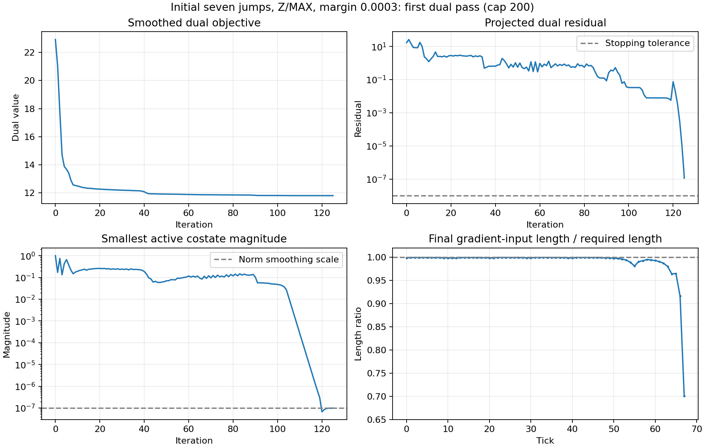

# Initial seven-jump Z/MAX: dual iteration cap and convergence audit

## Experiment

Same jumps 1–7, 68 input ticks, 33 constraints, cold multipliers, shared actual-inertia continuous validation, and fixed inward margin 0.0003. Only the per-margin dual iteration cap changes: 100, 200, 500, 1000, 5000, 20000. Both replay horizons (commit=3 through 30, commit=1 through 12) are tested. The existing early stops are retained. Margin 0.05 at caps 100 and 1000 is an explicit comparison control, not a change to the fixed-margin route policy. No full-route rerun or full suite.

`ClosedFormSolve.Config.dualMaxIterations` and a three-argument `CostateDualSolver.solve` expose the probe override. Defaults remain 100. Diagnostics now record the actual stopping reason, returned-iterate projected residual, and optional per-iteration objective/residual/input-change/minimum-costate samples. The old `lastPgres` log is the last loop-entry residual: when the cap is hit it is one update behind the returned state. `lastFinalPgres` records the returned state separately without changing old diagnostic values or solving behavior.

## All cap results

The maximum violation includes the accepted-prefix replay and full actual-inertia continuous validation. The first-pass/candidate details are in the candidate CSV; the best miss is selected across inertia passes, not across iterations inside a dual solve.

| Cap | First dual pass: iterations / stop | Inertia retry: iterations / stop | Best continuous violation | Accepted? |
|---:|---|---|---:|---|
| 100 | 100 / iteration limit | 83 / recovered-input stall | 0.011663350626 | No |
| 200 | 125 / no descent found | 83 / recovered-input stall | 0.071773792746 | No |
| 500 | 125 / no descent found | 83 / recovered-input stall | 0.071773792746 | No |
| 1000 | 125 / no descent found | 83 / recovered-input stall | 0.071773792746 | No |
| 5000 | 125 / no descent found | 83 / recovered-input stall | 0.071773792746 | No |
| 20000 | 125 / no descent found | 83 / recovered-input stall | 0.071773792746 | No |

Both replay horizons give the same overall results. At cap >=200, first-pass continuous violation is 0.072149436056, so the retry at 0.071773792746 becomes the best miss. At cap 100, the earlier first-pass candidate has only 0.011663350626 violation. The solver does not preserve that iteration-100 candidate when allowed to continue to 125; dual decrease does not imply monotonic angle-path feasibility.

The 0.05 control passes original constraints at both caps. At cap 100 it stops at the limit (returned residual 0.014447710217); at cap 1000 it stops after 110 iterations on projected-gradient tolerance (residual 2.347075423e-9). The latter also satisfies the margin-tightened affine model to about 2.35e-9. In contrast the original 100-iteration control misses its requested inward clearance by 0.014447710217 while still passing original constraints.

## Why the near-stationary dual still yields invalid angles

This code smooths the costate norm with `EPS2 = 1e-14` (`epsilon = 1e-7`). The gradient is computed using

```
u_gradient[t] = m[t] * g[t] / sqrt(dot(g[t], g[t]) + EPS2)
```

That vector can be shorter than `m[t]`. `FacingPrefold.expand` / `JumpLinearModel.recoverAlongCostate` recover only its direction as an angle. Evaluating that angle restores the full magnitude:

```
u_angles[t] = m[t] * g[t] / norm(g[t])
```

The probe reconstructs both using the actual returned costates and reads the source smoothing constant through reflection. It verifies that this direct reconstruction matches the production candidate's actual-continuous violation.

For the first pass at cap 200, the returned dual residual is 1.132375473e-7. The derivative-implied controls satisfy every margin-tightened affine positional row to within 1.132373953e-7. But normalization of the same costates violates original walls:

| Constraint | Gradient-control original clearance | Full-length-angle original clearance |
|---|---:|---:|
| Z@20hi | +0.000299973451 | -0.002620409135 |
| X@67lo | +0.000299961595 | -0.021415519152 |
| Z@68 | +0.000300025614 | -0.072149436056 |

The actual-inertia continuous X@67 value differs slightly from the unpatterned affine row above; its maximum violation is still the same Z@68 miss. Thus this discrepancy is visible even before inertia and game-angle mapping are applied.

Example at tick 67:

| Quantity | Value |
|---|---:|
| Costate norm | 9.824770808e-8 |
| Required input magnitude | 0.025999998674 |
| Gradient-control length / required length | 0.700829358132 |
| Gradient Z input | 0.018221562382 |
| Angle-derived Z input | 0.025999998674 |
| Added final Z from this tick alone | 0.007778436292 |

Across all ticks, restoring full input lengths adds 0.072449461670 to final Z. Starting with the gradient-control clearance +0.000300025614 leaves an angle-path violation of 0.072149436056. This directly measures a recovery discrepancy; it is not a claim that Minecraft can use reduced acceleration. The smoothed dual's derivative uses those reduced vectors internally, whereas the game and the continuous angle simulator cannot.

## Implementation-specific convergence theory

- One dual iteration updates the wall multipliers (33 here, plus explicit inertia rows on the retry), not one yaw or one movement tick. It builds the costate vectors over all 68 inputs. The current implementation uses a Levenberg-damped Newton step over its free multipliers, with Cholesky and Armijo backtracking; projected gradient with expanding/backtracking line search is the fallback. The file-level comment about truncated-eigen Newton is stale relative to the actual implementation.
- With a smooth strongly convex objective, first-order convergence can be geometric, with rate depending on conditioning. Without strong convexity, standard smooth projected-gradient theory gives sublinear objective convergence under suitable step rules. Newton has quadratic local convergence under regularity and nonsingular curvature. These are conditional textbook results, not a proven iteration bound for this particular hybrid. See [Boyd and Vandenberghe, Convex Optimization, chapter 9](https://web.stanford.edu/~boyd/cvxbook/bv_cvxbook.pdf).
- This dual can have redundant wall directions, changing active multiplier sets, almost-flat directions and rapidly changing curvature as a costate approaches the smoothing scale. There is no demonstrated strong-convexity constant or problem-specific guarantee that 100 iterations gives feasible recovered angles. The 100 cap dates to the introduction of the file in commit `9a22bdb` (angle optimizer #122); its comment describes a fast path expected to need only a handful of iterations. The inspected source/history does not supply a theoretical derivation of 100.
- The true unsmoothed dual is nonsmooth at zero costates. Smoothing changes the derivative and can make gradient controls substantially shorter than the fixed magnitudes; convergence of that smoothed objective is insufficient for feasibility of the normalized angle recovery. The file's broad claim of automatically feasible recovery should not be treated as a guarantee for this implementation.
- At cap 200, the first pass's returned projected residual is about 1.13e-7 and its line search cannot find further decrease; the retry stops because derivative-implied inputs change by at most 1e-9. Neither stop establishes the physical angle path's feasibility. The shared validator correctly rejects both.

## Timing and artifacts

These are instrumented single runs with JVM warmup differences, not benchmarks. All samples and timings are preserved. A cap of 20000 did not perform 20000 iterations because the same early stops fired.

| Margin | Cap | Replay prefix | Total closed-form call ms |
|---:|---:|---:|---:|
| 0.0003 | 100 | 30 | 72.432 |
| 0.0003 | 100 | 12 | 14.860 |
| 0.0003 | 200 | 30 | 12.832 |
| 0.0003 | 200 | 12 | 8.454 |
| 0.0003 | 500 | 30 | 6.266 |
| 0.0003 | 500 | 12 | 5.991 |
| 0.0003 | 1000 | 30 | 4.473 |
| 0.0003 | 1000 | 12 | 4.075 |
| 0.0003 | 5000 | 30 | 4.050 |
| 0.0003 | 5000 | 12 | 4.089 |
| 0.0003 | 20000 | 30 | 4.245 |
| 0.0003 | 20000 | 12 | 4.001 |
| 0.05 | 100 | 30 | 2.271 |
| 0.05 | 100 | 12 | 2.159 |
| 0.05 | 1000 | 30 | 2.217 |
| 0.05 | 1000 | 12 | 2.194 |



Seven focused JUnit tests passed: the cap/recovery sweep, the earlier baseline shared-helper audit, and five shared-validator tests. The cap probe contains sixteen cold-start experiments. No full suite ran. The default cap remains 100; no smoothing/recovery fix has been attempted. The next investigation should target the smoothed-gradient/full-length-recovery discrepancy, rather than only raising the work cap. A sharper epsilon may reduce bias but worsen conditioning; that would require a separate controlled probe.

Sources and reproduction:

- [Outcomes and timings](initial-seven-dual-cap-2026-10-23/outcomes.csv)
- [Every candidate, residual, costate scale and constraint violation](initial-seven-dual-cap-2026-10-23/candidates.csv)
- [Every iteration](initial-seven-dual-cap-2026-10-23/iterations.csv)
- [Every candidate's constraint margins](initial-seven-dual-cap-2026-10-23/constraint-margins.csv)
- [Per-tick gradient-control versus full-length input](initial-seven-dual-cap-2026-10-23/recovery.csv)
- [Recovery constraint-margin comparison](initial-seven-dual-cap-2026-10-23/recovery-constraint-margins.csv)
- [Solver trace with stopping reasons](initial-seven-dual-cap-2026-10-23/solver-trace.txt)
- [Focused test log](initial-seven-dual-cap-2026-10-23/focused-tests.log)

```sh
./gradlew -Dorg.gradle.java.home=/Library/Java/JavaVirtualMachines/jdk-21.jdk/Contents/Home -Dpkc.marginProbe=true :core:test -PslowTests --tests de.legoshi.parkourcalc.anglesolver.InitialSevenDualIterationProbeTest --tests de.legoshi.parkourcalc.anglesolver.InitialSevenSharedValidationAuditTest --tests de.legoshi.parkourcalc.core.anglesolver.solver.WindowCandidateValidationTest
```

Run in the background with output redirected to a file.


## Why EPS2 exists, and what a small costate means

`EPS2=1e-14` smooths the norm in the dual objective, not merely a denominator. The original term `m[t] * norm(g[t])` has a kink at `g[t]=0`: its gradient has no unique direction there, and the Newton Hessian formula involves division by the norm. Replacing it with `m[t]*sqrt(dot(g[t],g[t])+EPS2)` makes it differentiable with finite curvature. The effective norm scale is `sqrt(EPS2)=1e-7`. This does not remove all Hessian singularities (redundant constraints can still give flat directions); the separate damping handles that. Neither smoothing constant is a Minecraft velocity, inertia threshold or angle-resolution constant. It is a fixed numerical approximation parameter, with no problem-specific scale guarantee evident in the inspected code.

For this implementation, the per-tick costate is exactly the two-component vector

```
g[t] = c[t] - sum_j lambda[j] * A[j,t]
```

Here `c[t]` is the final-objective sensitivity to a unit X/Z acceleration at tick t, including its friction-propagated effects. `A[j,t]` is that acceleration's contribution to normalized wall j. `lambda[j]` is the wall's dual weight. Thus `g[t]` is the direction preferred by the objective after subtracting weighted constraint effects. It is a sensitivity vector, not player velocity or acceleration. Its direction supplies the recovered acceleration direction; `baseArg[t]` converts that direction to the required facing for the tick's keys.

At tick 67, the objective is maximize Z[68] and the only constraint row affected by that final tick's input is the upper wall on the same Z[68]. The coefficient is approximately 1 for both. Hence `gZ[67]` is approximately `1 - lambda[Z68]`. When that wall's multiplier approaches 1, objective and wall contributions cancel. The measured `gZ[67]=9.824770808e-8` corresponds to an approximately 0.999999902 multiplier; this multiplier value is inferred from that one-row relation, not separately logged. `gX[67]=0` exactly in the recorded candidate.

This is a structural cancellation: pushing Z improves the objective but presses equally against the active Z wall. At exact cancellation the unsmoothed Lagrangian is indifferent to that tick's direction; a zero costate does not identify a unique feasible angle. It also does not mean movement magnitude may be reduced. The solver's smoothed derivative nevertheless shrinks the internal movement vector around that cancellation, which is the discrepancy measured in the recovery audit.

Only changes to research notes were made for this explanation; no new test or solve was run.


### Component interpretation

The per-tick score is `gX*uX + gZ*uZ`. A zero Z component means no direct Z reward in this fixed-multiplier Lagrangian, not zero player Z velocity. A nonzero X component can still select X-directed acceleration. A zero whole vector leaves direction undetermined by this score, without making all directions feasible. With X component zero, any positive Z component (small, 0.5 or 1) selects the same full +Z acceleration before smoothing. With X component 1, Z components 0.5 and 1 yield Z fractions 0.447214 and 0.707107 respectively. Only relative components determine the recovered direction; absolute size matters to the smoothed derivative and numerical conditioning. In the special last-tick example, gZ approximately equals 1 minus the final-wall multiplier; this is not a universal numerical scale for other ticks.


## EPS2 provenance and outside-square-root proposal

The [gh/blame investigation](linkcraft-real11-norm-smoothing-history.md) traces EPS2=1e-14 to the original closed-form commit inside PR #122. That PR has no description/comments; its original commit and patch document tiny norm smoothing with modest accuracy plus fallback, but no justification for the specific constant. Moving it outside the objective sqrt adds only a constant and does not smooth the kink. Changing only the gradient denominator would make derivatives inconsistent. A smaller EPS2 is a separate probe and interacts with conditioning, degenerate recovery and the 1e-9 zero-costate yaw fallback. No epsilon experiment was run.


## Proposed objective/window preflight

The [whole-jump window versus motion design note](linkcraft-real11-window-objective-preflight-design.md) records the small-costate fallback, automatic matching-wall detection, and the concrete alternatives 1–6/end64, 1–7/end68, 1–8/end71. The user clarified whole-jump shifts as an alternative to terminal motion; a tick extension mixes position with one tick of movement rather than being a fundamentally separate strategy. Extending to 8 preserves existing constraints and removes the direct Z68 objective cap. This is a proposed next probe, not an implemented or tested policy. The note also identifies the existing scalar-MOTION evaluation inconsistency that a prototype must handle.
