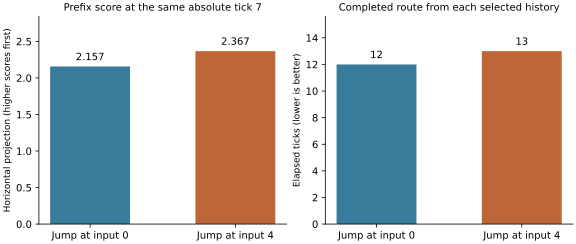

# Checkpoint guidance results

Implementation source: `5e36f490b8a5c17c9ce20240fcb48ff73cdddb5d`, branch `research/ipopt-cell-routes`. All measurements below use that solver source. Later reporting/plot files do not change numerical search. The [manifest](evidence/checkpoint-manifest.json) pins the runtime, compiler configuration and fixture hashes. This is standalone research with supplied spatial polylines and checkpoint times.

## Main comparison

Six scenes, three arms, three repeats: 54 runs. Each checkpoint pool retains up to four histories, including one unknown reserve when available. Arms share each fixture's prefix/candidate/call/time caps, enabled movement families, spatial corridor and no-threshold physics. Scoring calls are included in work and time. The generation-order arm pays the same checkpoint solve cost as the score-order arm.

All repetitions have identical acceptance, final tick count and final objective for each arm/scene. The checkpoint arms find accepted goals on all six scenes; the complete-program baseline finds three under these caps. Every one of the 219 saved accepted prefix/final witnesses passes independent scalar, support/contact and shared collision replay, including exact stored X/Z position/velocity reproduction.

| Scene | Complete-program baseline ticks | Checkpoints, generation order ticks | Checkpoints, score order ticks | Final objective of checkpoint arms |
| --- | ---: | ---: | ---: | ---: |
| Open | 12 | 12 | 12 | 4.385033 |
| Ceiling | 12 | 12 | 12 | 3.401667 |
| Multiple supports | 14 | 14 | 14 | 5.136175 |
| Step versus jump/slab boost | Unknown | 13 | 13 | 4.801811 |
| Grind versus run | Unknown | 13 | 13 | 5.878047 |
| Turn around blockage | Unknown | 16 | 16 | 4.447808 |

The baseline hits the prefix cap before any numerical proposal on stepping and grind. The blockage baseline hits its complete-candidate cap. These are search failures under the recorded limits, not geometric infeasibility. Checkpointing changes generation frontiers, free-continuation construction and physical-profile deduplication as well as enabling earlier scoring. Its success is not attributable to geometric ranking alone.

Median end-to-end search seconds, including geometry/generation/scoring/final solves:

| Scene | Baseline | Generation order | Score order | Score-order range |
| --- | ---: | ---: | ---: | ---: |
| Open | 0.229 | 1.052 | 1.073 | 1.045 to 1.083 |
| Ceiling | 0.276 | 2.029 | 1.976 | 1.946 to 2.053 |
| Multiple supports | 1.954 | 3.383 | 3.363 | 3.325 to 3.403 |
| Step versus jump/slab boost | 4.213 | 4.105 | 3.734 | 3.642 to 3.910 |
| Grind versus run | 3.223 | 7.664 | 7.637 | 7.585 to 7.825 |
| Turn around blockage | 3.849 | 4.850 | 4.698 | 4.684 to 4.821 |

Some baseline rows have no accepted result. Their shorter runtime does not make them successful solves. On easy scenes, the baseline already succeeds with one numerical call, while checkpoints add nine to 24 calls in total without improving the final result.

| Scene | Numerical calls, baseline / generation / score | Expanded prefixes, baseline / generation / score |
| --- | --- | --- |
| Open | 1 / 9 / 9 | 15 / 18 / 18 |
| Ceiling | 1 / 15 / 15 | 20 / 28 / 28 |
| Multiple supports | 1 / 24 / 24 | 95 / 64 / 64 |
| Step versus jump/slab boost | 0 / 21 / 21 | 192 / 90 / 68 |
| Grind versus run | 0 / 36 / 36 | 320 / 289 / 289 |
| Turn around blockage | 15 / 39 / 38 | 116 / 34 / 28 |

Geometric ordering reduces expansions from 90 to 68 on stepping and 34 to 28 on the turn, saving one numerical call in the latter. It does not improve final quality over generation ordering with this pool. Three repeats measure runtime spread, not a broad statistical performance guarantee. See [summary CSV](evidence/summary.csv), [summary JSON](evidence/summary.json) and [full runs/witnesses](evidence/checkpoint-guidance-final.json.gz).

## One-candidate diagnostic

Retain exactly one scored history and zero unknowns, with the same other fixture caps. This tests greedy commitment; it is not the proposed default. Six scenes, two arms, three repeats: another 36 runs. Acceptance, tick counts and final objectives repeat identically. All 237 saved witnesses pass independent replay, for 456 successful replays across both experiments. [Greedy summary](evidence/greedy-summary.json), [full runs/witnesses](evidence/checkpoint-guidance-greedy-final.json.gz), [run log](evidence/checkpoint-guidance-greedy-final.log).

| Scene | Generation order ticks | Score order ticks | Four-history score-order ticks |
| --- | ---: | ---: | ---: |
| Open | 12 | 12 | 12 |
| Ceiling | 12 | 13 | 12 |
| Multiple supports | 14 | 14 | 14 |
| Step versus jump/slab boost | Unknown | 14 | 13 |
| Grind versus run | 11 | 11 | 13 |
| Turn around blockage | 24 | 17 | 16 |

This exposes both useful guidance and ranking errors. On the ceiling scene, both alternatives are scored at absolute state tick 7:

| Selected discrete history | Score at tick 7 | Y at tick 7 | VY at tick 7 | Found completion tick |
| --- | ---: | ---: | ---: | ---: |
| Jump input 0 | 2.156794 | 2.176759 | -0.152335 | 12 |
| Jump input 4 | 2.367106 | 2.001336 | +0.164773 | 13 |

The higher horizontal score chooses a later jump. It still needs a ceiling contact and finishes one tick later. Y is not being optimized or compared; its real continuation dynamics affect when the route can finish. Both histories pass physical replay. This is a surrogate-ranking error, not obstacle phasing. All facings are reoptimized when completing the selected history, so the score's numerical tick-7 endpoint is not frozen.

On stepping, greedy score order keeps a slab-boost history and finds 14 ticks; the four-history pool keeps a normal-step alternative that finishes in 13. On the turn, geometric ranking improves the one-history result from 24 to 17 ticks, while retaining alternatives recovers 16.

The grind result is nonmonotone in pool size: both one-history arms find 11 ticks, compared with 13 in the four-history arms. All runs have finite global generation/candidate budgets. More retained parents change which descendants reach the next capped candidate batch; they do not guarantee a superset of the narrow pool's evaluated continuations. This is a work-allocation limitation. It argues for balancing descendant work among retained parents before treating a larger beam as a quality guarantee.

## Recommendation and limits

Use the geometric score as a cheap conceptual guide with a small retained alternative pool. The implementation demonstrates physical local decision scoring and continuation for different stepping/ceiling methods without a mixed-input initializer. It also demonstrates why a single locally best score cannot safely replace local alternatives.

The strongest measured benefit is the checkpoint frontier. Score ordering gives modest work reductions in the four-history comparison and a useful one-history turn preference, but no universal speedup or quality guarantee. The implementation currently spends real IPOPT work on each candidate; benchmark evidence does not establish that this is cheaper than a well-engineered screening-only policy.

Next targeted experiments should balance capped continuation work per parent and move the common ceiling checkpoint later to capture the unresolved contact/descent. Keep the same absolute tick for every sibling. More lookahead or a small coupled decision window is justified if these failures persist. A new mixed model, velocity weighting, third abstraction or bound is not yet shown necessary by these tests.

Checkpoint timing/segment selection is configured, not automatic. Supplied corridor coverage, finite candidate caps, local numerical unknowns and beam drops limit conclusions. No exhaustive top-k usefulness census or global optimum is established. Actual-world validation and inertia-threshold repair remain deferred; normal momentum is included throughout. Ladders and intentional wall hits remain excluded.

## Tests and evidence

The compiler/IPOPT-enabled gate passes 26 focused tests, including four new numerical checkpoint checks plus unit semantics and existing cell/stepping/composition integration. The broader autonomy run completes 359 tests with 81 environment skips and no failures after excluding one known ladder test. IPOPT completes 51 tests with eight environment skips and no failures. No mod Gradle test suite is required by the standalone instructions.

The excluded test is `LadderRegionTests.test_repeated_ladder_ceiling_events_regenerate_the_complete_schedule`; the same failure was independently reproduced at the untouched earlier baseline. [Current failure](evidence/checkpoint-known-ladder-failure.log), [earlier baseline reproduction](../route-guidance/evidence/guidance-baseline-ladder-test.log). This experiment does not modify its ladder semantics.

Evidence includes [focused tests](evidence/checkpoint-numerical-tests.log), [broader autonomy tests](evidence/checkpoint-autonomy-tests.log), [IPOPT tests](evidence/checkpoint-ipopt-tests.log), [main run log](evidence/checkpoint-guidance-final.log), raw fixtures/witnesses and runtime/source manifest. Benchmark commands are in the [README](README.md). Recreate the diagnostic figure with `.venv-guidance/bin/python standalone/autonomy/experiments/checkpoint-guidance/plot_diagnostic.py`.
