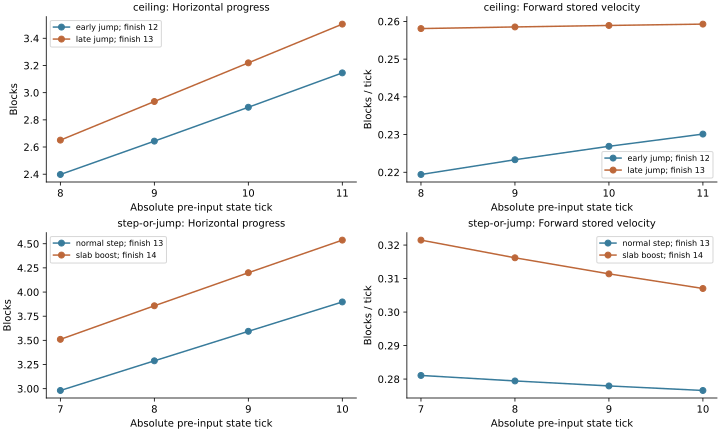

# Joint windows: what survives later comparison

Numerical source: `d9cffafc`, following implementation `9556c38e`, isolated branch `research/ipopt-cell-routes`. The [manifest](evidence/manifest.json) records exact source/runtime/fixture hashes. The score is still horizontal position at one shared state. No velocity weight, multi-tick objective, new bound or mixed initializer was introduced.

Completed evidence: 54 cold searches and 54 controlled prefix/continuation trials. All 402 saved accepted witness replays pass independently: 243 cold and 159 diagnostic checks. Diagnostic score gaps and best-found completion outcomes repeat identically across all three repetitions. Full [summary JSON](evidence/summary.json), [cold summary CSV](evidence/cold-summary.csv), [cold runs](evidence/decision-windows-final.json.gz) and [conditional trials](evidence/decision-window-diagnostic-final.json.gz).

## Implemented policy

Cluster supplied opportunity time ranges by proximity, overlap, dependencies and readiness. Enumerate compatible physical combinations through the earliest input of the next separate cluster, then retain objectives within an absolute progress gap. Compare p[q] before next input q, after input q-1, using one tick/direction for every sibling. Retain original initial position/velocity, free all earlier facings, and carry normal momentum with zero velocity thresholds. Y remains in feasibility only.

Band mode distinguishes outside-band omissions, hard pool-cap losses and numerical unknowns. Parent generation has explicit prefix quotas and round-robin candidate proposals. It does not yet recycle unused quotas. Last available clear selected-event states record position, forward/lateral velocity and Y/VY/ground state for later diagnosis.

These are supplied-route and supplied-opportunity experiments. The ranges are not certified earliest-event bounds; automatic range discovery, comprehensive detection of every unresolved interaction and passage-time auditing remain incomplete. Checkpoints are the latest states permitted by those supplied ranges, not proven latest physical comparison points. See the [API and scope](README.md).

## Cold search comparison

Six scenes, three retention policies, three repeats: 54 searches. All share the new opportunity domains, planned windows, hard pool cap eight, maximum 512 prefix expansions, 128 numerical calls and 20 seconds per search. Each candidate has its own numerical limits, all included in total work. Fixed retention keeps up to eight histories and can fill spare slots with unknowns. Band retention caps unknowns at one; fixed-versus-band comparisons include that allocation difference. The two numeric bands have the same unknown policy.

Found tick counts repeat identically in all three repetitions:

| Scene | Shared comparison states | Fixed pool | Gap 0.25 | Gap 0.5 |
| --- | --- | ---: | ---: | ---: |
| Open | 11 | 12 | 12 | 12 |
| Ceiling | 11 | 12 | 13 | 12 |
| Multiple supports | 10, 16 | 14 | 14 | 14 |
| Step versus jump/slab boost | 10 | 13 | 14 | 14 |
| Grind/run chain | No separate window | Unknown | Unknown | Unknown |
| Blockage turn | 10, outgoing segment 2 | Unknown | Unknown | Unknown |

Band retention reduces the actual first-window pool: ceiling eight to two/four; stepping eight to three; open eight to six; multiple supports eight to five. Smaller pools are not necessarily better selections. The ceiling's 0.5 band preserves a 12-tick alternative that 0.25 drops. Both tested bands drop the stepping history that finishes in 13 rather than 14 ticks.

Median end-to-end search seconds and numerical calls:

| Scene | Seconds, fixed / 0.25 / 0.5 | Calls, fixed / 0.25 / 0.5 |
| --- | --- | --- |
| Open | 3.703 / 3.615 / 3.565 | 21 / 21 / 21 |
| Ceiling | 4.310 / 4.119 / 4.268 | 29 / 27 / 29 |
| Multiple supports | 3.667 / 3.703 / 3.714 | 24 / 24 / 24 |
| Step versus jump/slab boost | 5.818 / 5.549 / 5.687 | 36 / 35 / 35 |
| Grind/run chain | 4.214 / 4.497 / 4.350 | 0 / 0 / 0 |
| Blockage turn | 8.597 / 7.377 / 7.352 | 63 / 57 / 57 |

These small work savings do not justify a quality loss. The earlier authored-checkpoint experiment solved six scenes under its settings; this experiment does not establish an improvement over it. Domains, horizons, caps and unknown retention differ, so that historical comparison is descriptive rather than an isolated horizon ablation.

There are two distinct discovery failures:

- The corrected grind domain includes the known input-8 jump and input-9 landing. All nearby interactions and the goal merge into one cluster. The cold generator hits 512 expansions before any complete numerical proposal. No score is computed, so changing the score cannot fix that failed run by itself.
- The turn's later window produces no accepted score. Of 16 partial candidates in the fixed arm, 12 exhaust their per-candidate numerical call limit, three exhaust contact search and one fails the post-turn stage check. Final attempts remain unknown. This points to physical repair effort, window readiness and opportunity timing, not demonstrated bad score ordering. These outcomes are not proofs of infeasibility.

## Independently continued sibling controls

The diagnostic uses two previously accepted histories per family, three horizons per family and three repeats: 54 controlled prefix/continuation trials. All six full controls lie inside the corrected opportunity domains. Every prefix is reoptimized from the original state; its selected repair guards are carried into independent continuation search. The known full symbolic schedule is also reoptimized with those guards, providing a compatible accepted completion control. No old optimized intermediate endpoint or unconditioned historical completion is substituted.

This is warm, restricted-family evidence. The recorded completion is best found from the compatible control and the budgeted independent suffix search, not a global optimum. Missing suffix proposals remain unknown even when the compatible control supplies a feasible result. In particular, grind suffix generation can consume its six-second diagnostic allowance before any numerical call; that is recorded separately.

| Family | Shared h | Faster-completing history's score gap | Available completion ticks, faster / score winner |
| --- | ---: | ---: | --- |
| Ceiling, early versus late jump | 7 | 0.210311 | 12 / 13 |
| Ceiling | 9 | 0.291514 | 12 / 13 |
| Ceiling | 11 | 0.358758 | 12 / 13 |
| Normal step versus slab boost | 4 | 0.382581 | 13 / 14 |
| Stepping | 7 | 0.529337 | 13 / 14 |
| Stepping | 10 | 0.639928 | 13 / 14 |
| Grind, shorter versus longer chain | 3, 7, 10 | 0 | 11 / 11 |

Moving comparison later does not fix these ceiling/stepping examples. It increases the progress gap against the faster completion. A 0.25 band retains the ceiling alternative at old h=7 but loses it at h=9 and 11. A 0.5 band retains the useful stepping alternative at h=4 but loses it at h=7 and 10. Tolerance and horizon cannot be calibrated independently.

The grind pair behaves differently: the 11-tick chain scores better than the 13-tick chain at each measured horizon. Its late-horizon cold failure is therefore a discovery/cluster-generation problem, not a demonstrated ranking reversal between these known chains.

## What the recorded horizontal features miss

At the latest diagnostic horizons, the slower histories are both farther ahead and have greater forward stored velocity at every recorded common clear tick. Ceiling uses states 8 through 11; stepping uses 7 through 10. This makes a simple positive weighting of those recorded progress/forward-velocity samples prefer the slower history too.

The endpoint states show the missing distinction:

| History | h | Progress | Forward velocity | Y | VY | Available finish |
| --- | ---: | ---: | ---: | ---: | ---: | ---: |
| Early jump | 11 | 3.145539 | 0.230128 | 1.121297 | -0.444826 | 12 |
| Late jump/ceiling hit | 11 | 3.504297 | 0.259282 | 1.585841 | -0.304317 | 13 |
| Normal step then jump | 10 | 3.897604 | 0.276599 | 2.296736 | -0.301535 | 13 |
| Slab boost then jump | 10 | 4.537532 | 0.307036 | 2.524424 | -0.227688 | 14 |

All four are airborne at their comparison states. Grounded-versus-airborne diversity alone would not distinguish them. The useful alternatives can make the next landing sooner despite lower horizontal progress and speed. Temporal separation from the last decision does not imply that the consequences of the earlier jump/contact have disappeared.

This is evidence about recorded position-optimal prefixes, not a proof that every reoptimized nonlinear or goal-aware horizontal score fails. It does show why merely adding a positive velocity bonus or averaging recent forward progress is insufficient for these recorded comparisons. Y stays out of the objective; physical readiness for the next contact is relevant continuation information. All cited prefixes and completions pass finite physical replay, so the observed reversal is not obstacle phasing.

## Alternatives worth retaining and next work

The next retention experiment should preserve a small number of histories with different next-contact timing or flight phase, even when their horizontal score gaps exceed a narrow band. The examples identify early descent versus late ceiling contact, and a normal step/early launch versus slab boost/later launch. Preserve meaningful contact/timing distinctions rather than merely different method names or near-identical facings. A global wider gap can recover these pairs but may retain many redundant histories; its cost must be measured rather than assumed acceptable.

Keep score design deferred until testing that contact-aware diversity control. Any future multi-tick position/velocity score should be judged against these counterexamples, with full earlier-facing reoptimization and independent completions. An estimate or category of readiness for the next contact is a candidate missing feature; no formula or height reward is selected here.

Separately, improve bounded joint-program proposals in the dense grind cluster and inspect the turn's physical-repair/window failures. A richer score cannot rank useful programs that the generator never proposes. Broad supplied timing ranges can merge a long chain, so automatic opportunity timing and cluster readiness need their own validation. Per-parent quotas prevent a form of starvation but do not resolve within-cluster combinatorial growth or guarantee quality monotonicity.

Bounds, mixed initializers, inertia-threshold repair, ladders, intentional wall hits and production routing changes remain deferred. The implementation is a tested experimental policy, not a universal local optimum selector.

## Validation and reproduction

The 38-test compiler/IPOPT-enabled gate passes. Broader autonomy: 371 tests, 82 environment skips, no failures with the one known baseline ladder failure excluded. IPOPT: 51 tests, eight environment skips, no failures. See [focused tests](evidence/decision-window-numerical-tests.log), [autonomy tests](evidence/decision-window-autonomy-tests.log), [IPOPT tests](evidence/decision-window-ipopt-tests.log) and the [previous baseline ladder evidence](../route-guidance/evidence/guidance-baseline-ladder-test.log).

Commands are in the [README](README.md). Full cold runs, conditional diagnostic witnesses, independent replay checks, source/runtime manifest, summary CSV/JSON and the reproducible feature figure are in `evidence/`. Run `.venv-guidance/bin/python standalone/autonomy/experiments/decision-windows/analyze_results.py` after reproducing/copying the two full report files into that directory to regenerate summaries and figures. These are headless scalar/shared-scene checks; actual-world execution remains a later step.
