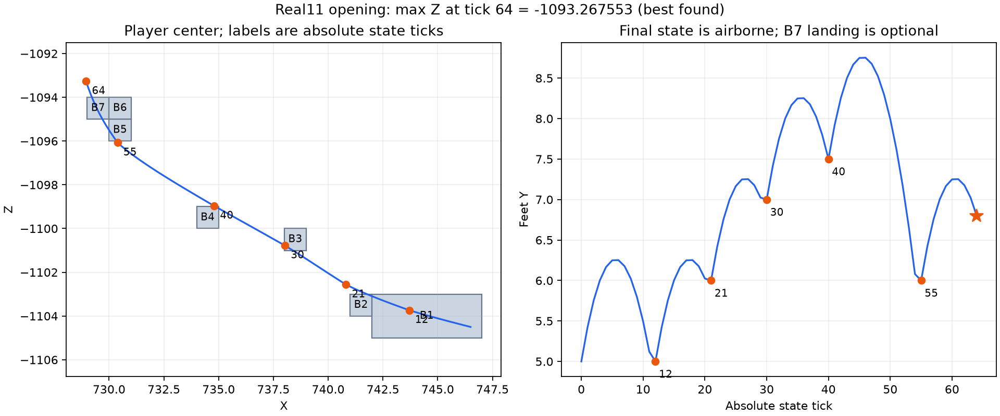

# Linkcraft Real11 opening: fixed-clock solve and retention counterexample

> Current implementation: [DFS/early-interaction results](../dfs-interactions/README.md). This supersedes earlier pending-status and checkpoint-ordering descriptions below; historical evidence remains unchanged.

> Current navigation/status: [Real11 agent guide](../../../docs/REAL11_GUIDE.md), [current state](../../../docs/CURRENT_STATE.md). This page records the original pilot and successive corrections; do not interpret its older pending-policy statements as current runtime status.

Latest failure investigation: [why all four main/resumed trials returned unknown](OTHER_FAILURES.md). The first two never reach numerical evaluation in the final64-input objective stage; the distant trial separately attempts two64-input B5-landing probes. A useful corrected B3-wait choice appears at proposal125, beyond the original20; an exact known continuation at135 validates from a retained parent in two calls. Final searches also starve their base problem behind inherited repair queues, and the55-input resume repeats18 prior finals without their64-input repair progress. A queue-order control recovers a valid64-input solution under the same8-second/24-call limits. These are additional failures beyond the early retention rule; protection guards alone do not fix all of them. Production code is unchanged by the investigation.

Latest user decision: retain both immediate-jump0 and run-then-jump8 setup families. In the saved full-route solutions jump0 regains directional progress at state23, ties support-arrival time atB4/state40 and reachesB5 three ticks earlier. These are observed continuations, not per-horizon optimality certificates. See [the measured crossover and plot](EXECUTION_AUDIT.md#when-does-the-immediate-jump-advantage-appear). This supersedes treating the8 setup as irrelevant in the preceding scope correction; it does not justify arbitrary additional ground-delay enumeration.

Subsequent user clarification: the intended case has no extra run ticks and only the B6 blockage choice. The [execution audit](EXECUTION_AUDIT.md) explains exactly how the pilot searched an unnecessarily broader problem, lists cells/routes/decision combinations/pruning/commitments and distinguishes scalar from physical acceptance. Its scope correction supersedes interpreting the early-history counterexample as evidence that this intended simple solve needs more candidates or a more elaborate score. [Every main-run evaluated prefix and its retention decision](audit/CANDIDATES.md).

2026-11-02. Isolated branch `research/ipopt-cell-routes`, numerical source through `f21d58ea`. The requested opening has a valid standalone result: **maximum Z found at absolute state tick64 is -1093.2675533415547**. Final X728.9505324575503, feetY6.796735600668692, airborne. No B7 landing is required or present in this candidate. It is approximately0.43245 blocks beyond B7's far player-center support edge. This is a best-found feasible result, not an optimality certificate.

[Solution summary](solution-summary.json), [full solution and fixed movement program](solution.json.gz), [per-tick trajectory](trajectory.csv), [exact retention counterexample](coupling-counterexample.json), [control measurements](control-summary.json), [evidence manifest](evidence-manifest.json).



## Geometry and objective

Only the seven user-confirmed AABBs are included. [Player bounds and coordinate conventions](PLAYER_BOUNDS.md) supersede the earlier JSON-only support guesses. B1 retains the complete corner union; no single GUI-derived rectangle restricts that support. B6 remains the tall obstacle adjacent to B5/B7. Unspecified space inside the declared geometry coverage is empty. No external world geometry is imported.

Original position[746.5,5,-1104.5] and velocity[0,-0.0784000015258789,0] are unchanged. Every numerical call starts from that state and reoptimizes all earlier facings. Normal momentum is carried, with zero inertia thresholds. Inputs use the configured sprint/45-strafe family. Normal and stepping candidates are enabled; ladders, water and intentional wall hits are excluded.

The source's nominal B7 landing state64 provides only the common final objective tick. B7 remains collision geometry and an optional contact. `terminalSupportRequired=false` removes the final support/landing box. The fixture's `goalBlock=b7` is a catalogue reference, not a mandatory final support in fixed-clock mode. The chosen spatial route requires B2,B3,B4,B5 in that order and follows a geometry-only corridor; other support orders or skipping blocks are outside this pilot. Guide points do not fix positions at times. Neither recorded facings nor source airtimes are cold seeds.

## Accepted solution

| Event | Input or resulting state tick |
| --- | --- |
| Initial jump on B1 | input0 |
| Return to B1 and jump again | state12, input12 |
| B2 contact and next jump | state21, input21 |
| B3 contact and next jump | state30, input30 |
| B4 contact and next jump | state40, input40 |
| B5 contact and final jump | state55, input55 |
| Score maximum Z, airborne | state64 |

Tick conventions matter: finite landing contact offset20 is resolved during input20 and yields state21, for example. Its vertical contact is processed before the horizontal movement, as in the shared scene model. The table gives resulting state ticks, not a promise that a post-movement center remains inside a static landing rectangle.

Scalar violation is0.0. Recompiling and independently replaying the saved solution reproduces every horizontal position/velocity exactly, validates the vertical schedule and required support/contact phases, and passes the shared finite-scene collision check for all64 inputs. The final tail has no B7 contact event. This establishes standalone model validity under the declared geometry and threshold assumptions; no actual Minecraft replay was run.

## What discovery did and did not accomplish

| Run | Seconds | Numerical calls | Accepted witness replays | Full64 candidate |
| --- | ---: | ---: | ---: | --- |
| Original distant-B5 comparison | 302.6 | 430 | 32 | unknown |
| Nearer B2/B3/B4/B5 spatial goals | 233.9 | 471 | 27 | unknown |
| Near goals plus support-progress proposal order | 300.1 | 773 | 53 | unknown |
| Resume the retained55-tick histories | 126.5 | 383 | 0 | unknown |

All112 returned witness replays in those runs pass. The original comparison gives no useful B5 arrival estimate near the start. Nearer goals measure early landing times, but unlanded air-gap proposals initially occupy the next numerical batch. Prioritizing generated programs with more completed required support interactions improves accepted28-tick prefixes from1 to9. It changes proposal order, not constraints or quotas. Retained width8, unknown reserve1, per-type raw-choice cap16 and evaluated-candidate cap20 remain unchanged.

The main cold checkpoint search still returns unknown on this harder scene, even when resumed. The accepted result comes from an explicit constructive continuation probe using its own generated candidates. For initial takeoffs0,8,9, it reuses existing normal movement choices, tries0..3 additional ground inputs before the next required jump, and accepts the first feasible delay at each stage. Every stage re-solves from the original state. It then compares landing and open-air final continuations at the same tick64. Seeds are previous accepted solves from this experiment, not recorded TAS facings. Exact executed scripts and all rejected/unknown attempts are saved under [evidence](evidence/).

The best final open-air solve retains its accepted incumbent but reaches `contact_branch_limit` after30 calls. Unknown alternatives remain. Even an exhausted contact search for one fixed program does not establish the best discrete program globally.

## A concrete failure of local time/progress exclusion

The first comparison now supplies a counterexample to treating measured local inferiority as future dominance:

| First jump input | Progress at common state10 | Best-found B2 arrival | First-comparison retention | Best tested Z at64 |
| --- | ---: | ---: | --- | ---: |
| 0 | 2.392651 | 21 | discarded as markedly worse than8 | **-1093.267553** |
| 8 | 2.721058 | 17 | retained | -1094.579584 |
| 9 | 2.717278 | 18 | retained | -1094.113304 |

The constructive continuations for8 and9 need additional ground inputs at later supports before they produce accepted next jumps. Takeoff0 completes B2/B3/B4/B5 at21/30/40/55 without those added delays, and has the best completed objective among these tested continuations. Prioritizing the earliest B2 arrival alone would have removed it.

This is evidence of earlier-input and future-decision coupling on a fixed spatial route. It is not proof that0 is globally optimal, that8/9 have no better continuation, or that the reason can be reduced to a single velocity feature. The ground-delay probes are nonexhaustive, and numerical unknowns are not infeasibility proofs. The initial comparison horizon10 is an explicit pilot setting rather than an automatically certified quiet interval; comparison placement should also be examined before inventing score weights.

Two mechanisms need to stay distinct. Proposal ordering improved which relevant contacts were attempted. Retention still excluded a useful history even after obtaining accepted local scores. A larger resource cap alone cannot repair a rule that labels the history markedly worse. Removing the corridor signature and then the corridor filter leaves one fast failed schedule unknown after the same single numerical problem, before geometry/corridor audits; that diagnostic supplies no evidence that the corridor caused its failure.

## Next work supported by this evidence

The execution audit and latest user steering narrow the immediate next step: preserve both selected initial0/8 setup families, then enumerate the actual B6 passage choices with full constraints before IPOPT. The broader suggestions below are potential later work for genuinely larger decision domains, not prerequisites established by this case.

1. Integrate a generic constructive complete continuation into orchestration using the existing builders. Obtain a valid full-route baseline before trusting local exclusions on a long route. Keep unknown continuation checks explicit.
2. Reopen distinct saved input/contact histories when complete continuation changes rankings, including after a successful solve. Preserve the Real11 counterexample as the acceptance case; compare reopened histories from the original state with all facings free.
3. Study the responsible decision groups and horizon placement against full-route references. Decide whether longer joint windows, history diversity or quiet-tick velocity samples are justified by measured losses. Do not begin with arbitrary score weights or blanket beam increases.
4. Extend discovery to additional spatial routes and movement alternatives after this fixed-route behavior is reliable. Threshold/integer-facing/game realization remains a later pass.

The constructive fallback is currently an archived research probe, not an integrated default search feature. The fixed-clock objective, per-window spatial goals, proposal priority and symbolic-window resume are implemented reusable APIs. Existing IPOPT and movement/contact physics are unchanged.

## Reproduction and checks

Run from the isolated repository root after setting up the standalone Java compiler helper and numerical environment as in the existing standalone documentation. The archived compiler configuration records this machine's classpath; generate a local `standalone/autonomy/build/compiler.json` on another checkout rather than copying those absolute paths.

```sh
export OPENBLAS_NUM_THREADS=1 OMP_NUM_THREADS=1
export PKC_RUN_TICKS_COMPILER="$PWD/standalone/autonomy/build/compiler.json"
export PKC_IPOPT_PYTHON="$PWD/.venv-guidance/bin/python"
export PYTHONPATH="$PWD"
.venv-guidance/bin/python standalone/autonomy/experiments/linkcraft11-opening/replay_solution.py
.venv-guidance/bin/python -m standalone.autonomy.cell_routes.fixed_clock_experiment \
  --input standalone/autonomy/experiments/linkcraft11-opening/fixtures/clock64-event-priority.json \
  --output standalone/autonomy/build/real11-clock64-event-priority.json.gz
```

To inspect the archived probe sequence without rerunning the expensive controls, copy the archived `real11-*.json.gz` files into `standalone/autonomy/build/`, then run the scripts under `evidence/scripts/` in this order: `probe_real11_next_support.py`, `real11_constructive_probe.py`, `real11_terminal_variants.py`. The first reads `real11-clock64-first.json.gz`. The corridor diagnostic separately reads the event-priority report. These scripts preserve the exact executed experiment settings and write fresh reports into the ignored build directory. They are research drivers, not a portable default solver CLI. `summarize_evidence.py` regenerates summaries, CSV, plot and manifest from the archived evidence.

Final focused gate:101 passed, including numerical fixed-clock overshoot, time/progress, resume, corridor, failure fixes, cell, stepping, composition and acceptance checks. Broader standalone gate:425 tests,88 environment skips, passing, with the previously documented unrelated exclusion `test_ladder_composition.LadderRegionTests.test_repeated_ladder_ceiling_events_regenerate_the_complete_schedule`. No mod Gradle suite or game launch. Exact logs are archived in `evidence/real11-final-focused.log` and `evidence/real11-final-autonomy.log`.
