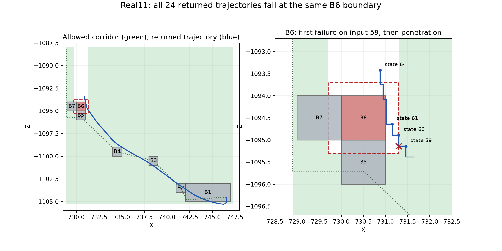

# Exact Real11 corridor failures

Instrumented reproduction of `real11-failure-numeric:retained_slow_exact_final`. All24 worker problem hashes match the archived sequence, including the following no-call proposal. No production source or model changed. The original archive did not retain individual trajectories; the exact boundary/scene checks below come from this reproduction. Callback audits can include intermediate worker candidates; this table uses the final returned candidate for each request.

The hand-authored spatial points visit B1, B2, B3, B4, B5, then move to X728.9 south of B6 before going in +Z to Z-1088. They select11 decomposition cells. The generated horizontal corridor has four rectangles, one contained in another. Its equivalent three-rectangle union is below, with coordinates rounded to0.1 (actual block offsets use float player half-width0.30000001192092896).

| Area | X range | Z range |
| --- | --- | --- |
| Right area | [731.3,747.3] | [-1105.3,-1088] |
| Lower connecting area | [728.9,731.3] | [-1105.3,-1095.3] |
| Left exit area | [728.9,729.7] | [-1105.3,-1088] |

Landmark signature: cross the X-centre planes of B1/B2/B3/B4/B5 toward decreasing X within each expanded Z footprint, then cross B6's X-centre plane toward decreasing X on its low-Z side. This signature records the route but does not fix crossing ticks. No final B7 landing is required.

## Exact observed failure

Every final returned candidate first fails corridor coverage during input59's X movement, segment178 of the Y/X/Z phase trace. Representative request1: after Y movement, feetY6.079698543676117 and Z-1095.1387901644962; X moves from731.4617637394731 to731.2999990117182. The corridor's right boundary is731.3000000119209. Z is already north of the lower connector limit-1095.300000011921, and X is nowhere near the left exit region. Thus the candidate enters the excluded area at B6.

The first entry is only about1e-6 blocks, but this is not merely a corridor-tolerance artifact: subsequent state61 is X731.1527931052182, feetY6, Z-1094.636146352213, substantially inside B6's expanded collision volume. A separate shared Java scene check on all24 returned candidates confirms scene_collision on input59, solidIndex5(B6), X axis. Request1 would be clipped to X731.3000000119209, with velocityError0.1472059064994082. These physical checks were additional diagnostics, not checks executed in the original corridor-first run.

All24 branches have the same8 inherited extra corridor rows, only at offsets4/5/31, and one B2 passage. They vary B2 exit gates29,31,32,...53. None selects a B6 avoidance passage or any new late corridor repair row. Seventy-two resulting pending branches contain new rows at59/60, but they are not dispatched before the24-call limit. Therefore these calls repeatedly optimize with missing B6 clearance while varying an earlier, unnecessary B2 exit restriction. All24 returned candidates have effectively the same late collision. This is stronger evidence than a generic claim that corridor filtering might be overrestrictive.

| Request | B2 gates | First corridor failure input/phase | X after X phase | Z during X phase | Independent scene check input/block/axis |
| --- | --- | --- | ---: | ---: | --- |
| 1 | [19, 29] | 59 / X | 731.299999011718 | -1095.138790164 | 59 / B6 / X |
| 2 | [19, 31] | 59 / X | 731.299999042706 | -1095.138790158 | 59 / B6 / X |
| 3 | [19, 32] | 59 / X | 731.299999011735 | -1095.138790164 | 59 / B6 / X |
| 4 | [19, 33] | 59 / X | 731.299999040068 | -1095.138790160 | 59 / B6 / X |
| 5 | [19, 34] | 59 / X | 731.299999039960 | -1095.138790160 | 59 / B6 / X |
| 6 | [19, 35] | 59 / X | 731.299999041662 | -1095.138790159 | 59 / B6 / X |
| 7 | [19, 36] | 59 / X | 731.299999042032 | -1095.138790158 | 59 / B6 / X |
| 8 | [19, 37] | 59 / X | 731.299999039010 | -1095.138790161 | 59 / B6 / X |
| 9 | [19, 38] | 59 / X | 731.299999011719 | -1095.138790164 | 59 / B6 / X |
| 10 | [19, 39] | 59 / X | 731.299999041474 | -1095.138790159 | 59 / B6 / X |
| 11 | [19, 40] | 59 / X | 731.299999039973 | -1095.138790160 | 59 / B6 / X |
| 12 | [19, 41] | 59 / X | 731.299999041780 | -1095.138790158 | 59 / B6 / X |
| 13 | [19, 42] | 59 / X | 731.299999011721 | -1095.138790164 | 59 / B6 / X |
| 14 | [19, 43] | 59 / X | 731.299999044774 | -1095.138790156 | 59 / B6 / X |
| 15 | [19, 44] | 59 / X | 731.299999041409 | -1095.138790159 | 59 / B6 / X |
| 16 | [19, 45] | 59 / X | 731.299999041719 | -1095.138790159 | 59 / B6 / X |
| 17 | [19, 46] | 59 / X | 731.299999045088 | -1095.138790156 | 59 / B6 / X |
| 18 | [19, 47] | 59 / X | 731.299999042863 | -1095.138790158 | 59 / B6 / X |
| 19 | [19, 48] | 59 / X | 731.299999047912 | -1095.138790153 | 59 / B6 / X |
| 20 | [19, 49] | 59 / X | 731.299999038006 | -1095.138790162 | 59 / B6 / X |
| 21 | [19, 50] | 59 / X | 731.299999040841 | -1095.138790159 | 59 / B6 / X |
| 22 | [19, 51] | 59 / X | 731.299999011740 | -1095.138790164 | 59 / B6 / X |
| 23 | [19, 52] | 59 / X | 731.299999040392 | -1095.138790160 | 59 / B6 / X |
| 24 | [19, 53] | 59 / X | 731.299999042018 | -1095.138790158 | 59 / B6 / X |



Reproduce with the existing standalone numerical environment:

```sh
OPENBLAS_NUM_THREADS=1 OMP_NUM_THREADS=1 PYTHONPATH="$PWD" .venv-guidance/bin/python standalone/autonomy/experiments/linkcraft11-opening/probe_corridor_failures.py
```

The probe uses the existing compiler manifest, eight seconds and24 requests, and reports whether the complete problem-hash sequence matches. Timing on another machine may change which work fits that deadline. Full trajectories, interim callback audits, selected rows/passages, final scene checks and corridor rectangles are in `evidence/real11-corridor-failures.json.gz`.

## User correction: representative points must not become hard limits

X728.9 is the minimum X of the hand-authored helper points. prescribed_projection clips the selected cells to an envelope from those points and endpoint anchors;728.9 has no physical significance. The left region should extend through compatible free space, bounded by actual route/geometry/coverage requirements. Current scene coverage allows player centers toX726.3. Removing the waypoint clip alone still leaves selected-cell minX728.7, so include neighboring compatible cells as well. The same issue applies to other bounds inherited only from the helper geometry.

A clearer nonoverlapping B6 partition uses left X<=729.7, central729.7<=X<=731.3 withZ<=-1095.3, and right X>=731.3. The old connecting rectangle extended into the left rectangle; their overlap was harmless as a set union, but its728.9 endpoint was not an obstacle boundary. Other solids and vertical overlap remain separate physical requirements.

The route adapter currently supplies coarse generation filters and a post-solve corridor check, rather than all chosen per-tick route constraints before solving. Lazy repair then adds rows to later candidates; inherited B2 repairs can run first. The user's selected direction treats that mismatch as an orchestrator bug: select a complete interaction/transition variant using existing builders before IPOPT, then verify those same requirements afterward. No runtime fix is included in this documentation update.

## Normal search logging milestone

The checked-in search now saves these details directly in each rejected returned branch's `candidateFilter.corridorAudit`, rather than requiring the tracing adapter to reconstruct them. Re-running this probe matches the same24 saved physical problem hashes and produces24 normal-path audit records, all input59/X, with selected B2 passages and explicit skipped-scene status. The probe separately runs24 physical checks; logging itself adds none.25 focused standalone tests cover phase/signature reporting, detached JSON snapshots and persistence without replay side effects. The [runbook](../../../CONSTRAINT_GENERATION_RUNBOOK.md#corridor-diagnostics-and-future-test-review) documents the format. Corridor policy remains enabled and unchanged; [the scope/constraint fix plan](../../../CORRIDOR_CONSTRAINT_FIX_PLAN.md) is pending.
