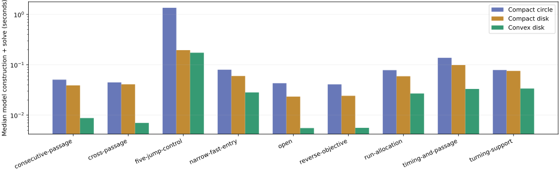
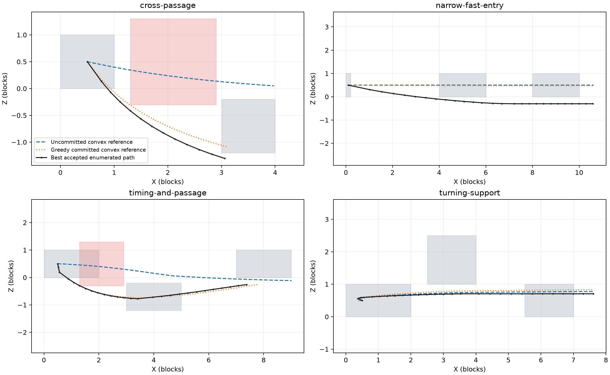
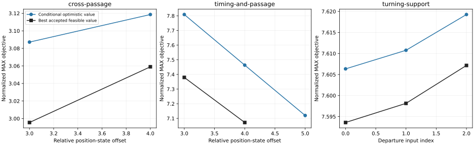

# Route-guidance model comparison

Subsequent goal review: [REFERENCE_STRATEGY_EVALUATION.md](../../REFERENCE_STRATEGY_EVALUATION.md) recommends a provisional-draft/improvement baseline first, with a focused comparison against a genuine mixed ceiling/stepping initializer. This report compares formulations within the older fixed-profile pilot; its SOCP recommendation does not establish which overall reference-construction strategy is best. The agreed no-threshold model has not been benchmarked here.

2026-10-31. Implemented and measured in the isolated `research/ipopt-cell-routes` worktree. The recommended first backend is the convex disk SOCP, using conditional whole-route values and retaining alternative decisions. The compact circle adds cost without a consistent objective or trajectory advantage in this sample. The initial relaxed trajectory is not reliably close enough to use as an unquestioned direction guide.

This is an experimental model/guidance API. It does not replace the cell-route or generic movement-program generator. Coverage is ordinary jump/run/landing and two-face horizontal avoidance on a supplied support sequence. Arbitrary stepping/ceiling histories, other support sequences, ladders and intentional wall hits are outside the implemented family.

## Experiment and evidence

Nine scenes, three repetitions, all three model arms: 81 root solves, 114 complete discrete assignment evaluations including repeats, 84 accepted assignment results. The nine scenes contain 38 distinct assignment combinations, of which 28 yielded accepted physical trajectories. All comparisons use the same fixed horizon and original full position/velocity; all facings remain variable.

The scenes cover open flight, a reversed MIN objective, run allocation, turning supports, both X-to-Z and Z-to-X passage ordering, combined timing/passage decisions, a narrow support with high incoming momentum, and five jumps over 62 inputs. The phase graph shares timing structure instead of enumerating complete histories during guidance. Exhaustive enumeration is used only to build the small benchmark reference.

- [Full measurements](evidence/measurements.json.gz), [per-run summaries](evidence/summaries.json), [scene medians](evidence/aggregate.json).
- [Independent replay](evidence/validation.json): 58 distinct accepted witnesses, exact reproduction of saved positions, scalar/support/Y/shared-scene acceptance, and all three actual constraint-assembly lift audits. Worst lift violation is below 1e-9. All 627 compatible root/conditional value comparisons cover the accepted witness, with zero misses at the recorded numerical tolerance.
- [Inertia ablation](evidence/guidance-inertia-ablation.json), [longer narrow-support refinement](evidence/narrow-long-refinement.json), and [unresolved timing diagnostic](evidence/timing-unknown-diagnostic.json).

Main measurement source is `55deae2ee0cb164ac9169c69bd7e834750c6a67d`. Follow-up validation/report tooling and the inertia ablation are in `1bc1f4bb`. After measurement, the public helper's default became width two; the experiment explicitly requests width one for its greedy control, preserving the measured workflow. No movement equation or unrestricted model was changed for that default. Dependencies/compiler-config digest are recorded in the full artifact. The native Java solver and other agent's worktree were not modified, and no further cross-agent communication occurred.

## Which model to use

| Model | Benefit | Cost or limitation | Recommendation |
| --- | --- | --- | --- |
| Compact circle NLP | Fewer variables; full acceleration magnitude at every input | Nonconvex circle plus mode/state products; slowest here; full magnitude does not ensure a close reference | Keep as a comparison, not the default |
| Compact disk NLP | Often much faster than the circle with the same small state representation | Mode/state products remain nonconvex; its numerical value uses the accepted NLP solve-quality premise | Useful compact alternative if SOCP size later dominates |
| Disaggregated disk SOCP | Convex; numerical dual upper value; generally fastest here; sometimes stronger state/guard coupling | More variables/rows; fractional mode/state splitting and inertia hull can distort reference/ranking | Default for the next integration experiment |

Median root construction plus solve time, milliseconds:

| Scene | Circle | Compact disk | Convex disk |
| --- | ---: | ---: | ---: |
| Open | 43.0 | 23.4 | 5.5 |
| Reverse objective | 40.8 | 24.2 | 5.6 |
| Consecutive passage | 50.6 | 38.9 | 8.8 |
| Cross passage | 44.7 | 40.9 | 7.0 |
| Run allocation | 78.2 | 59.2 | 26.9 |
| Turning supports | 78.6 | 75.5 | 33.7 |
| Narrow fast entry | 79.8 | 59.8 | 28.3 |
| Timing and passage | 137.4 | 98.7 | 33.1 |
| Five jumps | 1351.4 | 195.1 | 173.5 |

The median of the nine per-scene speed ratios is 5.8 versus the circle and 3.0 versus the compact disk. On the largest case the SOCP and compact disk are much closer. The SOCP has 3882 variables/13027 rows there, versus 1256 variables/775 NLP rows. This is evidence for this implementation and these scenes, not a general scaling theorem.

Times include each arm's model construction and solve. A/B receive the same conic warm start; its shared seed computation is excluded from their own root rows. Conditional A/B guidance includes its additional conic seed solves. Models are rebuilt per conditional trial; parameterized reuse remains unimplemented. Per-scene medians reduce the effect of the first IPOPT plugin load.



## Is it actually a bound?

Yes, for the declared continuous-model family. A real trajectory lifts into one-hot phase flow, authoritative per-mode transitions, closed support/passage guards, a carry-graph hull containing its true inertia, and bounded state/control copies. Fractional selectors and disk controls preserve that assignment. Candidate fixing only shrinks the parent set. The [implementation README](../../route_guidance/README.md) gives the inclusion argument and numerical dual construction.

The SOCP upper value projects multipliers into the dual cones and corrects stationarity residuals using finite variable bounds. It is not merely a feasible relaxed primal value. The compact NLPs have the corresponding mathematical inclusion guarantee under the user's accepted solve-quality assumption. Computed certificates are floating-point continuous-model results, not byte-exact game or interval-arithmetic certificates.

This does not establish a bound across unmodeled stepping/ceiling contacts or omitted support sequences. It also does not make a reference trajectory a pointwise envelope, or prove that a higher conditional upper value means a higher feasible optimum.

Numerical unknowns remain recorded. Most unaccepted discrete combinations have conic `PrimalInfeasible` status. One unaccepted timing/passage combination still has an upper value above the best accepted result; longer conditional and passage-seeded physical attempts remained unknown. Consequently that scene's best accepted value is not asserted to be the true optimum of its full family. Unknown outcomes were not converted into infeasibility claims.

## Is its trajectory similar to a feasible optimized route?

Sometimes, but not reliably before decisions are fixed. Convex root objective gaps and position RMSE against the best accepted enumerated trajectory, in blocks:

| Scene | Objective gap | Position RMSE |
| --- | ---: | ---: |
| Open | approximately 0 | 0.001 |
| Reverse objective | approximately 0 | 0.001 |
| Consecutive passage | 0.025 | 0.021 |
| Cross passage | 0.920 | 1.112 |
| Run allocation | 0.339 | 0.189 |
| Turning supports | 0.012 | 0.125 |
| Narrow fast entry | 0.031 | 0.710 |
| Timing and passage | 1.641 | 1.338 |
| Five jumps | 0.014 | 0.289 |

The narrow case shows that even a tight objective bound need not provide a nearby trajectory. Near-optimal paths need not be unique; the aggregate also reports the distance to the nearest saved feasible path within 0.001 of the best accepted objective. That does not remove the large cross-passage or timing/passage differences. Arc-length-aligned shape and velocity errors are recorded separately.

Fixing real choices generally makes the reference more useful. For example, cross-passage position RMSE falls to 0.146 against its own physical refinement, and timing/passage to 0.228. The uncommitted reference can pass through the obstacle while fractional passage choices loosen its guards. Therefore a local direction score based only on that reference is not established as safe or effective by this experiment.

Circle controls do not uniformly improve shape. On the five-jump case the circle's position RMSE is 1.846 versus 0.289 for the convex disk. Different fractional coupling and near-equivalent optima matter as well as acceleration magnitude.



## Can it guide local decisions?

Yes, as a ranking signal with retained alternatives. All arms produced physically accepted greedy and width-two results on all 27 scene-runs. Greedy results match the best accepted enumeration within 0.001 on eight of nine scenes; width two does so on all nine. This is a small-sample result, not a proof that width two is sufficient generally.

The narrow-support counterexample is stable across all three repetitions and longer refinement:

| First departure input | Conditional convex value | Best accepted feasible value |
| --- | ---: | ---: |
| 1 | 10.617130 | 10.334362 |
| 0 | 10.610336 | 10.588750 |

Every model ranks input 1 first and loses 0.254387 after physical optimization. The error is nonuniform optimism between candidates, not absence of an upper bound. Retaining both timings recovers input 0. The five-jump case has much smaller ordering differences, about 0.000137 in the resulting objective.

The convex five-jump guide refines two complete assignments, six numerical starts, versus ten assignments/thirty starts for exhaustive physical enumeration. Its median width-two guidance takes about 3.05 s excluding the already available root, while enumeration's physical refinements alone take about 7.48 s in the first repeat. This supports reducing physical optimization work; it is not a benchmark against the existing generic local generator, which has not been integrated with this module.



## Where does the optimism come from?

Acceleration disks are not the main problem in this sample. Root circle/disk objective values are almost identical, and keeping the circle does not fix the wrong timing order. Fractional guard/state coupling and the carry hull remain optimistic in both.

The diagnostic inertia ablation fixes each accepted trajectory's observed signed/zero carry pattern and its timing/passage selection, while keeping every facing free. This narrows the model and must not be used as a route-wide bound. Across 28 accepted assignments, its remaining disk-to-physical objective gap is at most 0.000871. Representative values:

| Case/choice | Feasible | Inclusive carry hull | Observed carry pattern |
| --- | ---: | ---: | ---: |
| Run allocation, [2,0] | 8.336390 | 8.675362 | 8.336390 |
| Narrow entry, [1,1] | 10.334362 | 10.617130 | 10.334362 |
| Timing/passage, [2,0], gate 3 | 7.379577 | 7.808890 | 7.379580 |

This identifies accumulated inertia-hull freedom as a major source of conditional optimism. It does not prove that the observed pattern is best over all patterns, and does not authorize freezing it for inclusive pruning. It suggests strengthening safe velocity domains/carry coupling before spending effort preserving the circle. If a separate restricted reference is used, its role must be distinguished from the inclusive bound.

## Recommendation and next integration

Use the convex disk for conditional values, keep at least a small configurable set of alternatives, update the continuation after commitments, and physically optimize the retained complete assignments. Keep every earlier facing free. The helper now defaults to width two and explicitly reports heuristic drops and lack of an optimality proof.

Use the conditional trajectory after real choices are imposed as a guide; do not treat the uncommitted path's local direction as authoritative. Do not prune a sibling merely because another has a better upper value. A valid upper value can support rejection only when it cannot beat an accepted incumbent in the same horizon/family.

Next work is safe inertia/domain strengthening and connecting the cell-route opportunity generator to these declared event families, followed by actual variable-Y stepping/ceiling/landing branches with their own inclusion checks. There is no evidence here that restoring full-strength circles alone solves the guidance problem, or that a general B&B engine is needed before this integration experiment.

## Verification and reproduction

Focused numerical/compiler/physical gate: [13 passing tests](evidence/guidance-focused-tests.log). The wider autonomy run has one pre-existing ladder failure, reproduced from untouched `38da4ed6`: [baseline evidence](evidence/guidance-baseline-ladder-test.log). With only that test excluded, [343 tests complete with 81 environment skips and no failures](evidence/guidance-autonomy-with-baseline-exclusion.log). The IPOPT suite has [51 tests with 8 environment skips and no failures](evidence/guidance-ipopt-tests.log). The excluded ladder behavior was not edited.

Install/run commands are in the [implementation README](../../route_guidance/README.md). To replay and regenerate plots from the saved artifact:

```sh
.venv-guidance/bin/python -m pip install -r standalone/autonomy/route_guidance/requirements-plot.txt
.venv-guidance/bin/python -m standalone.autonomy.route_guidance.replay \
  --input standalone/autonomy/experiments/route-guidance/evidence/measurements.json.gz \
  --output standalone/autonomy/build/guidance-validation.json
.venv-guidance/bin/python -m standalone.autonomy.route_guidance.report \
  --input standalone/autonomy/experiments/route-guidance/evidence/measurements.json.gz \
  --output standalone/autonomy/build/guidance-report
.venv-guidance/bin/python -m standalone.autonomy.route_guidance.inertia_ablation \
  --input standalone/autonomy/experiments/route-guidance/evidence/measurements.json.gz \
  --output standalone/autonomy/build/guidance-inertia-ablation.json
```

Conic data follow the [official Clarabel sparse problem format](https://clarabel.org/stable/python/getting_started_py/). The mathematical inclusion proof and the measured conclusions above are project-specific.
